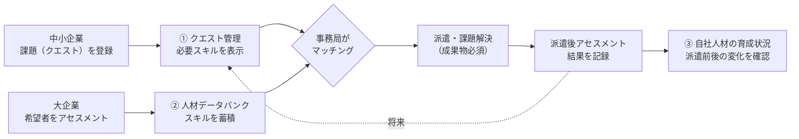
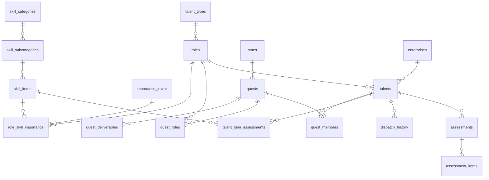

# 実践DXクエスト システム説明書

| 項目 | 内容 |
|---|---|
| 対象 | 実践DXクエストのプロダクト案（画面プロトタイプとダミーデータベース） |
| 版 | 第2.1版（2026年11月14日）。第1版（2026年11月13日）からの変更点と、第2版への追加修正は [次の章](#第2版の変更点2026年11月14日) を参照 |
| 画面 | 同じフォルダの `site/`（HTML・CSS・JavaScriptだけで動く静的サイト）。公開方法は [3.2](#32-サイトのファイル構成と公開方法) を参照 |
| データベース | 同じフォルダの `dx_quest_dummy.db`（SQLite）と `dx_quest_dummy.sql`（作成用SQL） |
| 元資料 | 同じフォルダの `261112_実践DXのスキーム.pptx`、`261114_プロダクト改善案.pptx`（第2版の改修指示） |
| スキル体系 | デジタルスキル標準 ver.2.0（IPA／経済産業省、2026年4月公開・10月誤記修正） |

> **注意**：画面とデータベースに入っている企業名・人名・評価・数値は、すべて説明用の架空データです。

---

## 第2版の変更点（2026年11月14日）

`261114_プロダクト改善案.pptx` の指摘を反映しました。本文の変更箇所には次の目印を付けています。

| 目印 | 意味 |
|---|---|
| **［変更］** | 第1版から内容を変えた箇所 |
| **［追加］** | 第2版で新しく加えた箇所 |
| **［削除］** | 第1版にあったが、第2版でなくした箇所（何をなくしたかを残しています） |
| ~~取り消し線~~ → **太字** | 変更前の値 → 変更後の値 |
| **［第2.1版］** | 第2版のあとの追加修正（[第2.1版の追加修正](#第21版の追加修正2026年11月14日)）で変えた箇所 |

| No. | 指摘（スライド） | 対応 | 説明の場所 |
|---|---|---|---|
| 1 | ロールでの応募枠は削除し、中小企業の悩みをヒアリングした事務局からの推薦ロールを書く（1） | 「募集枠（ロール×1名）」を廃止し、「事務局からの推薦ロール」に変更。ヒアリング内容と推薦理由を表示 | [5.1](#51-標準準拠と独自基準の区別)、6.1、6.5 |
| 2 | 大企業側のサイト（1） | 企業ポータルに **④ クエスト一覧** を追加 | [3](#3-利用者と画面の構成)、6.5 |
| 3 | 自社の社員を派遣している場合は具体的な企業名を表示（1） | ④では、自社の社員が派遣中・派遣予定のクエストだけ企業名を表示。それ以外は「企業名非公開」 | [5.1](#51-標準準拠と独自基準の区別)、6.5 |
| 4 | 必要なスキルに関する掲載はすべて削除（2） | ④には必要スキルを載せない（事務局の画面①には、マッチングに使うため残す） | 6.5 |
| 5 | 派遣基準は85%に設定（3） | 派遣基準を ~~70%~~ → **85%** に変更 | [5.6](#56-状態と判定独自基準)、[8.3](#83-画面に表示される結果初期設定派遣基準85) |
| 6 | 充足度85%以上の人は名前を目立たせる（3） | ③の一覧で、名前を大きくしてマーカーと「派遣基準以上」ラベルを付ける | 6.3 |
| 7 | 派遣状況は「完了」か「未派遣」で表記（3） | 派遣状況を「派遣完了」「未派遣」の2つに統一 | [5.6](#56-状態と判定独自基準) |
| 8 | 異動判定の項目は削除（3・4） | 一覧の異動判定の列、詳細の異動判定の枠、集計の「DX部 異動候補」、異動基準（75%）を削除 | [5.6](#56-状態と判定独自基準)、6.3 |
| 9 | 同じ内容が重複して表記されている（3） | 「ロール（類型）」で同じ名前が2回並ぶため、③ではロールだけを表示 | 6.3 |
| 10 | レーダーチャートにし、[戦略の理解とアーキテクチャ設計] と同じ大分類で判定。各分類をクリックすると詳細項目のページへ（4） | ③のスキル項目の表を、11分類のレーダーチャートと分類ごとの判定に変更。分類名をクリックすると ③-2 のページに移る | [5.6](#56-状態と判定独自基準)、6.3、6.4 |

**ファイルの変更**

| ファイル | 内容 |
|---|---|
| `site/company/quests.html`、`site/assets/company-quests.js` | ［追加］④ クエスト一覧（大企業向け） |
| `site/company/skill.html`、`site/assets/hr-skill.js` | ［追加］③-2 分類ごとのスキル項目の評価 |
| `site/assets/hr.js` | ［変更］③ 自社人材の育成状況（上の5〜10） |
| `site/assets/common.js`、`site/assets/style.css` | ［変更］分類ごとの集計とレーダーチャートの部品、名前の強調の見た目 |
| `site/assets/quests.js`、`site/assets/talents.js` | ［変更］「募集枠」を「推薦ロール」に変更 |
| `site/assets/data.js` | ［変更］派遣基準85%、ヒアリング内容・推薦理由・参加メンバーを追加、異動基準を削除 |
| `dx_quest_dummy.sql`、`dx_quest_dummy.db` | ［変更］`data.js` と同じ内容にそろえた（[7.3](#73-テーブル一覧)） |

### 第2.1版の追加修正（2026年11月14日）

④ クエスト一覧の画面を見たうえでの指摘を反映しました。本文の該当箇所には **［第2.1版］** を付けています。

| No. | 指摘 | 対応 | 説明の場所 |
|---|---|---|---|
| 11 | 自社の人間を送るのに「募集中」だと分かりにくいので「実施中」にする | Q-2027-001 の状態を ~~募集中~~ → **実施中** に変更。Aさんは ~~派遣予定~~ → **派遣中** に変更 | [8.1](#81-クエスト)、[8.2](#82-登録人材)、[8.3](#83-画面に表示される結果初期設定派遣基準85) |
| 12 | 「A社」という表現だと匿名感が強いので「田中工務店(株)」にする | Q-2027-001 の企業名を ~~A社~~ → **田中工務店(株)** に変更 | [8.1](#81-クエスト)、[8.3](#83-画面に表示される結果初期設定派遣基準85) |

**合わせて直したこと**（指摘に合わせるために必要だった変更）

| 内容 | 理由 |
|---|---|
| Q-2027-001 の派遣期間を ~~2027年1月〜3月（週2日）~~ → **2026年11月〜2027年1月（週2日）** に変更 | 今日（2026年11月14日）時点で「実施中」にするため。クエストIDは変えていません |
| Aさんを「派遣中」として扱う（`data.js` の `active`、データベースの `talents.is_dispatched` を1に） | 実施中のクエストに参加しているため |
| 事務局の画面②で、Q-2027-001 が需給と候補者の対象から外れる | 実施中のクエストは需給・候補者の対象外というルール（[5.7](#57-ロールごとの需給事務局画面)）のため。ビジネスアナリストとデータエンジニアは「募集なし」になる |

- ③ 自社人材の育成状況での Aさんの派遣状況は「派遣完了」のままです（E社への派遣が完了しているため）。今回の派遣は派遣実績の欄には出ません（1人につき派遣実績を1件持つデータ構造のため）。
- 「田中工務店(株)」も架空の企業名です。B社・C社・D社は変えていません。
- 変更したファイル：`site/assets/data.js`、`dx_quest_dummy.sql`、`dx_quest_dummy.db`（画面のプログラムは変更なし）。

---

## 目次

0. [第2版の変更点](#第2版の変更点2026年11月14日)
1. [このシステムの目的](#1-このシステムの目的)
2. [全体の仕組み](#2-全体の仕組み)
3. [利用者と画面の構成](#3-利用者と画面の構成)
4. [スキル体系：デジタルスキル標準 ver.2.0](#4-スキル体系デジタルスキル標準-ver20)
5. [判断基準と計算ロジック](#5-判断基準と計算ロジック)
6. [画面ごとの説明](#6-画面ごとの説明)
7. [データベース](#7-データベース)
8. [サンプルデータ](#8-サンプルデータ)
9. [制約と今後の課題](#9-制約と今後の課題)
10. [用語集](#10-用語集)
11. [出典](#11-出典)

---

## 1. このシステムの目的

### 1.1 背景：マナビDXクエストの課題

経済産業省の「マナビDXクエスト」には、次の課題があると考えています（元資料 Slide 1）。

- 参加人数が少なく、期間も短い。
- IT企業（部門）の参加者が全体の16%しかいない。DXを進めるには、もっと多くの人を実践の場に連れていく必要がある。
- 成果物を求めていないため、本当に役立っているのかが分からない。
- 中小企業に協力してもらう国のプログラムなので、中途半端な人材は送れない。そのため選考が厳しく、1回あたり30人程度に制限されているのではないか。

### 1.2 実践DXクエストの考え方

**大企業の社員のうちDXに関わりたい人を、中小企業の実践の場に派遣してスキルを身につけてもらい、DX人材を育てる**仕組みです（元資料 Slide 2）。

| 関係者 | 役割 | 得られるもの |
|---|---|---|
| 中小企業 | 建前ではなく本当に解決したい課題（クエスト）を出す。成果物を必須にする | 大企業の人材の力を借りて、自社の課題を解決できる |
| 大企業 | 希望者にアセスメントを行い、基準以上の人を派遣する | 派遣でスキルを得た社員をDX部へ異動させ、社内のDX人材として使える |
| 経済産業省（事務局） | 全体を運営し、クエストと人材をマッチングする | DX人材の層を厚くする |

### 1.3 このシステムで実現したいこと

元資料 Slide 3・4 の考え方を形にしたものです。

1. **課題とスキルの対応を記録する**：中小企業の課題（クエスト）ごとに、必要なスキルを決める。
2. **人材のスキルを記録する**：大企業の派遣希望者のスキルを、同じ物差しで記録する（人材データバンク）。
3. **マッチングする**：クエストに必要なスキルと人材のスキルを比べ、合う人を選ぶ。
4. **育成の効果を見る**：派遣の前後でスキルがどう変わったかを記録し、DX部への異動判断に使う。
5. **（将来）精度を上げる**：成功事例がたまったら、それをもとにクエストの必要スキルを補正し、マッチングの再現性を高める。

今のプロトタイプで動くのは1〜4です。5はまだ作っていません（[9章](#9-制約と今後の課題)を参照）。

---

## 2. 全体の仕組み



1. 中小企業がクエストを登録します。**［変更］** 事務局が中小企業の悩みをヒアリングし、課題の解決に向くロール（例：ビジネスアナリスト、データエンジニア）を**推薦ロール**として決めます（第1版の「募集するロールと人数」は廃止）。
2. クエストの必要スキルは、推薦ロールについて**デジタルスキル標準が公式に定める重要度**から自動で決まります（**［変更］** 事務局の画面だけに表示）。
3. 大企業は希望者のスキルを評価し、人材データバンクに登録します。
4. 事務局は、推薦ロールごとに適合度の高い人材を候補として確認し、マッチングします。
5. 派遣後に再びアセスメントを行い、大企業の人事部は派遣前後の変化を見ます。**［変更］** 変化は分類（サブカテゴリー）ごとのレーダーチャートで確認します（画面上の異動判定は廃止）。

---

## 3. 利用者と画面の構成

見る人によって必要な情報と見てよい情報が違うため、画面を利用者ごとに分けています。

| No. | 画面 | 利用者 | 見られる範囲 | 目的 |
|---|---|---|---|---|
| ① | クエスト管理（課題と必要スキル） | 事務局 | 全クエスト | 課題の内容と必要なスキルを確認する |
| ② | 人材データバンク | 事務局 | 全参加企業の登録人材 | 需給の把握、候補者の選定、人材の一覧 |
| ③ | 自社人材の育成状況 | 大企業の人事部 | **自社の社員のみ** | 派遣前後のスキル変化（**［変更］** 分類ごとのレーダーチャート。~~DX部への異動判断~~） |
| ③-2 | **［追加］** 分類ごとのスキル項目の評価 | 大企業の人事部 | **自社の社員のみ** | レーダーチャートの分類をクリックして、項目ごとの評価を見る |
| ④ | **［追加］** クエスト一覧（大企業向け） | 大企業の人事部 | 全クエスト（企業名は自社の社員が参加するものだけ） | 課題の内容と事務局の推薦ロールを確認する。必要スキルは表示しない |

- ①と②は事務局向けのサイトで、上部メニューで行き来できます。ヘッダーに「事務局」と表示されます。
- **［変更］** ③・③-2・④は大企業向けの「企業ポータル」です。ヘッダーの見た目を変え、「X社 人事部」と表示しています。上部メニューで「クエスト一覧」と「自社人材の育成状況」を行き来できます。事務局の画面へのメニューはありません。
- ②に他社の社員が並ぶのは事務局だけが見るためです。大企業の人事部には③・③-2・④だけを見せる想定です。

### 3.1 画面の開き方

- `site/index.html` がトップページです。「事務局サイト」と「企業ポータル」への入口があります。
- 手元で見るときは、`site/index.html` をブラウザで開くだけで動きます（サーバーは不要です）。
- 今のプロトタイプは確認しやすいように、事務局サイトと企業ポータルを1つのサイトに入れています。実際の運用では、ログインと権限で分ける必要があります。

### 3.2 サイトのファイル構成と公開方法

```
site/
├── index.html          トップページ（事務局サイト・企業ポータルへの入口）
├── admin/
│   ├── index.html      ① クエスト管理（事務局）
│   └── talents.html    ② 人材データバンク（事務局）
├── company/
│   ├── index.html      ③ 自社人材の育成状況（大企業人事部）
│   ├── skill.html      ③-2 分類ごとのスキル項目の評価（大企業人事部）  ［追加］
│   └── quests.html     ④ クエスト一覧（大企業向け）                    ［追加］
└── assets/
    ├── style.css       見た目（色・レイアウト）
    ├── data.js         マスタとサンプルデータ（データベースと同じ内容）
    ├── common.js       共通の計算（必要スキル・充足度・適合度・分類ごとの集計）と表示部品（レーダーチャートを含む）  ［変更］
    ├── quests.js       ①の画面処理
    ├── talents.js      ②の画面処理
    ├── hr.js           ③の画面処理
    ├── hr-skill.js     ③-2の画面処理  ［追加］
    └── company-quests.js ④の画面処理  ［追加］
```

- 外部のライブラリは使っていません。フォント（Noto Sans JP）だけ Google Fonts から読み込みます。
- 充足度・適合度・判定は、ページを開いたときに `data.js` の評価データから計算します。数値を直接書いている箇所はありません。

**インターネットに公開する方法**（どれも無料で使えます。公開するとURLを知っている人は誰でも見られるので、サンプルデータであることを確認してから公開してください）

| サービス | 手順 | URLの形 |
|---|---|---|
| Netlify Drop | https://app.netlify.com/drop を開き、`site` フォルダをドラッグ＆ドロップする（アカウント登録が必要） | `https://好きな名前.netlify.app` |
| GitHub Pages | GitHubにリポジトリを作り、`site` の中身をpushして、Settings → Pages で公開する | `https://ユーザー名.github.io/リポジトリ名/` |
| Vercel | `site` フォルダで `npx vercel` を実行し、ブラウザでログインする | `https://プロジェクト名.vercel.app` |

サイト名はサービスの設定画面で変えられます（例：`jissen-dx-quest.netlify.app`）。

**データを変えるとき**：`site/assets/data.js` を書き換えると画面に反映されます。データベース（`dx_quest_dummy.db`）とは連携していないので、両方をそろえて直してください。

---

## 4. スキル体系：デジタルスキル標準 ver.2.0

### 4.1 デジタルスキル標準とは

IPA（情報処理推進機構）と経済産業省が定めた、DXに必要なスキルの標準です。次の2つで構成されています。

| 標準 | 対象 | 内容 |
|---|---|---|
| DXリテラシー標準（DSS-L） | すべてのビジネスパーソン | Why（DXの背景）、What（データ・技術）、How（データ・技術の利活用）、マインド・スタンス |
| DX推進スキル標準（DSS-P） | DXを推進する人材 | 人材類型・ロールと、共通スキルリスト・ロール別の重要度 |

**このシステムが使っているのはDSS-Pです。** 最新版は ver.2.0 で、データマネジメントの類型が新しく加わりました。

### 4.2 人材類型とロール（6類型・17ロール）

| 人材類型 | ロール |
|---|---|
| ビジネスアーキテクト | ビジネスアーキテクト／ビジネスアナリスト／プロダクトマネージャー |
| デザイナー | サービスデザイナー／ＵＸ／ＵＩデザイナー／コミュニケーションデザイナー |
| データサイエンティスト | データビジネスストラテジスト／データサイエンスプロフェッショナル |
| データマネジメント | データスチュワード／データエンジニア／データアーキテクト |
| ソフトウェアエンジニア | フロントエンドエンジニア／バックエンドエンジニア／クラウドエンジニア／ＳＲＥ／フィジカルコンピューティングエンジニア |
| サイバーセキュリティ | サイバーセキュリティマネージャー／サイバーセキュリティエンジニア |

ロール名は公式資料の表記（全角の「ＵＸ／ＵＩ」「ＳＲＥ」を含む）をそのまま使っています。

### 4.3 共通スキルリスト（5カテゴリー・13サブカテゴリー・67項目）

| カテゴリー | サブカテゴリー | 項目数 |
|---|---|---|
| ビジネス変革 | 戦略の理解とアーキテクチャ設計 | 5 |
| | プロダクトのマネジメント | 7 |
| | 変革活動のマネジメント | 7 |
| | デザイン | 9 |
| データ整備・活用 | データ・AIの戦略的活用 | 6 |
| | AI・データサイエンス | 2 |
| | データマネジメント | 6 |
| テクノロジー | ソフトウェア開発 | 10 |
| | デジタルテクノロジー | 3 |
| セキュリティ | セキュリティマネジメント | 4 |
| | セキュリティ技術 | 2 |
| パーソナルスキル | ヒューマンスキル | 2 |
| | コンセプチュアルスキル | 4 |
| **合計** | **13サブカテゴリー** | **67** |

67項目の名前と説明文は、データベースの `skill_items` テーブルに公式資料のまま入っています。

### 4.4 重要度（公式の凡例）

DSS-Pは、**ロールごと・スキル項目ごと**に「そのロールにはこのスキルがどの程度重要か」を定めています（公式の「スキルマッピング」）。

| 記号 | 公式の定義 | 使われる範囲 |
|---|　　　　　　　　---　　　　　 |　---|
| a | 高い実践力と専門性が必要　　 | パーソナルスキル以外の61項目 |
| b | 一定の実践力と専門性が必要 　| 同上 |
| c | 説明可能なレベルで理解が必要 | 同上 |
| d | 位置づけや関連性の理解が必要 | 同上 |
| z | 役割や状況に応じた実践力が必要 | パーソナルスキルの6項目（全ロール共通） |

**z は「不要」という意味ではありません。** 役割や状況に応じて必要になる、という意味です。

### 4.5 ロールごとの重要度の分布（公式スキルマッピングから集計）

パーソナルスキルを除く61項目の内訳です。a と b を合わせた数が、そのロールの「重点項目」の数になります。

| ロール | a | b | c | d | 重点項目（a+b） |
|---|---:|---:|---:|---:|---:|
| ビジネスアーキテクト | 8 | 26 | 13 | 14 | 34 |
| ビジネスアナリスト | 11 | 25 | 14 | 11 | 36 |
| プロダクトマネージャー | 13 | 25 | 14 | 9 | 38 |
| サービスデザイナー | 19 | 11 | 18 | 13 | 30 |
| ＵＸ／ＵＩデザイナー | 8 | 18 | 27 | 8 | 26 |
| コミュニケーションデザイナー | 8 | 7 | 38 | 8 | 15 |
| データビジネスストラテジスト | 5 | 25 | 26 | 5 | 30 |
| データサイエンスプロフェッショナル | 3 | 10 | 30 | 18 | 13 |
| データスチュワード | 3 | 12 | 30 | 16 | 15 |
| データエンジニア | 3 | 8 | 29 | 21 | 11 |
| データアーキテクト | 3 | 13 | 40 | 5 | 16 |
| フロントエンドエンジニア | 6 | 16 | 33 | 6 | 22 |
| バックエンドエンジニア | 8 | 16 | 23 | 14 | 24 |
| クラウドエンジニア／ＳＲＥ | 4 | 15 | 24 | 18 | 19 |
| フィジカルコンピューティングエンジニア | 1 | 18 | 29 | 13 | 19 |
| サイバーセキュリティマネージャー | 4 | 16 | 31 | 10 | 20 |
| サイバーセキュリティエンジニア | 4 | 17 | 26 | 14 | 21 |

ロールによって重点項目の数が大きく違います（11〜38）。そのため、このシステムでは充足度や適合度を件数ではなく**割合**で表しています。

### 4.6 標準が定めていないこと

デジタルスキル標準のFAQには、次の趣旨が書かれています。

- DSS-Pは ITSS+ のレベル4相当のスキル水準を想定しているが、**独自の詳細なレベル評価指標は用意していない**。
- 業種・職種を問わず使えるよう、**統一的な達成基準は設けていない**。各スキル項目の「学習項目例」を参考に、**独自の評価指標を作ることを勧める**。

つまり「個人をどう評価するか」「何%なら合格か」は標準に定めがありません。このシステムでは、その部分を**独自基準**として決め、画面とデータベースの両方に「独自基準」と明記しています（次章）。

---

## 5. 判断基準と計算ロジック

### 5.1 標準準拠と独自基準の区別

| 項目 | 区分 | 中身 |
|---|---|---|
| 人材類型・ロール | 標準準拠 | 公式の6類型・17ロール |
| スキル項目 | 標準準拠 | 公式の67項目（5カテゴリー・13サブカテゴリー） |
| ロール別の重要度 | 標準準拠 | 公式スキルマッピングの値をそのまま使用 |
| 推薦ロール **［追加］** | **独自運用** | 事務局が中小企業へのヒアリングをもとに推薦する（ロール自体は公式の17ロール） |
| クエストの必要スキル | 標準準拠（組み合わせ方のみ独自） | **［変更］** 推薦ロールの公式重要度。複数ロールなら項目ごとに高い方。事務局の画面だけに表示 |
| 個人評価のやり方 | **独自基準** | 重要度 a〜d の定義に相当する水準かを項目ごとに評価 |
| 充足度 | **独自基準** | 本人ロールの重点項目の達成率 |
| 適合度 | **独自基準** | **［変更］** 推薦ロールの重点項目の達成率 |
| 派遣基準 | **独自基準** | **［変更］** 充足度 ~~70%~~ → **85%** 以上 |
| ~~DX部異動候補~~ | **［削除］** | ~~派遣成功、かつ充足度75%以上~~ |
| 分類ごとの判定 **［追加］** | **独自基準** | 分類（サブカテゴリー）内の本人ロールの重点項目をすべて達成しているか |
| 企業名の表示 **［追加］** | **独自運用** | 大企業向けの画面では、自社の社員が派遣中・派遣予定のクエストだけ企業名を表示 |
| パーソナルスキルの扱い | **独自基準** | 点数化せず面談で確認 |

独自基準の内容は、データベースの `project_rules` テーブルにも記録しています。

### 5.2 クエストの必要スキル

**ルール**：推薦ロールそれぞれについて、公式スキルマッピングの重要度を項目ごとに取り出し、**最も高いもの**をクエストの必要スキルにします（a > b > c > d）。

**例**：Q-2027-001（推薦ロール：ビジネスアナリスト＋データエンジニア）の「データエンジニアリング（設計・収集・統合・提供）」

| ロール | 公式の重要度 |
|---|---|
| ビジネスアナリスト | c |
| データエンジニア | a |
| **クエストの必要スキル** | **a**（高い方） |

この方法で、Q-2027-001 の必要スキルは a が14項目、b が27項目、c が15項目、d が5項目になります。

- パーソナルスキル（全ロール z）は計算に入れず、別枠で表示します。
- 「実績データ」（類似クエストの件数・成功件数）は表示していますが、今は必要スキルの補正には使っていません。

### 5.3 個人評価（独自基準）

**ルール**：人材ごとに、パーソナルスキルを除く61項目について a〜d のどれかで評価します。記号の意味は公式の重要度と同じです。

| 評価 | 意味（その人がこの水準にある） |
|---|---|
| a | 高い実践力と専門性がある |
| b | 一定の実践力と専門性がある |
| c | 説明可能なレベルで理解している |
| d | 位置づけや関連性を理解している |

重要度と同じ物差しで評価するので、「要件が b で、本人の評価が c なら未達」というように、そのまま比べられます。

> 実際の運用では、各項目の「学習項目例」をもとに評価のしかた（面談、試験、実績確認など）を決める必要があります。今のサンプルデータは、仕組みを説明するために作った値です。

### 5.4 充足度（独自基準）

**定義**：本人のロールで重要度が a・b の項目（重点項目）のうち、個人評価が重要度以上の項目の割合です。

```
充足度(%) = 四捨五入( 100 × 達成した重点項目の数 ÷ 本人ロールの重点項目の数 )
「達成」＝ 個人評価 ≧ 公式の重要度（a=4, b=3, c=2, d=1 として比較）
```

**例**：Aさん（ビジネスアーキテクト、重点項目34件）

- 34件のうち29件を達成 → 29 ÷ 34 = 85.3% → **充足度85%**

c・d の項目は計算に入りません。これらは「理解しているか」を問う項目なので、達成率ではなく画面上の一覧で確認します。

### 5.5 適合度（独自基準）

**定義**：クエストの**推薦ロール**（**［変更］** 第1版は「募集枠」）の重点項目のうち、個人評価が重要度以上の項目の割合です。計算式は充足度と同じで、比べる相手が本人のロールではなく推薦ロールになります。

**推薦ロールごとに計算する理由**：1つのクエストには複数のロールが推薦されます（例：ビジネスアナリスト＋データエンジニア）。2つのロールの要件を合わせたものと1人を比べると、誰も条件を満たせません。そのため、推薦ロールごとに1人ずつ比べています。

- 本人のロールと違う推薦ロールでも、スキルが合えば上位に来ます。サンプルでは、データビジネスストラテジストの1位はビジネスアナリストのIさん（77%）です。
- 派遣中の人は候補から外します。
- 適合度が同じ場合は、登録順（人材IDの小さい順）に並べます。

**端数の扱い**：充足度・適合度とも、小数点以下を四捨五入します（62.5% → 63%）。画面（JavaScript）とデータベース（SQLiteの `ROUND`）で同じ結果になります。

### 5.6 状態と判定（独自基準）

**事務局画面（②）の状態**

| 状態 | 条件 |
|---|---|
| 派遣中 | 現在派遣中 |
| 派遣可 | 派遣中ではなく、充足度が派遣基準（**［変更］** ~~70%~~ → **85%**）以上 |
| 基準未満 | 派遣中ではなく、充足度が派遣基準未満 |

**人事部画面（③）の派遣状況** **［変更］**

| 派遣状況 | 条件 |
|---|---|
| 派遣完了 | 派遣が終わっている（結果が成功・未達のどちらでも） |
| 未派遣 | 派遣実績がない（派遣予定・派遣中を含む） |

- **［追加］** 充足度が派遣基準（85%）以上の社員は、一覧で名前を大きくし、マーカーと「派遣基準以上」のラベルで強調します。

**人事部画面（③）の異動判定** **［削除］**

第1版にあった次の判定は、画面から削除しました（データからも異動基準75%を削除）。

| 判定（削除） | 条件（第1版） |
|---|---|
| ~~DX部 異動候補~~ | ~~派遣結果が「成功」かつ、充足度が異動基準（75%）以上~~ |
| ~~継続育成~~ | ~~派遣結果が「成功」だが充足度が異動基準未満、または派遣結果が成功以外~~ |
| ~~派遣待ち~~ | ~~未派遣で、充足度が派遣基準以上~~ |
| ~~基準未満~~ | ~~未派遣で、充足度が派遣基準未満~~ |

**分類ごとの判定（③のレーダーチャート）** **［追加］**

| 判定 | 条件 |
|---|---|
| 達成 | その分類（サブカテゴリー）にある本人ロールの重点項目（a・b）をすべて達成 |
| 未達 | 重点項目のうち未達のものがある（達成数／重点項目数を併記） |
| 重点項目なし | その分類に本人ロールの重点項目がない |

- 分類は「戦略の理解とアーキテクチャ設計」などのサブカテゴリーで、パーソナルスキルを除く11分類です。
- レーダーチャートの値は、分類内の全項目の平均水準（a=4、b=3、c=2、d=1）です。「ロールの要求（公式の重要度の平均）」「派遣前」「現在」を重ねて表示します。

派遣基準（85%）は、`site/assets/data.js` の `rules.dispatchThreshold` で変えられます。データベースでは `project_rules` テーブルの値です（**［削除］** `transferThreshold`・`transfer_threshold`）。

### 5.7 ロールごとの需給（事務局画面）

```
需要 ＝ 募集中・マッチング中のクエストのうち、そのロールが推薦されている件数　［変更］
供給 ＝ そのロールの人材のうち「派遣可」の人数
不足 ＝ 需要 − 供給（正の値のとき「不足 n名」と表示）
```

実施中のクエスト（Q-2026-014、**［第2.1版］** Q-2027-001）は需要に含めません。

### 5.8 サブカテゴリー別の達成数（事務局画面の一覧表）

一覧表のサブカテゴリーの欄には、**本人ロールの重点項目のうち、そのサブカテゴリーで達成している数／重点項目の数**（例：4/5）を表示します。

| 表示 | 意味 |
|---|---|
| 濃い緑 | すべて達成 |
| 薄い緑 | 半数以上達成 |
| オレンジ | 半数未満 |
| — | そのサブカテゴリーに本人ロールの重点項目がない |

---

## 6. 画面ごとの説明

### 6.1 ① クエスト管理（課題と必要スキル）【事務局】

**左側：クエスト一覧**
- クエストごとに、会社名・業種・タイトル・状態（募集中／マッチング中／実施中）を表示します。
- クリックすると右側の詳細が切り替わります。

**右上：クエストの詳細**

| 表示項目 | 内容 |
|---|---|
| 業種・規模・所在地・派遣期間 | 中小企業の基本情報 |
| 現状と背景 | 今どうなっていて、何に困っているか |
| 本当に解決したい課題（ゴール） | 建前ではなく本当に解決したいこと（Slide 2 の方針） |
| 成果物（必須） | 派遣で必ず作るもの（Slide 2 の方針） |
| 事務局からの推薦ロール **［変更］** | 事務局のヒアリング内容と、推薦するロール・推薦理由（~~募集枠：DSS-Pのロールと人数（1ロール1名）~~） |

**右下：必要なスキル**

| 表示項目 | 内容 |
|---|---|
| 実績データ | 類似クエストの件数と成功件数。将来の補正用で、今は補正に使っていない |
| 重要度ごとの項目数 | 必要スキルの a・b・c・d がそれぞれ何項目あるか |
| 表示の切り替え | 「重点項目（a・b）のみ」と「すべての項目（61項目）」 |
| スキル項目の表 | サブカテゴリーごとに、各推薦ロールの公式重要度と、採用した必要スキルを並べる。必要スキルが a・b の項目は枠を強調 |
| パーソナルスキル | 6項目を z として別枠で表示し、面談で確認すると明記 |
| 重要度の凡例 | 公式の定義 |

### 6.2 ② 人材データバンク【事務局】

**上部：集計**
- 登録人材の数（参加企業数）、派遣可能な人数（充足度が派遣基準以上で派遣中でない人）、派遣中の人数を表示します。

**算出ルール**
- 個人評価・充足度・適合度の定義を、独自基準として画面上に明記しています。

**ロールごとの需給**
- 募集があるロールと、人材が登録されているロールについて、需要・供給・判定（不足 n名／充足／募集なし）をカードで表示します。
- 不足しているロールが先頭に来ます。

**クエスト別の候補者**
- 上のタブでクエストを選びます（募集中・マッチング中のもの）。
- **［変更］** 推薦ロールごとに、適合度の高い順で上位3名を表示します。

| 表示項目 | 内容 |
|---|---|
| 順位・氏名・所属・本人のロール | 候補者の情報 |
| 未達 | その推薦ロールの重点項目のうち未達の項目。最初の3件と残りの件数 |
| 適合度 | その推薦ロールの重点項目の達成率 |
| 状態 | 派遣可／基準未満（本人ロールの充足度による） |

**登録人材一覧**
- 人材類型（6類型）、所属企業、「派遣基準以上のみ」で絞り込めます。
- 列は、人材、ロール（類型）、11サブカテゴリーの達成数（[5.8](#58-サブカテゴリー別の達成数事務局画面の一覧表)）、充足度、状態です。

### 6.3 ③ 自社人材の育成状況【大企業人事部】

**上部：集計**
- **［変更］** 登録社員、派遣完了、未派遣、派遣基準以上（充足度85%以上）の人数を表示します（~~派遣待ち~~、~~DX部異動候補~~ は削除）。

**判定ルール**
- **［変更］** 充足度・派遣基準の定義を、独自基準として画面上に明記しています（~~異動基準~~ は削除）。

**登録社員一覧**
- **［変更］** 社員、ロール、充足度（派遣前 → 現在、上がった分）、派遣状況（派遣完了／未派遣）を表示します（~~異動判定~~ の列は削除）。
- **［変更］** 第1版の「ロール（類型）」は同じ名前が2回並ぶことがあったため、一覧と詳細ではロールだけを表示します。
- **［追加］** 充足度が派遣基準（85%）以上の社員は、名前を強調します。
- 名前をクリックすると下の詳細が切り替わります。

**社員の詳細（左側）**

| 表示項目 | 内容 |
|---|---|
| ロール・アセスメント時期・充足度・希望テーマ | 基本情報。派遣済みの人は派遣前と派遣後を並べて表示 |
| ~~異動判定~~ **［削除］** | ~~判定結果と理由~~ |
| 派遣実績 | クエスト・期間・派遣先・結果・派遣先からの評価 |
| 次に伸ばす項目 | 本人ロールの重点項目のうち、今も未達の項目 |

**社員の詳細（右側）：分類ごとのスキル水準** **［変更］**

第1版の「スキル項目ごとの評価」の表を、レーダーチャートに変えました。

- 11の分類（「戦略の理解とアーキテクチャ設計」などのサブカテゴリー）を軸にしたレーダーチャートです（判定のルールは [5.6](#56-状態と判定独自基準)）。
- 各軸の分類名の下に判定（達成 n/m、未達 n/m、重点項目なし）を表示します。
- **分類名をクリックすると ③-2 のページに移り、その分類のスキル項目ごとの評価を確認できます。**
- チャートの下に同じ内容の表（ロールの要求・派遣前・現在・判定）を置き、表の分類名からも ③-2 に移れます。
- 上に「重点項目 n件中 達成 x→y件」とまとめて表示します。

### 6.4 ③-2 分類ごとのスキル項目の評価【大企業人事部】

> **［追加］** 第2版で新しく作った画面です。

- URL は `company/skill.html?id=人材ID&sub=分類番号` です。
- 項目ごとに「ロールの重要度（公式）」「派遣前」「現在」「判定（達成／未達）」を並べ、上がった項目には「向上」を付けます。本人ロールの重点項目には「重点」を付けます。
- 上部のボタンで他の分類に切り替えられます。「育成状況に戻る」で ③ の同じ社員に戻ります。

### 6.5 ④ クエスト一覧【大企業向け】

> **［追加］** 第2版で新しく作った画面です。

- 中小企業のクエストを一覧で表示し、クリックすると右側に詳細を表示します。
- **企業名**：自社の社員が派遣中・派遣予定のクエストだけ具体的な企業名を表示し、「自社社員が参加」のラベルと参加する社員名を出します。それ以外は「企業名非公開」と表示します（業種・所在地は表示）。
- 詳細には、業種・規模・所在地・派遣期間、現状と背景、ゴール、成果物（必須）、**事務局からの推薦ロール**（ヒアリング内容と推薦理由）を表示します。
- **必要スキルは表示しません**（必要スキルは事務局の画面①だけで確認します）。

---

## 7. データベース

### 7.1 ファイル

| ファイル | 内容 |
|---|---|
| `dx_quest_dummy.db` | SQLiteのデータベース本体。DB Browser for SQLite などで開けます |
| `dx_quest_dummy.sql` | テーブル定義とデータを書いたSQL。これだけでデータベースを作り直せます |

作り直す方法：

```bash
sqlite3 dx_quest_dummy.db < dx_quest_dummy.sql
```

Pythonの場合：

```python
import sqlite3
con = sqlite3.connect("dx_quest_dummy.db")
con.executescript(open("dx_quest_dummy.sql", encoding="utf-8").read())
con.commit()
```

### 7.2 テーブルの全体像



### 7.3 テーブル一覧

**マスタ（デジタルスキル標準 ver.2.0 の公式値）**

| テーブル | 件数 | 内容 |
|---|---:|---|
| `skill_categories` | 5 | カテゴリー |
| `skill_subcategories` | 13 | サブカテゴリー |
| `skill_items` | 67 | スキル項目。`description` は公式の説明文 |
| `importance_levels` | 5 | 重要度 a〜d・z と公式の定義。`score` は比較用の数値（a=4〜d=1、z は NULL） |
| `talent_types` | 6 | 人材類型 |
| `roles` | 17 | ロール（`type_id` で類型に紐づく） |
| `role_skill_importance` | 1,139 | 公式スキルマッピング（17ロール × 67項目） |

**独自ルール**

| テーブル | 件数 | 内容 |
|---|---:|---|
| `project_rules` | 6 | **［変更］** 個人評価・必要スキル・充足度・適合度の定義と、派遣基準（~~70~~ → **85**）・企業名の表示ルール（**［追加］** `company_name_disclosure`）。~~異動基準（75）~~ は削除 |

**クエスト（画面①）**

| テーブル | 件数 | 内容 |
|---|---:|---|
| `smes` | 4 | 中小企業 |
| `quests` | 4 | クエスト（背景、ゴール、**［追加］** 事務局のヒアリング内容 `hearing`、状態、期間、実績データ） |
| `quest_deliverables` | 12 | 成果物（必須） |
| `quest_roles` | 8 | **［変更］** 事務局の推薦ロール（クエスト × ロール）。**［追加］** 推薦理由 `reason` |
| `quest_members` **［追加］** | 3 | クエストに派遣中・派遣予定の人材。大企業向けの画面で企業名を表示するかの判定に使う |
| `quest_skill_requirements`（ビュー） | — | 推薦ロールの公式重要度から、クエストの必要スキルを計算する |

**人材（画面②・③）**

| テーブル | 件数 | 内容 |
|---|---:|---|
| `enterprises` | 3 | 大企業 |
| `talents` | 10 | 登録人材（ロール、充足度、派遣中かどうか、希望テーマ） |
| `talent_item_assessments` | 610 | 最新の個人評価（10名 × 61項目、a〜d） |
| `dispatch_history` | 6 | 派遣履歴（派遣先、結果、派遣先からの評価） |
| `assessments` | 6 | 派遣前後のアセスメント（3名 × 2回） |
| `assessment_items` | 366 | アセスメントごとの項目評価 |

### 7.4 主なカラム

**`talents`**

| カラム | 内容 |
|---|---|
| `id` | 人材ID（TB-0001 など） |
| `enterprise_id` | 所属企業 |
| `role_id` | 本人のロール |
| `assessed_on` | 最新アセスメントの時期 |
| `fulfillment_rate` | 充足度（%）。`talent_item_assessments` から計算した値 |
| `is_dispatched` | 1 = 派遣中 |
| `wish_theme` | 希望テーマ |

**`dispatch_history`**

| カラム | 内容 |
|---|---|
| `quest_id` | 派遣したクエスト。過去のクエストも含むため外部キーにしていない |
| `result` | 成功／未達／実施中 |
| `sme_feedback` | 派遣先からの評価コメント |

### 7.5 よく使うSQL

**クエストの必要スキル（重点項目）を見る**

```sql
SELECT s.name AS subcategory, i.name AS item, r.importance
FROM quest_skill_requirements r
JOIN skill_items i ON i.id = r.item_id
JOIN skill_subcategories s ON s.id = i.subcategory_id
WHERE r.quest_id = 'Q-2027-001' AND r.importance IN ('a', 'b')
ORDER BY i.id;
```

**あるロールの公式重要度を見る**

```sql
SELECT i.name, m.importance
FROM role_skill_importance m
JOIN roles ro ON ro.id = m.role_id
JOIN skill_items i ON i.id = m.item_id
WHERE ro.name = 'データエンジニア'
ORDER BY i.id;
```

**充足度を計算し直す**（`talents.fulfillment_rate` と同じ値になります）

```sql
SELECT t.id, t.name,
       ROUND(100.0 * SUM(CASE WHEN la.score >= lr.score THEN 1 ELSE 0 END) / COUNT(*)) AS fulfillment_rate
FROM talents t
JOIN role_skill_importance m ON m.role_id = t.role_id
JOIN importance_levels lr ON lr.code = m.importance AND lr.score >= 3
JOIN talent_item_assessments a ON a.talent_id = t.id AND a.item_id = m.item_id
JOIN importance_levels la ON la.code = a.level
GROUP BY t.id
ORDER BY t.id;
```

**推薦ロールへの適合度を計算する**（例：Q-2027-001 のデータエンジニア）

```sql
SELECT t.name,
       ROUND(100.0 * SUM(CASE WHEN la.score >= lr.score THEN 1 ELSE 0 END) / COUNT(*)) AS fit_rate
FROM talents t
JOIN roles ro ON ro.name = 'データエンジニア'
JOIN role_skill_importance m ON m.role_id = ro.id
JOIN importance_levels lr ON lr.code = m.importance AND lr.score >= 3
JOIN talent_item_assessments a ON a.talent_id = t.id AND a.item_id = m.item_id
JOIN importance_levels la ON la.code = a.level
WHERE t.is_dispatched = 0
GROUP BY t.id
ORDER BY fit_rate DESC;
```

**独自ルールを見る**

```sql
SELECT * FROM project_rules;
```

---

## 8. サンプルデータ

### 8.1 クエスト

| ID | 企業 | タイトル | 状態 | 推薦ロール | 必要スキル a / b / c / d |
|---|---|---|---|---|---|
| Q-2027-001 | **［第2.1版］** ~~A社~~ → **田中工務店(株)**（金属加工業・愛知県） | 受注〜生産計画のデジタル化による納期回答の迅速化 | **［第2.1版］** ~~募集中~~ → **実施中**（2026年11月〜2027年1月） | ビジネスアナリスト、データエンジニア | 14 / 27 / 15 / 5 |
| Q-2027-002 | B社（食品スーパー・静岡県） | POSデータを活用した需要予測による廃棄ロス削減 | マッチング中 | データビジネスストラテジスト、データサイエンスプロフェッショナル | 8 / 27 / 21 / 5 |
| Q-2027-003 | C社（旅館業・長野県） | 予約・顧客情報の一元化とリピーター集客の仕組みづくり | 募集中 | サービスデザイナー、フロントエンドエンジニア | 25 / 19 / 17 / 0 |
| Q-2026-014 | D社（建設業・福岡県） | 現場写真・日報のクラウド化と情報セキュリティの整備 | 実施中 | クラウドエンジニア／ＳＲＥ、サイバーセキュリティマネージャー | 8 / 24 / 25 / 4 |

### 8.2 登録人材

**［変更］** 派遣基準を85%にしたため、「状態」が変わった人がいます（~~第1版~~ → **第2版**）。

| ID | 氏名 | 所属 | ロール | 充足度 | 状態 | 派遣履歴 |
|---|---|---|---|---:|---|---|
| TB-0001 | Aさん | X社 経営企画部 | ビジネスアーキテクト | 85%（派遣前74%） | **［第2.1版］** ~~派遣可~~ → **派遣中** | E社 部品在庫の見える化（成功）。**［第2.1版］** 田中工務店(株) Q-2027-001（実施中） |
| TB-0002 | Bさん | X社 情報システム部 | データエンジニア | 73%（派遣前64%） | ~~派遣可~~ → **基準未満** | E社 部品在庫の見える化（成功） |
| TB-0003 | Cさん | Y社 営業企画部 | プロダクトマネージャー | 71% | ~~派遣可~~ → **基準未満** | なし |
| TB-0004 | Dさん | Y社 DX推進室 | サービスデザイナー | 80% | ~~派遣可~~ → **基準未満** | F社 来店予約フローの改善（成功） |
| TB-0005 | Eさん | Z社 システム開発部 | クラウドエンジニア／ＳＲＥ | 84% | 派遣中 | D社 現場写真・日報のクラウド化（実施中） |
| TB-0006 | Fさん | Z社 リスク管理部 | サイバーセキュリティマネージャー | 75% | 派遣中 | D社 現場写真・日報のクラウド化（実施中） |
| TB-0007 | Gさん | X社 マーケティング部 | データビジネスストラテジスト | 67% | 基準未満 | なし |
| TB-0008 | Hさん | Z社 商品開発部 | フロントエンドエンジニア | 59% | 基準未満 | なし |
| TB-0009 | Iさん | X社 生産技術部 | ビジネスアナリスト | 72% | ~~派遣可~~ → **基準未満** | なし |
| TB-0010 | Jさん | X社 情報システム部 | バックエンドエンジニア | 71%（派遣前63%） | ~~派遣可~~ → **基準未満** | G社 受発注システムの改修（未達） |

### 8.3 画面に表示される結果（初期設定：派遣基準85%）

**［変更］** 第1版は「派遣基準70%、異動基準75%」での結果でした。

**ロールごとの需給（募集中・マッチング中の**［第2.1版］** ~~3~~ → **2** クエスト）**

派遣基準を85%に上げたため、派遣基準以上は Aさん（ビジネスアーキテクト、85%）だけです。**［第2.1版］** Aさんは派遣中なので、派遣可は0名です。Q-2027-001 が実施中になったため、ビジネスアナリストとデータエンジニアは需要がなくなりました。

| ロール | 需要 | 供給 | 判定 |
|---|---:|---:|---|
| サービスデザイナー | 1 | ~~1~~ → **0** | ~~充足（Dさん）~~ → **不足 1名**（Dさんは80%で基準未満） |
| データビジネスストラテジスト | 1 | 0 | 不足 1名 |
| データサイエンスプロフェッショナル | 1 | 0 | 不足 1名 |
| フロントエンドエンジニア | 1 | 0 | 不足 1名 |
| ビジネスアナリスト | **［第2.1版］** ~~1~~ → **0** | 0 | **［第2.1版］** **募集なし**（第2版は不足 1名） |
| データエンジニア | **［第2.1版］** ~~1~~ → **0** | 0 | **［第2.1版］** **募集なし**（第2版は不足 1名） |

**推薦ロールごとの候補者（上位3名、派遣中の人は除外）**

適合度と順位は基準値に関係しないため、第1版と同じです（状態の表示だけが「基準未満」に変わります）。**［第2.1版］** Q-2027-001 は実施中になったので候補者の対象から外れ、派遣中の Aさんは候補から除かれます。

| クエスト | 推薦ロール | 1位 | 2位 | 3位 |
|---|---|---|---|---|
| ~~Q-2027-001~~ **［第2.1版］** | ~~ビジネスアナリスト~~ | ~~Iさん 72%~~ | ~~Cさん 69%~~ | ~~Aさん 61%~~ |
| ~~Q-2027-001~~ **［第2.1版］** | ~~データエンジニア~~ | ~~Bさん 73%~~ | ~~Gさん 64%~~ | ~~Iさん 55%~~ |
| Q-2027-002 | データビジネスストラテジスト | Iさん 77% | Gさん 67% | Dさん 63% |
| Q-2027-002 | データサイエンスプロフェッショナル | Iさん 54% | Jさん 54% | Gさん 46%（Hさんと同率） |
| Q-2027-003 | サービスデザイナー | Dさん 80% | Cさん 47% | **［第2.1版］** ~~Aさん 43%~~ → **Iさん 40%** |
| Q-2027-003 | フロントエンドエンジニア | Hさん 59% | Jさん 50% | Iさん 45% |

**X社 人事部の画面**

| 社員 | 充足度 | 派遣状況 | 名前の強調 **［追加］** | ~~異動判定~~ **［削除］** |
|---|---|---|---|---|
| Aさん | 74% → 85% | 派遣完了 | あり（派遣基準以上） | ~~DX部 異動候補~~ |
| Bさん | 64% → 73% | 派遣完了 | なし | ~~継続育成~~ |
| Gさん | 67% | 未派遣 | なし | ~~基準未満~~ |
| Iさん | 72% | 未派遣 | なし | ~~派遣待ち~~ |
| Jさん | 63% → 71% | 派遣完了 | なし | ~~継続育成~~ |

**X社向けのクエスト一覧（④）** **［追加］**

| クエスト | 表示される企業名 | 理由 |
|---|---|---|
| Q-2027-001 | **［第2.1版］** ~~A社~~ → **田中工務店(株)** | Aさん（X社）が **［第2.1版］** ~~派遣予定~~ → **派遣中** |
| Q-2027-002 | 企業名非公開 | X社の社員が参加していない |
| Q-2027-003 | 企業名非公開 | 同上 |
| Q-2026-014 | 企業名非公開 | 派遣中なのは Z社の社員 |

---

## 9. 制約と今後の課題

### 9.1 今のプロトタイプの制約

| 制約 | 内容 |
|---|---|
| 画面とデータベースが連携していない | 画面は `site/assets/data.js` のデータを使います。データベースを直しても画面には反映されません。ただし、どちらも同じ元データから作ったので、内容は一致しています |
| データの入力・編集ができない | 表示と絞り込みだけです。クエストの登録、評価の入力などの機能はありません |
| 権限の分離がない | 事務局サイトと企業ポータルを1つのサイトに入れており、URLを知っていれば誰でも両方を見られます。実際の運用では、ログインと権限管理が必要です |
| 必要スキルの補正がない | 「実績データ」は表示だけです。成功事例をもとに必要スキルを補正する仕組み（Slide 4 の将来像）は未実装です |
| サンプルデータ | 個人評価は仕組みの説明用に作った値で、実際のアセスメント結果ではありません |

### 9.2 運用ルールとして決める必要があること

- **個人評価のやり方**：各スキル項目の「学習項目例」をもとに、何をもって a〜d と判定するか（面談、試験、実績、上司評価など）。
- **基準値の妥当性**：**［変更］** 派遣基準85%に根拠を持たせる。今のサンプルでは派遣可が1名だけになるため、実績がたまったら見直す。
- **DX部への異動判断**：**［追加］** 画面上の異動判定は廃止した。派遣後のレーダーチャートを見て人事部が判断する前提で、判断の目安を決めるか検討する。
- **推薦ロールの決め方**：**［追加］** 事務局がヒアリングで何を聞き、どうロールを選ぶか（ヒアリングシートなど）。
- **パーソナルスキルの確認方法**：z の6項目を面談でどう確認し、どう記録するか。
- **DXリテラシー標準（DSS-L）の扱い**：Slide 2 の「マインド／基礎知識がある」を、DSS-L や ITパスポート試験などで確認するか。
- **エース人材の扱い**：Slide 2 の懸念「エースが業務から離れる最悪のケース」を避けるルール（派遣の対象者や期間など）。
- **大企業の参加条件**：東証プライム上場またはそれに準ずる企業か、DX部があることを条件にするか。

### 9.3 今後作るとよい機能

1. **必要スキルの補正**：成功したクエストの派遣者のスキルを集計し、公式の重要度に実績を反映させる（Slide 3・4）。
2. **中小企業向けの画面**：自社クエストの登録と、匿名化した候補者の確認。
3. **派遣者本人向けの画面**：自分の評価、目標ロールとの差、派遣履歴。
4. **評価の入力機能**：アセスメント結果を項目ごとに入力・更新する。
5. **画面とデータベースの連携**：データベースの内容を画面で表示・更新できるようにする。
6. **チーム編成の支援**：1つのクエストの複数の枠を、合計の適合度が高くなるように組み合わせる。

---

## 10. 用語集

| 用語 | 意味 |
|---|---|
| クエスト | 中小企業が出す課題。成果物の作成を必須とする |
| 推薦ロール **［追加］** | 事務局が中小企業へのヒアリングをもとに、クエストに推薦するロール |
| ~~募集枠~~ **［削除］** | ~~クエストが募集するロールと人数~~（推薦ロールに置き換え） |
| デジタルスキル標準（DSS） | IPA・経済産業省が定めたDX人材のスキル標準。DSS-L と DSS-P からなる |
| DX推進スキル標準（DSS-P） | DXを推進する人材の類型・ロール・スキルを定めた標準 |
| 人材類型 | DSS-P の人材の大きな区分（6つ） |
| ロール | 人材類型の中の役割（17）。このシステムでは推薦ロールと人材の両方をロールで表す |
| 共通スキルリスト | DSS-P のスキルの一覧（5カテゴリー・13サブカテゴリー・67項目） |
| スキルマッピング | ロールごと・スキル項目ごとの重要度を示した公式の表 |
| 重要度 | そのロールにとってのスキルの重要さ（a〜d、パーソナルスキルは z） |
| 重点項目 | 重要度が a または b の項目（このシステムでの呼び方） |
| 個人評価 | 人材のスキルを項目ごとに a〜d で評価したもの（独自基準） |
| 充足度 | 本人のロールの重点項目のうち、達成している割合（独自基準） |
| 適合度 | 推薦ロールの重点項目のうち、達成している割合（独自基準） |
| 派遣基準 | 派遣できる充足度の下限（**［変更］** ~~70%~~ → **85%**、独自基準） |
| ~~異動基準~~ **［削除］** | ~~DX部異動候補にする充足度の下限（75%）~~ |
| 分類 **［追加］** | 共通スキルリストのサブカテゴリー（「戦略の理解とアーキテクチャ設計」など）。③のレーダーチャートの軸 |
| 人材データバンク | 大企業の登録人材とそのスキルを集めたもの |

---

## 11. 出典

- IPA「デジタルスキル標準」資料ダウンロード（ver.2.0、DX推進スキル標準 共通スキルリスト Excel版）
  https://www.ipa.go.jp/jinzai/skill-standard/dss/download.html
- IPA「デジタルスキル標準」概要・FAQ
  https://www.ipa.go.jp/jinzai/skill-standard/dss/about.html
- IPA「DX推進スキル標準（DSS-P）」概要
  https://www.ipa.go.jp/jinzai/skill-standard/dss/about_dss-p.html
- IPA「DXリテラシー標準（DSS-L）」概要
  https://www.ipa.go.jp/jinzai/skill-standard/dss/about_dss-l.html
- 元資料：`261112_実践DXのスキーム.pptx`（同じフォルダ）
- 改修指示：`261114_プロダクト改善案.pptx`（同じフォルダ、第2版で反映）
