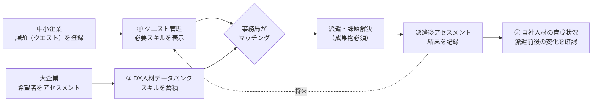
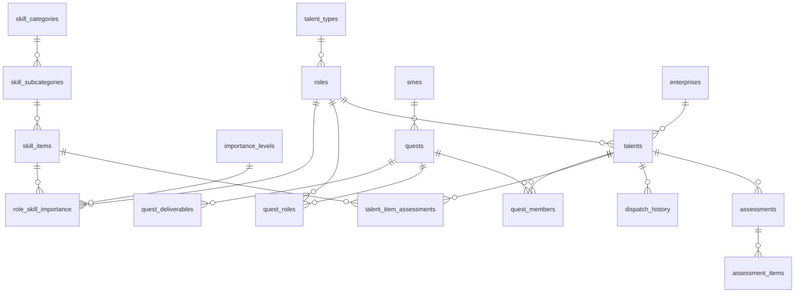

# 実践DXクエスト システム説明書

| 項目 | 内容 |
|---|---|
| 対象 | 実践DXクエストのプロダクト案（画面プロトタイプとダミーデータベース） |
| 版 | 第2.24版（2026年11月19日）。第1版（2026年11月13日）からの変更点と、第2版への追加修正（第2.1版〜第2.24版）は [次の章](#第2版の変更点2026年11月14日) を参照 |
| 公開先 | **［第2.16版］** https://jissen-dx-quest.azurewebsites.net （Azure App Service。構成と作業記録は [デプロイ計画.md](デプロイ計画.md)） |
| ソースコード | **［第2.16版］** https://github.com/Yasshy-WOW/KEISANSHO-TECH0 （この説明書も含む。`main` ブランチに入ると自動で公開先にデプロイされる） |
| 画面 | このフォルダ（リポジトリ）の `index.html`・`admin/`・`company/`・`assets/`。**［第2.16版］** バックエンド（`app/`、Python / FastAPI）が画面と API を配信し、データは MySQL から読み込む。構成は [3.2](#32-サイトのファイル構成と公開方法) を参照 |
| データベース | **［第2.16版］** 画面が使うのは Azure Database for MySQL のデータベース `jissen_dx_quest`（[7.6](#76-公開版のデータベースmysql第216版)）。設計用のダミーデータベース `dx_quest_dummy.db`（SQLite）と `dx_quest_dummy.sql` は親フォルダにあり、リポジトリには入っていない（[7.1](#71-ファイル)〜[7.5](#75-よく使うsql)） |
| 元資料 | 親フォルダの `261112_実践DXのスキーム.pptx`、`261114_プロダクト改善案.pptx`（第2版の改修指示）。リポジトリには入っていない |
| スキル体系 | デジタルスキル標準 ver.2.0（IPA／経済産業省、2026年4月公開・10月誤記修正） |

> **注意**：画面とデータベースに入っている企業名・人名・評価・数値は、すべて説明用の架空データです。

---

## 第2版の変更点（2026年11月14日）

`261114_プロダクト改善案.pptx` の指摘を反映しました。本文の変更箇所には次の目印を付けています。

| 目印 | 意味 |
|---|---|
| **［変更］** | 第1版から内容を変えた箇所 |
| **［追加］** | 第2版で新しく加えた箇所 |
| **［削除］** | 第1版にあったが、第2版でなくした箇所（何をなくしたかを残しています） |
| ~~取り消し線~~ → **太字** | 変更前の値 → 変更後の値 |
| **［第2.1版］** | 第2版のあとの追加修正（[第2.1版の追加修正](#第21版の追加修正2026年11月14日)）で変えた箇所 |
| **［第2.2版］** | 人事部画面への追加（[第2.2版の追加修正](#第22版の追加修正2026年11月16日)）で変えた箇所 |
| **［第2.3版］** | デジタル庁のガイドブックに合わせた体裁の整理（[第2.3版の追加修正](#第23版の追加修正2026年11月16日)）で変えた箇所 |

| No. | 指摘（スライド） | 対応 | 説明の場所 |
|---|---|---|---|
| 1 | ロールでの応募枠は削除し、中小企業の悩みをヒアリングした事務局からの推薦ロールを書く（1） | 「募集枠（ロール×1名）」を廃止し、「事務局からの推薦ロール」に変更。ヒアリング内容と推薦理由を表示 | [5.1](#51-標準準拠と独自基準の区別)、6.1、6.5 |
| 2 | 大企業側のサイト（1） | 企業ポータルに **④ クエスト一覧** を追加 | [3](#3-利用者と画面の構成)、6.5 |
| 3 | 自社の社員を派遣している場合は具体的な企業名を表示（1） | ④では、自社の社員が派遣中・派遣予定のクエストだけ企業名を表示。それ以外は「企業名非公開」 | [5.1](#51-標準準拠と独自基準の区別)、6.5 |
| 4 | 必要なスキルに関する掲載はすべて削除（2） | ④には必要スキルを載せない（事務局の画面①には、マッチングに使うため残す） | 6.5 |
| 5 | 派遣基準は85%に設定（3） | 派遣基準を ~~70%~~ → **85%** に変更 | [5.6](#56-状態と判定独自基準)、[8.3](#83-画面に表示される結果初期設定派遣基準85) |
| 6 | 充足度85%以上の人は名前を目立たせる（3） | ③の一覧で、名前を大きくしてマーカーと「派遣基準以上」ラベルを付ける | 6.3 |
| 7 | 派遣状況は「完了」か「未派遣」で表記（3） | 派遣状況を「派遣完了」「未派遣」の2つに統一 | [5.6](#56-状態と判定独自基準) |
| 8 | 異動判定の項目は削除（3・4） | 一覧の異動判定の列、詳細の異動判定の枠、集計の「DX部 異動候補」、異動基準（75%）を削除 | [5.6](#56-状態と判定独自基準)、6.3 |
| 9 | 同じ内容が重複して表記されている（3） | 「ロール（類型）」で同じ名前が2回並ぶため、③ではロールだけを表示 | 6.3 |
| 10 | レーダーチャートにし、[戦略の理解とアーキテクチャ設計] と同じ大分類で判定。各分類をクリックすると詳細項目のページへ（4） | ③のスキル項目の表を、11分類のレーダーチャートと分類ごとの判定に変更。分類名をクリックすると ③-2 のページに移る | [5.6](#56-状態と判定独自基準)、6.3、6.4 |

**ファイルの変更**

| ファイル | 内容 |
|---|---|
| `site/company/quests.html`、`site/assets/company-quests.js` | ［追加］④ クエスト一覧（大企業向け） |
| `site/company/skill.html`、`site/assets/hr-skill.js` | ［追加］③-2 分類ごとのスキル項目の評価 |
| `site/assets/hr.js` | ［変更］③ 自社人材の育成状況（上の5〜10） |
| `site/assets/common.js`、`site/assets/style.css` | ［変更］分類ごとの集計とレーダーチャートの部品、名前の強調の見た目 |
| `site/assets/quests.js`、`site/assets/talents.js` | ［変更］「募集枠」を「推薦ロール」に変更 |
| `site/assets/data.js` | ［変更］派遣基準85%、ヒアリング内容・推薦理由・参加メンバーを追加、異動基準を削除 |
| `dx_quest_dummy.sql`、`dx_quest_dummy.db` | ［変更］`data.js` と同じ内容にそろえた（[7.3](#73-テーブル一覧)） |

### 第2.1版の追加修正（2026年11月14日）

④ クエスト一覧の画面を見たうえでの指摘を反映しました。本文の該当箇所には **［第2.1版］** を付けています。

| No. | 指摘 | 対応 | 説明の場所 |
|---|---|---|---|
| 11 | 自社の人間を送るのに「募集中」だと分かりにくいので「実施中」にする | Q-2027-001 の状態を ~~募集中~~ → **実施中** に変更。青山 拓真さんは ~~派遣予定~~ → **派遣中** に変更 | [8.1](#81-クエスト)、[8.2](#82-登録人材)、[8.3](#83-画面に表示される結果初期設定派遣基準85) |
| 12 | 「A社」という表現だと匿名感が強いので「田中工務店(株)」にする | Q-2027-001 の企業名を ~~A社~~ → **田中工務店(株)** に変更 | [8.1](#81-クエスト)、[8.3](#83-画面に表示される結果初期設定派遣基準85) |

**合わせて直したこと**（指摘に合わせるために必要だった変更）

| 内容 | 理由 |
|---|---|
| Q-2027-001 の派遣期間を ~~2027年1月〜3月（週2日）~~ → **2026年11月〜2027年1月（週2日）** に変更 | 今日（2026年11月14日）時点で「実施中」にするため。クエストIDは変えていません |
| 青山 拓真さんを「派遣中」として扱う（`data.js` の `active`、データベースの `talents.is_dispatched` を1に） | 実施中のクエストに参加しているため |
| 事務局の画面②で、Q-2027-001 が需給と候補者の対象から外れる | 実施中のクエストは需給・候補者の対象外というルール（[5.7](#57-ロールごとの需給事務局画面)）のため。ビジネスアナリストとデータエンジニアは「募集なし」になる |

- ③ 自社人材の育成状況での 青山 拓真さんの派遣状況は「派遣完了」のままです（E社への派遣が完了しているため）。今回の派遣は派遣実績の欄には出ません（1人につき派遣実績を1件持つデータ構造のため）。
- 「田中工務店(株)」も架空の企業名です。B社・C社・D社は変えていません。
- 変更したファイル：`site/assets/data.js`、`dx_quest_dummy.sql`、`dx_quest_dummy.db`（画面のプログラムは変更なし）。

### 第2.2版の追加修正（2026年11月16日）

③ 自社人材の育成状況（大企業人事部）の画面を見たうえでの指摘を反映しました。本文の該当箇所には **［第2.2版］** を付けています。

| No. | 指摘 | 対応 | 説明の場所 |
|---|---|---|---|
| 13 | 経歴：入社以降の部署や役職の推移を経年で表示する | 社員の詳細（左側）に「経歴（入社以降の部署・役職の推移）」を追加。年月・部署・役職を縦のタイムラインで新しい順に並べ、現在の部署に「現在」、入社時の行に「（入社）」を付ける | [6.3](#63--自社人材の育成状況大企業人事部) |
| 14 | スキル（自己評価）：Q1 職種区分（選択式）、Q2 職種（選択式）、Q3 スキルレベル | 社員の詳細（左側）に「スキル（自己評価）」を追加。本人の回答をアンケートの形で表示し、選んだ選択肢を●で強調する。Q3 は5段階のバーと説明文で表示 | [6.3](#63--自社人材の育成状況大企業人事部) |

**自己評価の設問と選択肢**

| 設問 | 形式 | 選択肢 |
|---|---|---|
| Q1. あなたの職種はどれに該当しますか？ | 選択式 | ビジネス職（経営企画・営業・人事など）／ITエンジニア・クリエイティブ職（エンジニア・デザイナー・ディレクターなど） |
| Q2. あなたの職種は？ | 選択式（Q1の回答で選択肢が変わる） | ビジネス職：経営企画／営業／人事／マーケティング／生産管理・生産技術／その他<br>ITエンジニア・クリエイティブ職：ソフトウェアエンジニア／データエンジニア／インフラエンジニア／デザイナー／ディレクター／その他 |
| Q3. あなたのスキルレベルを教えてください。 | 5段階 | 1 知識はあるが実務経験は少ない／2 指導を受けながら実務を遂行できる／3 自立して実務を遂行できる／4 チームを率いて推進・指導できる／5 社内外を代表する専門家として活躍できる |

- Q2 の選択肢と Q3 の5段階の文言は、指摘に具体的な指定がなかったため仮に決めたものです（[9.2](#92-運用ルールとして決める必要があること)）。`site/assets/data.js` の `selfQ` を直せば画面に反映されます。
- 自己評価は本人の申告です。充足度や派遣基準の判定には使いません（判定はこれまでどおりアセスメント結果の個人評価で行います）。

**サンプルデータ**（X社の5名分。すべて架空）

| ID | 氏名 | 経歴（入社 → 現在） | Q1 / Q2 / Q3 |
|---|---|---|---|
| TB-0001 | 青山 拓真さん | 2019年4月 営業本部 法人営業課 担当 → 2022年4月 事業企画部 事業企画課 担当 → 2024年4月 経営企画部 経営企画課 主任 | ビジネス職 / 経営企画 / レベル4 |
| TB-0002 | 北村 美紀さん | 2021年4月 情報システム部 運用課 担当 → 2024年4月 情報システム部 データ基盤課 担当 → 2026年4月 同 主任 | ITエンジニア・クリエイティブ職 / データエンジニア / レベル3 |
| TB-0007 | 星野 真央さん | 2023年4月 営業本部 販売推進課 担当 → 2025年4月 マーケティング部 顧客分析課 担当 | ビジネス職 / マーケティング / レベル2 |
| TB-0009 | 堀内 圭さん | 2021年4月 製造部 第一工場 製造課 担当 → 2023年10月 生産技術部 生産技術課 担当 → 2026年4月 同 主任 | ビジネス職 / 生産管理・生産技術 / レベル3 |
| TB-0010 | 永井 純一さん | 2022年4月 情報システム部 開発課 担当 → 2025年4月 情報システム部 基幹システム課 担当 | ITエンジニア・クリエイティブ職 / ソフトウェアエンジニア / レベル3 |

**ファイルの変更**

| ファイル | 内容 |
|---|---|
| `site/assets/data.js` | ［追加］社員ごとの経歴 `career`（開始年月・部署・役職）と自己評価の回答 `self`（Q1・Q2・Q3・回答時期）、設問の定義 `selfQ` |
| `site/assets/hr.js` | ［追加］経歴のタイムラインと自己評価の表示 |
| `site/assets/style.css` | ［追加］タイムラインと自己評価の見た目 |

- `dx_quest_dummy.sql`・`dx_quest_dummy.db` には、経歴と自己評価のテーブルをまだ追加していません（[7.3](#73-テーブル一覧)、[9.1](#91-今のプロトタイプの制約)）。

### 第2.3版の追加修正（2026年11月16日）

企業ポータル（③ 自社人材の育成状況、③-2、④ クエスト一覧）の体裁を、デジタル庁「ダッシュボードデザインの実践ガイドブック」（2026年3月31日 正式版、カラーコードは2026年7月17日更新版）に合わせて整えました。事務局の画面（①・②）は変えていません。本文の該当箇所には **［第2.3版］** を付けています。

| No. | ガイドブックの考え方 | 対応 | 画面 |
|---|---|---|---|
| 15 | 配色はテンプレートのカラーパレットを使う。グレーを基調にし、強調する色は必要最小限にする | 企業ポータルの配色を、ガイドブックの Blue／Solid Gray テンプレートのカラーコードに置き換え（下表）。これまでの青緑（#0B4F5C など）は事務局の画面だけに残る（**第2.15版で事務局の画面も同じ配色にした**。**第2.16版でトップページも同じ配色にし、青緑は使わなくなった**） | ③・③-2・④ |
| 16 | セマンティックカラー：目標達成は Success、未達・警告は Error、増加は Positive | 分類ごとの判定「達成」を Success（#197A4B）、「未達」を Error（#CE0000）、充足度の上がった分（+○pt）を Positive（#3460FB）、「派遣完了」のタグを Success の枠線で表示 | ③ |
| 17 | 特に強調したい指標は Highlight 背景にする | 「派遣基準以上」の集計を Highlight（Blue 900 #0017C1 の背景に白文字）で表示 | ③ |
| 18 | 数値には比較対象を添える | 集計（登録社員・派遣完了・未派遣・派遣基準以上）の下に「登録社員の ○%」を表示 | ③ |
| 19 | 出典・更新日・基準時点・注記などのメタ情報を明記する | タイトルの下に「基準時点」「最終更新」「出典」「注記」を表示（`data.js` の `meta`）。**第2.16版で画面からは削除**（データの `meta` は残っている） | ③ |
| 20 | グラフのタイトルにはデータの範囲を書く | レーダーチャートの見出しの下に、対象（社員名・ロール）、範囲（11分類・評価61項目）、アセスメントの時期を表示。**第2.16版で見出しの下の説明文は削除** | ③ |
| 21 | 色だけに頼らない（線種・図形でも区別する） | レーダーチャートの系列を、ロールの要求＝灰色の破線、派遣前＝灰色の実線＋四角、現在＝青の実線＋丸＋塗りで区別。凡例にも線種と形を表示し、「破線」「四角」「丸」と文字で書き添えた（**第2.18版で文字の書き添えは削除**。凡例の線種と形は残している）。判定にも「✓ 達成」「✕ 未達」の記号を付けた | ③ |
| 22 | 強調はキー色1系統にし、比較対象は Neutral（控えめな色）にする | レーダーチャートで色を付けるのは「現在」だけにし、ロールの要求と派遣前は灰色にした（第2.2版までは灰・橙・青緑の3色） | ③ |
| 23 | グラフの色と背景のコントラスト比は3:1以上、文字は4.5:1以上 | 使う色はすべて白背景で4.5:1以上（灰 #767676・#4D4D4D、青 #0017C1・#3460FB、緑 #197A4B、赤 #CE0000、補助文字 #626264） | ③・③-2・④ |
| 24 | グラフには代替テキストを付ける | レーダーチャートの読み上げ用テキストに、分類ごとの「現在・派遣前・要求」の値を入れた。同じ値はチャートの下の表にもある | ③ |
| 25 | 3D・影・グラデーションなどの装飾は使わない | 派遣基準以上の社員名に付けていた黄色のマーカー（グラデーション）をやめ、名前の大きさ・太さと「派遣基準以上」ラベルで強調 | ③ |

**企業ポータルの配色**（ガイドブックのカラーコード）

| 役割 | 色 | 使う場所 |
|---|---|---|
| キー色（Blue 900） | #0017C1 | リンク、選択中のメニュー、Highlight の集計、レーダーチャートの「現在」、評価 a |
| Blue 600 | #3460FB | 増加（+○pt）、評価 b |
| Blue 200 ／ Blue 50 | #C5D7FB ／ #E8F1FE | 評価 c ／ d、選択中の行の背景 |
| 文字（Solid Gray 900 ／ 800） | #1A1A1A ／ #333333 | 本文 |
| 補助文字（Label） | #626264 | 注釈・ラベル・メタ情報 |
| 罫線（Solid Gray 200 ／ 50） | #CCCCCC ／ #F2F2F2 | 枠線・表の区切り |
| 背景（Standard） | #F8F8FB | ページの背景、表の見出し |
| Neutral（Solid Gray 700 ／ 536） | #4D4D4D ／ #767676 | レーダーチャートの「ロールの要求」「派遣前」 |
| Success | #197A4B | 達成、派遣完了 |
| Error（Red 50 ／ Red 200） | #CE0000（#FDEEEE ／ #FFBBBB） | 未達、次に伸ばす項目 |

**ガイドブックにない部分の扱い**

- **レーダーチャート**：ガイドブックの「グラフの選び方」はレーダーチャートを扱っていません。第2版の指摘（No.10）で採用した形なので残し、色・線種・凡例・代替テキストなど、ガイドブックの一般的なルールを当てはめました。
- **数値の右寄せ**：ガイドブックで明記を確認できなかったため、一般的な表の作り方として、③の表の数値の列を右寄せ・等幅数字にしました（独自の判断）。
- **画面の比率とグリッド**：ガイドブックは16:9の画面と縦横2〜6分割のグリッドを想定しています。この画面は縦に長いWebページなので、従来どおり「上に全体（集計）、下に詳細（一覧 → 社員の詳細）」の順で並べ、全体から部分へ流れるガイドブックの考え方に沿うようにしました。

**ファイルの変更**

| ファイル | 内容 |
|---|---|
| `site/company/index.html`、`quests.html`、`skill.html` | ［変更］`<body class="dash">` を付け、企業ポータルだけにガイドブックの配色を当てる |
| `site/assets/style.css` | ［追加］`body.dash` の配色（CSS変数の上書き）、メタ情報・比較値・数値の右寄せ・レーダーチャートの系列のスタイル |
| `site/assets/common.js` | ［変更］レーダーチャートの色を CSS のクラスで指定。派遣前に四角のマーカーを追加。読み上げ用テキストに値を入れた |
| `site/assets/hr.js` | ［変更］集計に比較値、メタ情報、チャートの範囲、線種と形の凡例、判定の記号、数値の右寄せ |
| `site/assets/data.js` | ［追加］メタ情報 `meta`（基準時点・最終更新・出典・注記） |

- 参照したのは、ガイドブックのページ、代替テキスト版、カラーパレットとカラーコードのページです。代替テキスト版の一部は文字化けしていて読めなかったため、本体のPDF（約22MB）で細部を確認することをおすすめします。

### 第2.4版の追加修正（2026年11月16日〜17日）

企業ポータルの「③ 自社人材の育成状況」を、登録社員200名を前提にした形に作り直しました。事務局の画面（①・②）は変えていません。

> 本文の [6.3](#63--自社人材の育成状況大企業人事部)・[8.2](#82-登録人材)・[8.3](#83-画面に表示される結果初期設定派遣基準85) などは、第2.5版の時点の内容に更新済みです（本文の目印は **［第2.4版］**・**［第2.5版］**）。

**1. X社の登録社員を5名から200名に増やした**

| 項目 | 内容 |
|---|---|
| 人数 | 既存の5名（青山 拓真さん・北村 美紀さん・星野 真央さん・堀内 圭さん・永井 純一さん）＋追加195名＝200名 |
| ID | 追加分は TB-1001 〜 TB-1195（既存の TB-0001 〜 TB-0010 とは重ならない） |
| 氏名 | ランダムに組み合わせた架空の日本人名（例：小山 達也）。既存5名は他の画面でも使っているため「青山 拓真さん」などのまま |
| 部署 | 20部署（下表）。既存5名の部署（経営企画部・情報システム部・マーケティング部・生産技術部）を含む |
| ロール | 部署ごとに候補を決め、その中からランダムに選ぶ（例：セキュリティ統括部 → サイバーセキュリティマネージャー／エンジニア、クラウドエンジニア） |
| 個人評価 | 全員が61項目すべての評価を持つ。作り方は第2.5版で見直した（[第2.5版](#第25版の追加修正2026年11月17日)） |
| 経歴・自己評価 | 経歴は入社から最大3つ。自己評価は約75%が回答済み |
| 派遣実績 | 派遣完了の人は派遣前の評価を持ち、派遣で充足度が必ず上がるようにした |
| 結果 | 第2.5版でデータを作り直したため、人数は [8.2](#82-登録人材) を参照 |

**20部署**：経営企画部、事業企画部、営業本部、営業企画部、マーケティング部、広報部、人事部、経理部、法務部、購買部、物流部、生産技術部、製造部、品質保証部、研究開発部、商品企画部、情報システム部、DX推進室、データ活用推進部、セキュリティ統括部

- 追加分は別ファイル `site/assets/data-staff.js` に入れ、企業ポータル（`company/` の3画面）だけで読み込みます。事務局の「② DX人材データバンク」は従来どおり既存の10名だけを表示します。
- 追加分の派遣先（K社〜T社）とクエスト番号（Q-2025-021 など）は、派遣実績を表示するためだけの架空の値です。`data.js` のクエスト一覧には入っていません。
- データは固定のシード値を使うスクリプト `site/tools/generate-staff.js` で作りました。同じスクリプトを実行すれば同じデータになります（[3.2](#32-サイトのファイル構成と公開方法)）。

**2. ③ 自社人材の育成状況を2つのタブに整理した**

| タブ | 表示する内容 |
|---|---|
| 会社全体 | 登録社員全員（200名）のレーダーチャート。分類ごとに「全社員の平均」（各社員の分類内の平均水準を全員で平均）と「ロールの要求」（各社員のロールの要求を全員で平均）を重ねる。分類名の下に「達成 ○%（達成者／対象者）」を表示 |
| 従業員 | 従業員の一覧（氏名・部署・ロール・充足度・派遣状況）と、一覧で選んだ従業員のレーダーチャート |

- 一覧の充足度は、派遣実績があれば「派遣前 → 現在（+○pt）」、なければ現在の値だけを表示します。
- 200名を扱うため、一覧に部署の絞り込みと、氏名・社員IDの検索を付けました。一覧は高さを抑えてスクロールし、見出し行は固定です。
- 従業員のレーダーチャートの分類名をクリックすると、従来どおり「③-2 分類ごとのスキル項目の評価」を開きます。③-2 から戻ると従業員タブが開きます。
- タブはクリックのほか、左右の矢印キーでも切り替えられます。

**削除した表示**（第2.3版までにあったもの）

- 集計カード（登録社員・派遣完了・未派遣・派遣基準以上）と、判定ルールの説明欄。これにより第2.3版の No.17（Highlight）・No.18（比較値）の対応はなくなった
- 「派遣基準以上」のラベルと名前の強調（第2.3版の No.25）
- 社員の詳細（派遣実績、次に伸ばす項目、経歴、自己評価、分類ごとの表）。経歴と自己評価のデータは `data.js` に残っている
- メタ情報（基準時点・出典・注記）は、タイトルの下の1行にまとめて残した（第2.3版の No.19）

**会社全体の「達成 ○%」の分母について**（第2.5版で表示をやめ、平均水準だけの表示に変更。[第2.5版](#第25版の追加修正2026年11月17日) を参照）

分母は、**その分類に、本人ロールの重点項目（重要度 a・b）がある社員の数**です。重点項目がないロールの社員は、その分類では判定の対象外になります。どの分類に重点項目があるかはロールで決まるため、分類ごとに分母が大きく違います。

| 分類 | 重点項目があるロール（17ロール中） |
|---|---|
| データ・AIの戦略的活用 | 16ロール（ほぼ全ロール） |
| ソフトウェア開発 | 11ロール |
| セキュリティ技術 | 6ロール（エンジニア系・セキュリティ系） |
| AI・データサイエンス | 6ロール（データ系・エンジニア系） |

- 分母の小さい分類と大きい分類で同じ割合を比べると、誤解されやすい点が残っています。対応案は次の3つで、まだ決めていません（おすすめは2）。
  1. 分母を全社員にそろえる（求められていないスキルも未達と数えることになる）
  2. 画面に「分母はその分類が重点項目となるロールの社員数」と注記する
  3. 人数を出さず割合だけにする

**ファイルの変更**

| ファイル | 内容 |
|---|---|
| `site/assets/data-staff.js` | ［追加］X社の追加社員195名 |
| `site/company/index.html`、`quests.html`、`skill.html` | ［変更］`data-staff.js` を読み込む |
| `site/assets/hr.js` | ［変更］2つのタブ（会社全体／従業員）に作り直した。部署の絞り込みと氏名・社員IDの検索を追加 |
| `site/assets/common.js` | ［変更］レーダーチャートで、分類名の下のラベルを差し替えられるようにし、リンクなしでも描けるようにした（会社全体のチャート用）。既存の使い方は変わらない |
| `site/assets/style.css` | ［追加］タブ、絞り込み欄、一覧のスクロールと見出し行の固定、会社全体チャートのラベル |

- `dx_quest_dummy.sql`・`dx_quest_dummy.db` には追加の195名を入れていません。`data.js` と同じ内容という前提から外れています（[9.1](#91-今のプロトタイプの制約)）。

### 第2.5版の追加修正（2026年11月17日）

第2.4版の会社全体チャートの集計と、追加195名のダミーデータを見直しました。第2.4版と食い違う部分は、この節の内容が新しいものです。

**前提の確認：アセスメントとロール**

- スキルを登録する前に、デジタルスキル標準に沿ったアセスメントを全員に実施します。そのため、**登録社員は全員、評価対象の61項目すべてに a〜d の評価を持ちます**（パーソナルスキル6項目は点数化しない）。レーダーチャートはこのアセスメント結果から作ります。ダミーデータの200名も、全員が61項目の評価を持っていることを確認しました。
- 各社員のロールは計算で求めておらず、社員データの `role` にあらかじめ入っている値です。既存の10名は手で決めた値、追加の195名は部署ごとの候補からランダムに選んだ値です。実際の運用で誰がどうロールを決めるかは、まだ決まっていません（[9.2](#92-運用ルールとして決める必要があること) に追加が必要）。→ **第2.6版で、アセスメント結果から判定する形に変更しました（[第2.6版](#第26版の追加修正2026年11月17日)）。**
- ロールは、充足度・重点項目・分類ごとの達成／未達・従業員タブのレーダーチャートの「ロールの要求（破線）」に使います。会社全体のチャートでは使いません（次項）。

**1. 会社全体のチャートを「平均水準だけ」の表示にした**

第2.4版では、分類名の下に「達成 ○%（達成者／対象者）」を出していました。この分母は「その分類に本人ロールの重点項目がある社員の数」だったため、分類ごとに35名〜193名とばらつき、比べにくい表示でした。評価が欠けていたのではなく、判定にロールを使っていたことが原因です。

検討した3案のうち、**案3（割合を出さず平均水準だけを表示）** を採用しました。

| 項目 | 第2.4版 | 第2.5版 |
|---|---|---|
| 分類名の下のラベル | 達成 ○%（達成者／対象者） | 平均 ○.○（a=4・b=3・c=2・d=1） |
| ロールの要求（破線） | 全社員のロールの要求の平均を表示 | 表示しない |
| 集計の対象 | 分類ごとに重点項目がある社員だけ | 登録社員全員（200名）。ロールによる区別はしない |

- 不採用の案：案1「分類の平均水準が b 以上の人の割合（全員が分母）」、案2「ロールの要求を満たす人の割合（全員が分母、重点項目がない人は達成とみなす）」。
- 従業員タブの個人のチャートは変えていません。本人ロールの要求（破線）と、分類ごとの達成／未達を引き続き表示します。

**2. 充足度100%の人がいないようにした**

第2.4版のデータでは、追加195名のうち51名の充足度が100%でした。本人の水準をロールの要求とほぼ同じ高さから作っていたため、実力が高めの人はすべての重点項目を満たしていました。

- 上限：充足度が95%を超える場合は、達成している重点項目を1段階ずつ下げ、95%以下にしました。
- 下限：充足度が10%未満の場合は、未達の重点項目を要求の水準まで上げ、10%以上にしました。
- 結果（X社200名）：充足度は **10%〜95%、平均60%**。派遣基準（85%）以上は **33名**。→ 第2.6版でロールの決め方を変えたため、今の値は [8.2](#82-登録人材) を参照してください。

**3. スキルに偏りを持たせた**

第2.4版のデータは、本人の評価がロールの要求の形をなぞっていたため、どの人のチャートもロールの形とほぼ同じでした。次の3つを足して、会社と個人の両方に偏りが出るようにしました。

| 偏りの種類 | 内容 |
|---|---|
| 会社の傾向（X社＝電機メーカー） | 技術系の分類に強く、デザイン・データ活用・AI に弱い。分類ごとに −0.7〜+0.6 の補正 |
| 本人の得意・不得意 | 1人ずつ、11分類からランダムに得意2分類（+1）と不得意3分類（−1、うち1つは −1.5）を決める |
| 本人の実力 | 入社年次が長いほど高め。同じ年次でも個人差がある |

各分類の水準は「ロールの要求 − 0.15 ＋ 本人の実力 ＋ 会社の傾向 ＋ 本人の得意・不得意 ＋ 項目ごとのばらつき」を四捨五入し、a〜d に当てはめています。ロールの重点項目ではない分類にも同じ補正がかかるため、ロール外のスキルが高い人・低い人も出ます。

**会社全体の平均水準**（X社200名、a=4〜d=1）

| 分類 | 平均 | 分類 | 平均 |
|---|---|---|---|
| 戦略の理解とアーキテクチャ設計 | 2.7 | データマネジメント | 2.5 |
| プロダクトのマネジメント | 2.6 | ソフトウェア開発 | 2.2 |
| 変革活動のマネジメント | 2.4 | デジタルテクノロジー | 2.6 |
| デザイン | 1.9 | セキュリティマネジメント | 2.6 |
| データ・AIの戦略的活用 | 2.2 | セキュリティ技術 | 2.0 |
| AI・データサイエンス | 1.5 | | |

- データを作り直したため、追加195名の氏名・ロール・評価・派遣実績は第2.4版から変わっています。既存の5名（青山 拓真さんなど）は変えていません。X社200名の内訳は [8.2](#82-登録人材) を参照してください。
- 派遣完了の人は、派遣前の評価で重点項目を少なくとも1つ未達に戻しているため、派遣で充足度が必ず上がります。

**ファイルの変更**

| ファイル | 内容 |
|---|---|
| `site/assets/data-staff.js` | ［変更］追加195名を作り直した（偏りのあるスキル、充足度の上限95%・下限10%） |
| `site/assets/hr.js` | ［変更］会社全体のチャートを平均水準だけの表示にし、ロールの要求（破線）と達成の割合を外した |
| `site/assets/common.js` | ［変更］レーダーチャートで、ロールの要求（破線）を描かない指定（`noReq`）を追加。既存の使い方は変わらない |
| `site/tools/generate-staff.js` | ［追加］`data-staff.js` を作り直すスクリプト（一時フォルダからプロジェクトに移した） |
| `site/README.md`、本書の本文（3.2・6.3・6.4・8.2・8.3・9.1・9.2） | ［変更］第2.4版・第2.5版の内容に合わせて更新 |

### 第2.6版の追加修正（2026年11月17日）

③ 自社人材の育成状況の従業員一覧への指摘を反映しました。本文の該当箇所には **［第2.6版］** を付けています。

**1. 既存の10名を日本人らしい名前に変えた**

「Aさん」〜「Jさん」としていた10名を、架空の日本人名に変えました。社員ID・所属・評価は変えていません。本書の本文も新しい名前に置き換えています。

| ID | 旧 | 新 | 所属 |
|---|---|---|---|
| TB-0001 | Aさん | 青山 拓真 | X社 経営企画部 |
| TB-0002 | Bさん | 北村 美紀 | X社 情報システム部 |
| TB-0003 | Cさん | 西田 康平 | Y社 営業企画部 |
| TB-0004 | Dさん | 南 早紀 | Y社 DX推進室 |
| TB-0005 | Eさん | 浅野 亮介 | Z社 システム開発部 |
| TB-0006 | Fさん | 片山 直子 | Z社 リスク管理部 |
| TB-0007 | Gさん | 星野 真央 | X社 マーケティング部 |
| TB-0008 | Hさん | 大西 航 | Z社 商品開発部 |
| TB-0009 | Iさん | 堀内 圭 | X社 生産技術部 |
| TB-0010 | Jさん | 永井 純一 | X社 情報システム部 |

- 追加の195名の名前と重ならないことを確認しました。
- 名前は事務局の画面（①・②）、企業ポータル（③・③-2・④）、データベースのすべてで変わります。

**2. ロールをアセスメント結果から判定するようにした**

第2.5版までは、ロールはデータに入れておいた値でした。第2.6版からは、**アセスメント結果（61項目の個人評価）から判定**します。

| 項目 | 内容 |
|---|---|
| 判定の方法 | 17ロールそれぞれで充足度を計算し、最も高いロールを本人のロールとする（[5.4](#54-充足度独自基準)） |
| 同じ充足度のとき | 達成した重点項目の数が多いロール → それも同じなら [4.2](#42-人材類型とロール6類型17ロール) の表で先のロール |
| 対象 | すべての登録人材（事務局の10名、X社の追加195名） |
| 計算する場所 | 画面を開いたときに `common.js` の `assessedRole` で判定し、すべての画面で使う。データ（`data.js`・`data-staff.js`・データベース）の `role` も同じ値にそろえた |
| 画面の表示 | ③ の従業員一覧の見出しを「ロール（アセスメント判定）」にし、レーダーチャートの下に判定の方法を書いた |

*既存10名への影響*：7名は今までのロールがそのまま最も高いロールでした。次の3名はロールが変わり、充足度も上がりました。いずれも派遣基準（85%）未満のままなので、状態は変わりません。

| ID | 氏名 | 旧ロール（充足度） | 新ロール（充足度） |
|---|---|---|---|
| TB-0008 | 大西 航 | フロントエンドエンジニア（59%） | フィジカルコンピューティングエンジニア（79%） |
| TB-0009 | 堀内 圭 | ビジネスアナリスト（72%） | データスチュワード（80%） |
| TB-0010 | 永井 純一 | バックエンドエンジニア（派遣前63% → 71%） | クラウドエンジニア／ＳＲＥ（派遣前74% → 79%） |

- 推薦ロールごとの候補者の順位（[8.3](#83-画面に表示される結果初期設定派遣基準85)）は、クエストの推薦ロールに対する適合度で決まるため、変わりません。
- 事務局の需給（派遣基準以上の人数）も変わりません（事務局の10名で、派遣中でない基準以上の人は0名のまま）。

*X社の追加195名への影響*：生成スクリプトで、評価を作ったあとにロールを判定するようにしました。評価を作る基準には今までどおり部署ごとの候補ロールを使い、本人のロールは判定の結果で決めます。98名は候補ロールのまま、残りは別のロールになりました。

- どのロールで見ても充足度が95%を超えないよう、最も高いロールの達成済み重点項目を下げています（第2.5版の上限を、全ロールに広げた）。
- 派遣前の評価は、判定したロールの重点項目を基準に作り直しました（派遣で充足度が必ず上がる形）。
- 氏名・部署・年次・派遣実績などは第2.5版から変えていません（ロールの判定には別の乱数列を使うため）。
- 結果（X社200名）：充足度は **14%〜95%、平均66%**。派遣基準（85%）以上は **43名**。→ 第2.7版で評価を作り直したため、今の値は [8.2](#82-登録人材) を参照してください。

**ファイルの変更**

| ファイル | 内容 |
|---|---|
| `site/assets/common.js` | ［追加］アセスメント結果からロールを判定する `assessedRole`。読み込み時に全員のロールを判定し直す |
| `site/assets/data.js` | ［変更］10名の名前。大西 航・堀内 圭・永井 純一のロール |
| `site/assets/data-staff.js`、`site/tools/generate-staff.js` | ［変更］ロールをアセスメント結果から判定し、充足度の上限を全ロールに広げた |
| `site/assets/hr.js` | ［変更］一覧の見出しを「ロール（アセスメント判定）」に。レーダーチャートの下に判定の方法を表示 |
| `dx_quest_dummy.sql`、`dx_quest_dummy.db` | ［変更］10名の名前、3名のロールと充足度、永井 純一の派遣前後の充足度（63% → 71% を 74% → 79% に）。`talents.role_id` のコメントに判定の方法を追記 |
| 本書 | ［変更］名前の置き換え、[5.4](#54-充足度独自基準)・[5.5](#55-適合度独自基準)・[6.3](#63--自社人材の育成状況大企業人事部)・[8.2](#82-登録人材)・[8.3](#83-画面に表示される結果初期設定派遣基準85)・[9.1](#91-今のプロトタイプの制約)・[9.2](#92-運用ルールとして決める必要があること) |

- 同じフォルダの `実践DXクエスト システム画面.html`（`site/` の外にある画面の資料）は更新していません。古い名前（Aさん〜Jさん）とロールのままの可能性があります。

### 第2.7版の追加修正（2026年11月17日）

会社全体のレーダーチャートで、分類ごとの平均が 1.5〜2.7 に収まっていて差が小さく、どこに注力すべきか判断しにくいという指摘を反映しました。X社の追加195名の評価を作り直しています。本文の該当箇所には **［第2.7版］** を付けています。

**1. 会社の傾向を強くした**

評価の作り方（[第2.5版](#第25版の追加修正2026年11月17日)）のうち、「会社の傾向（X社＝電機メーカー）」の補正を大きくしました。

| 分類 | 第2.5版の補正 | 第2.7版の補正 | 会社全体の平均（第2.6版 → 第2.7版） |
|---|---:|---:|---|
| 戦略の理解とアーキテクチャ設計 | 0 | +0.7 | 2.7 → **3.0** |
| プロダクトのマネジメント | −0.2 | +0.3 | 2.6 → **3.0** |
| 変革活動のマネジメント | −0.4 | −0.5 | 2.4 → 2.3 |
| デザイン | −0.7 | −1.7 | 1.9 → **1.4** |
| データ・AIの戦略的活用 | −0.5 | −1.3 | 2.1 → **1.7** |
| AI・データサイエンス | −0.6 | −1.8 | 1.5 → **1.2** |
| データマネジメント | 0 | +0.2 | 2.5 → 2.5 |
| ソフトウェア開発 | +0.4 | +1.0 | 2.2 → 2.7 |
| デジタルテクノロジー | +0.6 | +1.4 | 2.6 → **3.2** |
| セキュリティマネジメント | +0.3 | +0.2 | 2.6 → 2.5 |
| セキュリティ技術 | +0.2 | −0.3 | 2.0 → **1.7** |

- 平均の幅は **1.5〜2.7（差1.2）から 1.2〜3.2（差2.0）** に広がりました。強みは技術と戦略、弱みはデザインと AI・データ活用で、「AI・データ活用とデザインに注力すべき」と読める形です。
- セキュリティの補正を上げた案も試しましたが、ロールの判定（17ロールのうち充足度が最も高いロール）でセキュリティ系のロールが極端に増えたため、セキュリティは中立〜やや弱めにしました。

**2. 評価づくりの乱数を分けた**

- 評価（スキル）を作る乱数を、氏名・部署・派遣実績などを作る乱数と別にしました。今後、評価の作り方を変えても、氏名などは変わりません。
- この切り替えのため、**今回に限り**、追加195名の2人目以降の氏名・派遣実績などが第2.6版から変わっています（部署の人数は同じ）。既存の10名は変えていません。
- 派遣前の評価は、達成済みの重点項目を必ず要求の1段階下まで下げるようにしました（第2.6版では、1段階下げても要求を満たしたままになり、充足度が上がらない人がいた）。

**結果（X社200名）**

| 項目 | 第2.6版 | 第2.7版 |
|---|---|---|
| 充足度 | 14%〜95%（平均66%） | 14%〜93%（平均63%） |
| 派遣基準（85%）以上 | 43名 | 19名（第2.8版で14名） |
| 派遣完了／派遣中 | 40名／13名 | 32名／9名 |
| 多いロール | データスチュワード 37、データエンジニア 27 | サイバーセキュリティエンジニア 44、データエンジニア 28、ビジネスアナリスト 28 |

- 「サイバーセキュリティエンジニア」が多いのは、このロールの重点項目に、会社の強みであるデジタルテクノロジー・ソフトウェア開発の項目が多く含まれるためです。ロールを「充足度が最も高いロール」で決める方法の特徴で、運用で気にするなら判定方法の見直しが必要です（[9.2](#92-運用ルールとして決める必要があること)）。

**ファイルの変更**

| ファイル | 内容 |
|---|---|
| `site/tools/generate-staff.js` | ［変更］会社の傾向の補正、評価づくりの乱数を分離、派遣前の評価の下げ方 |
| `site/assets/data-staff.js` | ［変更］追加195名を作り直した |
| 本書 | ［変更］[8.2](#82-登録人材)・[8.3](#83-画面に表示される結果初期設定派遣基準85)・[9.2](#92-運用ルールとして決める必要があること) の数値 |

- 画面のプログラム（`hr.js`・`common.js`）とデータベースは変えていません（データベースには追加195名が入っていないため）。

### 第2.8版の追加修正（2026年11月17日）

第2.7版の会社全体のチャートでも、まだ差が小さいという指摘を受け、会社の傾向の補正をさらに大きくしました。X社の追加195名の評価だけを作り直しています（氏名・部署・派遣実績は第2.7版から変わりません）。

| 分類 | 第2.7版の補正 | 第2.8版の補正 | 会社全体の平均（第2.7版 → 第2.8版） |
|---|---:|---:|---|
| 戦略の理解とアーキテクチャ設計 | +0.7 | +1.4 | 3.0 → **3.4** |
| プロダクトのマネジメント | +0.3 | +1.0 | 3.0 → **3.3** |
| 変革活動のマネジメント | −0.5 | −0.9 | 2.3 → 1.9 |
| デザイン | −1.7 | −2.2 | 1.4 → **1.2** |
| データ・AIの戦略的活用 | −1.3 | −1.9 | 1.7 → **1.4** |
| AI・データサイエンス | −1.8 | −2.2 | 1.2 → **1.1** |
| データマネジメント | +0.2 | +0.3 | 2.5 → 2.6 |
| ソフトウェア開発 | +1.0 | +0.3 | 2.7 → 2.2 |
| デジタルテクノロジー | +1.4 | +2.4 | 3.2 → **3.7** |
| セキュリティマネジメント | +0.2 | +0.4 | 2.5 → 2.6 |
| セキュリティ技術 | −0.3 | −0.8 | 1.7 → **1.4** |

- 平均の幅は **1.2〜3.2（差2.0）から 1.1〜3.7（差2.6）** に広がりました。
- ソフトウェア開発の補正は逆に下げました。全体を強めに振った試作では、サイバーセキュリティエンジニアと判定される人が86名（43%）になりました。このロールは重点項目21件のうち10件がソフトウェア開発にあるためです。重点項目が少ないデジタルテクノロジーを強みの中心にし、ソフトウェア開発を控えめにして偏りを抑えました。
- 結果（X社200名）：充足度は **23%〜95%、平均59%**。派遣基準（85%）以上は **14名**（第2.7版は19名）。→ 第2.9版で作り直したため、今の値は [8.2](#82-登録人材) を参照してください。最も多いロールはビジネスアナリスト42名（21%）で、サイバーセキュリティエンジニアは28名（第2.7版は44名）。ロールの内訳は [8.2](#82-登録人材) を参照してください。
- 変更したファイル：`site/tools/generate-staff.js`（会社の傾向の補正）、`site/assets/data-staff.js`（作り直し）、本書の [8.2](#82-登録人材)・[8.3](#83-画面に表示される結果初期設定派遣基準85)・[9.2](#92-運用ルールとして決める必要があること)。画面のプログラムとデータベースは変えていません。

### 第2.9版の追加修正（2026年11月17日）

会社全体のチャートについて、「AI・データサイエンスの平均はそのままで、ほかの分類は一律2.4以上にする」という指示を反映しました。X社の追加195名の評価だけを作り直しています（氏名・部署・派遣実績は変わりません）。

**会社全体の平均（第2.8版 → 第2.9版）**

| 分類 | 第2.8版 | 第2.9版 | 分類 | 第2.8版 | 第2.9版 |
|---|---:|---:|---|---:|---:|
| 戦略の理解とアーキテクチャ設計 | 3.4 | 3.2 | データマネジメント | 2.6 | 2.4 |
| プロダクトのマネジメント | 3.3 | 3.0 | ソフトウェア開発 | 2.2 | 2.4 |
| 変革活動のマネジメント | 1.9 | 2.5 | デジタルテクノロジー | 3.7 | 3.5 |
| デザイン | 1.2 | 2.6 | セキュリティマネジメント | 2.6 | 2.6 |
| データ・AIの戦略的活用 | 1.4 | 2.6 | セキュリティ技術 | 1.4 | 2.5 |
| **AI・データサイエンス** | **1.1** | **1.1** | | | |

**評価の作り方の変更**

1. **会社の傾向**：弱みだった分類の補正を引き上げ、AI・データサイエンスだけを大きく下げたままにしました（−2.4）。

   | 分類 | 戦略 | プロダクト | 変革 | デザイン | データ・AI戦略 | AI・DS | データ管理 | ソフトウェア | デジタル技術 | セキュリティ管理 | セキュリティ技術 |
   |---|---|---|---|---|---|---|---|---|---|---|---|
   | 第2.8版 | +1.4 | +1.0 | −0.9 | −2.2 | −1.9 | −2.2 | +0.3 | +0.3 | +2.4 | +0.4 | −0.8 |
   | 第2.9版 | +1.4 | +1.0 | +0.2 | +0.5 | +0.4 | −2.4 | +0.3 | +0.7 | +2.4 | +0.6 | +0.8 |

2. **ロールの要求への沿わせ方と、項目ごとのばらつき**：会社の傾向を上げただけでは、ほとんどの社員が自分のロールの重点項目を満たしてしまい、派遣基準（85%）以上が115名（57%）になりました。そこで、評価の式を次のように変えました。

   ```
   水準 = 基準値 ＋ 沿わせ度 ×（ロールの要求 − 2.5）＋ 本人の実力 ＋ 会社の傾向 ＋ 本人の得意・不得意 ＋ 項目ごとのばらつき
   ```

   | パラメータ（`generate-staff.js`） | 第2.8版まで | 第2.9版 | 意味 |
   |---|---|---|---|
   | `BASE`（基準値） | 2.35 相当 | 2.1 | 全体の水準 |
   | `K_REQ`（沿わせ度） | 1.0 | 0.6 | 評価がロールの要求の高さにどれだけ沿うか |
   | `NOISE`（ばらつきの幅） | 1.2 | 3.8 | 項目ごとのばらつき。大きいほど、重点項目をすべて満たす人が減る |

   分類の平均は高く保ちつつ、項目ごとの凸凹を大きくして、重点項目の取りこぼしが出るようにしています。

**結果（X社200名）**

| 項目 | 第2.8版 | 第2.9版 |
|---|---|---|
| 充足度 | 23%〜95%（平均59%） | 19%〜95%（平均70%） |
| 派遣基準（85%）以上 | 14名 | 42名（21%） |
| 最も多いロール | ビジネスアナリスト 42名 | サイバーセキュリティマネージャー 31名 |

- 会社全体の水準が上がったため、派遣基準以上の人数は第2.8版より増えました（第2.6版の43名と同程度）。
- 変更したファイル：`site/tools/generate-staff.js`（会社の傾向、評価の式とパラメータ）、`site/assets/data-staff.js`（作り直し）、本書の [8.2](#82-登録人材)・[8.3](#83-画面に表示される結果初期設定派遣基準85)・[9.2](#92-運用ルールとして決める必要があること)。画面のプログラムとデータベースは変えていません。

### 第2.10版の追加修正（2026年11月17日）

会社全体のチャートで、分類ごとに最高得点の社員がどれくらいいるか分かるように、母数と対象人数を表示しました。データは変えていません。

| 項目 | 内容 |
|---|---|
| 表示 | 分類名の下を「平均 ○.○｜最高点 ○/200名」にした |
| 最高点（対象人数） | その分類のすべての項目が最高評価 a（分類の平均4.0）の社員の数 |
| 母数 | 登録社員全員（X社200名） |
| 説明 | チャートの上に「最高点 対象人数/母数」の定義を書いた |

**最高点の人数**（/200名）

| 分類 | 人数 | 分類 | 人数 |
|---|---:|---|---:|
| 戦略の理解とアーキテクチャ設計 | 31 | データマネジメント | 2 |
| プロダクトのマネジメント | 17 | ソフトウェア開発 | 0 |
| 変革活動のマネジメント | 3 | デジタルテクノロジー | 81 |
| デザイン | 2 | セキュリティマネジメント | 9 |
| データ・AIの戦略的活用 | 7 | セキュリティ技術 | 26 |
| AI・データサイエンス | 0 | | |

- 項目数が少ない分類（デジタルテクノロジー3項目、セキュリティ技術2項目など）ほど、全項目 a になりやすく人数が多く出ます。ソフトウェア開発（10項目）は平均2.4でも最高点は0名です。
- AI・データサイエンスは、全社員の中の最高でも分類の平均3.0（1名）で、a 水準の人がいません。
- 変更したファイル：`site/assets/hr.js`（最高点の人数の集計と表示）、本書の [6.3](#63--自社人材の育成状況大企業人事部)・[8.3](#83-画面に表示される結果初期設定派遣基準85)。

### 第2.11版の追加修正（2026年11月17日）

事務局の「② DX人材データバンク」を作り直しました。本文の該当箇所には **［第2.11版］** を付けています。

**1. 参加大企業を10社にした（東証の大分類10分類）**

X社以外の登録人材が少なかったため、東証の業種別分類の大分類10分類を1社ずつ満たすように、参加大企業を10社にしました。X社以外は1社10名です。

| 項目 | 内容 |
|---|---|
| 企業 | U社（水産・農林業）、V社（鉱業）、W社（建設業）、X社（製造業）、Q社（電気・ガス業）、J社（運輸・情報通信業）、Y社（商業）、Z社（金融・保険業）、H社（不動産業）、I社（サービス業）。すべて架空 |
| 人数 | X社200名（企業ポータルと同じ）、ほかの9社は各10名（Y社・Z社は既存の人を含む）。計290名 |
| 企業の情報 | `data.js` に `ents`（企業名・業種・売上高）、`sectors`（大分類10分類）、`revenueBands`（売上区分）を追加 |
| 登録人材のデータ | `data-others.js`（85名、TB-2001〜TB-2085）を `generate-staff.js` で作成。氏名・部署・評価・派遣実績の作り方は X社と同じで、会社の傾向だけ業種ごとに変えた |
| X社のデータ | 変えていません（生成スクリプトを整理したあとも、`data-staff.js` は1文字も変わらないことを確認） |

- 企業名の記号は、中小企業（A社〜G社、K社〜T社）と重ならないものを選びました。
- 売上高は説明用の架空の値です。

**2. 画面を2つのタブにした**

| タブ | 内容 |
|---|---|
| 登録人材全体 | 10社・290名のスコア平均のレーダーチャートと、参加企業の表 |
| 企業別 | 売上（3区分）と業種（10分類）を選び、当てはまる企業の登録人材のスコア平均のレーダーチャート。登録人材全体の平均を破線で重ねて比べられる |

- スコアの集計と表示（平均、最高点 対象人数/母数）は、企業ポータルの会社全体と同じ規則です。規則を1か所にまとめるため、集計を `common.js` の `groupStats` に移し、企業ポータル（`hr.js`）も同じ関数を使うようにしました（企業ポータルの表示は変わっていないことを確認）。
- 第2.10版までの集計・需給・候補者・登録人材一覧は表示していません（[6.2](#62--dx人材データバンク事務局)）。

**登録人材全体の平均**（10社・290名、平均｜最高点/290名）

| 分類 | 平均 | 最高点 | 分類 | 平均 | 最高点 |
|---|---:|---:|---|---:|---:|
| 戦略の理解とアーキテクチャ設計 | 3.0 | 34 | データマネジメント | 2.4 | 3 |
| プロダクトのマネジメント | 2.9 | 20 | ソフトウェア開発 | 2.3 | 0 |
| 変革活動のマネジメント | 2.5 | 6 | デジタルテクノロジー | 3.1 | 86 |
| デザイン | 2.4 | 5 | セキュリティマネジメント | 2.6 | 12 |
| データ・AIの戦略的活用 | 2.5 | 8 | セキュリティ技術 | 2.4 | 35 |
| AI・データサイエンス | 1.4 | 6 | | | |

- X社が290名中200名を占めるため、全体の平均は X社の傾向に近くなります。

**ファイルの変更**

| ファイル | 内容 |
|---|---|
| `site/assets/data.js` | ［追加］`ents`・`sectors`・`revenueBands` |
| `site/assets/data-others.js` | ［追加］X社以外の9社の登録人材85名 |
| `site/tools/generate-staff.js` | ［変更］1人分を作る処理を関数にまとめ、X社以外の9社も作るようにした（会社の傾向は `OTHERS`） |
| `site/assets/common.js` | ［追加］集団のスコア平均 `groupStats`。レーダーチャートの破線の名前を変えられる指定（`reqLabel`） |
| `site/assets/talents.js` | ［変更］2つのタブに作り直した |
| `site/admin/talents.html` | ［変更］`data-staff.js`・`data-others.js` を読み込む |
| `site/assets/hr.js` | ［変更］会社全体の集計を `groupStats` に置き換え（表示は同じ） |
| `site/index.html`、`site/README.md` | ［変更］② の説明 |

- データベース（`dx_quest_dummy.sql`・`.db`）には、追加の企業と登録人材を入れていません。

### 第2.12版の追加修正（2026年11月17日）

② DX人材データバンクの参加大企業が10社では少ないという指摘を受け、**1業種あたり5社、計50社**にしました。画面の構成（2つのタブ）とスコアの規則は第2.11版のままです。

| 項目 | 第2.11版 | 第2.12版 |
|---|---|---|
| 参加大企業 | 10社（大分類10分類×1社） | **50社（大分類10分類×5社）** |
| 登録人材 | 290名 | **690名**（X社200名＋49社×10名） |
| 売上区分ごとの企業数（1兆円以上／3,000億円〜1兆円／3,000億円未満） | 6／3／1社 | 19／18／13社 |

- 追加した40社は、業種ごとに4社です。名前は「U2社（養殖）」のように、同じ業種の第2.11版の企業の記号に番号を付けました（製造業は X2社〜X5社）。企業名・業態・売上高はすべて架空です（一覧は [8.2](#82-登録人材)）。
- 追加した40社の評価の傾向は、業種ごとの基本に、会社ごとの小さな差（分類ごとに±0.5）を足して作りました。同じ業種の5社は似ているが同じではない形です。製造業の基本は、X社ほど極端でない一般的な値にしました。
- 第2.11版の10社（X社を含む）の登録人材は変えていません（生成し直しても同じ内容であることを確認）。
- 画面：参加企業の表を「業種の順 → 売上高の大きい順」に並べ、行が多いときは高さを抑えてスクロールするようにしました。企業別のタブで業種を選ぶと、その業種の5社がまとめて表示されます。売上と業種の組み合わせによっては当てはまる企業がない場合があります（例：水産・農林業で1兆円以上）。

**登録人材全体の平均**（50社・690名、平均｜最高点/690名）

| 分類 | 平均 | 最高点 | 分類 | 平均 | 最高点 |
|---|---:|---:|---|---:|---:|
| 戦略の理解とアーキテクチャ設計 | 2.7 | 57 | データマネジメント | 2.4 | 6 |
| プロダクトのマネジメント | 2.7 | 36 | ソフトウェア開発 | 2.1 | 2 |
| 変革活動のマネジメント | 2.5 | 11 | デジタルテクノロジー | 2.7 | 115 |
| デザイン | 2.3 | 10 | セキュリティマネジメント | 2.5 | 34 |
| データ・AIの戦略的活用 | 2.5 | 21 | セキュリティ技術 | 2.2 | 59 |
| AI・データサイエンス | 1.7 | 21 | | | |

- X社の割合が 200/290 から 200/690 に下がったため、全体の平均は第2.11版より X社の傾向から離れました。

**ファイルの変更**

| ファイル | 内容 |
|---|---|
| `site/assets/data.js` | ［変更］`ents` に40社を追加（50社） |
| `site/assets/data-others.js` | ［変更］登録人材を485名に（TB-2001〜TB-2485） |
| `site/tools/generate-staff.js` | ［変更］追加40社の傾向を業種ごとの基本（`SECTOR`）から作る処理 |
| `site/assets/talents.js` | ［変更］企業の表の並び順と、行が多いときのスクロール |
| `site/README.md`、本書 | ［変更］説明と数値（[6.2](#62--dx人材データバンク事務局)・[8.2](#82-登録人材)・[9.1](#91-今のプロトタイプの制約)） |

### 第2.13版の追加修正（2026年11月17日）

② DX人材データバンクの企業の表で、企業名の横に付けていた業態の括弧書き（例：「V2社（石油開発）」の「（石油開発）」）は不要という指摘を反映しました。

- 企業の列と、企業を1社だけ選んだときの見出しを、企業名だけ（例：「V2社」「Q5社 のスキル水準」）にしました。業種は表の「業種（東証の大分類）」の列で分かります。
- データ（`data.js` の `ents` の `label`）には業態を残しています。画面では使っていません。[8.2](#82-登録人材) の企業一覧の業態も、データの説明として残しています。
- 変更したファイル：`site/assets/talents.js`、本書の [6.2](#62--dx人材データバンク事務局)。

### 第2.14版の追加修正（2026年11月17日）

② DX人材データバンクの参加大企業を、**1業種あたり10社、計100社**にしました。1社あたりの登録人材は10名です（X社は200名のまま）。あわせて、会社ごとの特徴がはっきり出るように評価の作り方を変えました。画面の構成とスコアの規則は変えていません。

| 項目 | 第2.12版 | 第2.14版 |
|---|---|---|
| 参加大企業 | 50社（10分類×5社） | **100社（10分類×10社）** |
| 登録人材 | 690名 | **1,190名**（X社200名＋99社×10名） |
| 売上区分ごとの企業数（1兆円以上／3,000億円〜1兆円／3,000億円未満） | 19／18／13社 | 28／36／36社 |
| 派遣基準（85%）以上 | — | 186名（16%） |

**1. 50社を追加した**

- 業種ごとに5社（U6社〜U10社 のように番号を続けた）。業態と売上高は架空です（一覧は [8.2](#82-登録人材)）。

**2. 会社ごとの特徴（特異性）を出した**

第2.12版では、追加企業の傾向を「業種の基本＋小さな差（±0.5）」で作っていたため、同じ業種の会社が似た形になっていました。第2.14版では、業種の代表企業9社とX社以外のすべての会社（第2.12版の40社を含む90社）に、次の特徴を足しました。

| 特徴 | 内容 |
|---|---|
| 得意分類（2つ） | +1.0〜+1.6。その会社の「看板」になる強み |
| 苦手分類（2つ） | −1.0〜−1.6 |
| そのほかの分類 | ±0.4 のばらつき |
| 会社全体の水準 | ±0.3 |

- 得意・苦手の分類は会社ごとにランダムに選ぶので、同じ業種でも強み・弱みが会社ごとに違います（例：運輸・情報通信業では、J2社はプロダクトのマネジメント、J3社はセキュリティ技術、J8社は戦略の理解とアーキテクチャ設計が最も高い）。
- 同じ業種の会社どうしの差は、分類ごとの平均で約0.7（二乗平均）です。1社の中の最も高い分類と最も低い分類の差は、多くの会社で1.6〜2.7あります。
- 第2.12版の40社は、氏名・部署・派遣実績は同じで、評価（スキル）だけが変わりました。

**3. 変えていないもの**

- X社の200名（`data-staff.js` は1文字も変わらないことを確認）。
- 業種の代表企業（U社・V社・W社・Q社・J社・Y社・Z社・H社・I社）の登録人材。
- 画面のタブ、スコアの規則（平均、最高点 対象人数/母数）。参加企業の表の見出しの社数は、データから自動で数えるようにしました。

**登録人材全体の平均**（100社・1,190名、平均｜最高点/1,190名）

| 分類 | 平均 | 最高点 | 分類 | 平均 | 最高点 |
|---|---:|---:|---|---:|---:|
| 戦略の理解とアーキテクチャ設計 | 2.7 | 106 | データマネジメント | 2.5 | 37 |
| プロダクトのマネジメント | 2.6 | 72 | ソフトウェア開発 | 2.0 | 6 |
| 変革活動のマネジメント | 2.6 | 49 | デジタルテクノロジー | 2.5 | 157 |
| デザイン | 2.3 | 22 | セキュリティマネジメント | 2.5 | 82 |
| データ・AIの戦略的活用 | 2.5 | 46 | セキュリティ技術 | 2.1 | 121 |
| AI・データサイエンス | 1.8 | 45 | | | |

**ファイルの変更**

| ファイル | 内容 |
|---|---|
| `site/assets/data.js` | ［変更］`ents` に50社を追加（100社） |
| `site/assets/data-others.js` | ［変更］登録人材を985名に（TB-2001〜TB-2985） |
| `site/tools/generate-staff.js` | ［変更］会社ごとの特徴（得意2・苦手2・水準）を足す処理 |
| `site/assets/talents.js` | ［変更］参加企業の表の見出しの社数をデータから数える |
| `site/README.md`、本書 | ［変更］説明と数値（[6.2](#62--dx人材データバンク事務局)・[8.2](#82-登録人材)・[9.1](#91-今のプロトタイプの制約)） |

### 第2.15版の追加修正（2026年11月17日）

事務局の画面（① クエスト管理、② DX人材データバンク）のデザインを、企業ポータルにそろえました。

| 項目 | 第2.14版まで（事務局） | 第2.15版（事務局） |
|---|---|---|
| 配色 | 青緑（#0B4F5C など） | 企業ポータルと同じ、デジタル庁ガイドブックの Blue／Solid Gray（キー色 #0017C1、背景 #F8F8FB など。[第2.3版](#第23版の追加修正2026年11月16日) の配色表） |
| ヘッダー | 青緑の背景に白文字 | 企業ポータルと同じ白い背景。ロゴの横に「事務局」と表示（企業ポータルは「企業ポータル」） |
| 達成・増加などの色 | 青緑 | Success（#197A4B）、Error（#CE0000）、Positive（#3460FB） |
| フォント・文字サイズ | Noto Sans JP（同じ） | 変更なし（もともと共通の `style.css` で同じ指定） |

- 方法：`admin/index.html`・`admin/talents.html` の `<body>` に企業ポータルと同じ `class="dash"` を付け、ヘッダーを `class="hdr light"` にしました。配色は `style.css` の `body.dash` で切り替わるので、CSS は変えていません。
- トップページ（`site/index.html`）は、事務局と企業ポータルの入口なので変えていません（青緑のまま）。**［第2.16版］** トップページも同じ配色にしました。
- 変更したファイル：`site/admin/index.html`、`site/admin/talents.html`。

### 第2.16版の追加修正（2026年11月17日〜18日）

画面を Azure で公開し、データを MySQL から読み込む形にしました。あわせて、画面の説明文を減らし、トップページの配色をそろえました。

> **ファイルの場所が変わりました**：GitHub のリポジトリ（https://github.com/Yasshy-WOW/KEISANSHO-TECH0）に入れるときに、`site/` の中身をリポジトリの直下に移しました（例：`site/assets/hr.js` → `assets/hr.js`）。この説明書もリポジトリに入っています。第2.15版までの変更点に書いた `site/...` のパスは、当時の場所です。

**1. バックエンドの追加と Azure への公開**

| 項目 | 第2.15版まで | 第2.16版 |
|---|---|---|
| 画面の動かし方 | HTML をブラウザで開くだけ（サーバーなし） | バックエンド（Python / FastAPI）が画面と API を配信する。HTML を直接開くだけでは表示されない |
| 画面のデータ | `assets/data.js`・`data-staff.js`・`data-others.js` をそのまま読み込む | 同じ内容を MySQL のデータベース `jissen_dx_quest` に入れ、API（`/api/dq`）から読み込む。返すデータの形は `window.DQ` のまま |
| 公開先 | なし（Netlify などで公開できると説明していた） | Azure App Service：https://jissen-dx-quest.azurewebsites.net |
| デプロイ | — | GitHub の `main` ブランチに入ると、GitHub Actions で自動デプロイ |

- 画面の計算と表示のプログラム（`common.js`、`quests.js` など）は変えていません。HTML の `<script src="data*.js">` を `assets/loader.js` に置き換え、`loader.js` が API からデータを受け取ってから画面のプログラムを読み込みます。
- 公開後に、API の返すデータと全画面の表示内容が、元の `data*.js` を使った画面と完全に一致することを確かめました。
- データベースの設計は [7.6](#76-公開版のデータベースmysql第216版)、手順と作業記録は [デプロイ計画.md](デプロイ計画.md) にあります。

**2. 見出しの下のグレーの説明文を削除**

全画面で、見出し・ページタイトルの下にあったグレーの小さな説明文を削除しました。数値・表・レーダーチャートの中身は変えていません。

| 画面 | 削除した説明文 |
|---|---|
| トップページ | 「画面に表示している企業名・人名・評価はすべて架空のサンプルです。」 |
| ① クエスト管理 | 必要なスキルの説明（共通スキルリストの構成、推薦ロールの重要度の使い方）、実績データの説明（「成功事例が蓄積されたら…補正に使う予定」）、パーソナルスキルの説明（「点数化はせず、選考の面談で確認します」） |
| ② DX人材データバンク | タイトルの下の説明（スコア平均・基準時点・注記）、各タブの見出し横の「対象：○社・○名｜11分類・評価61項目」、スコアの規則の説明（平均の出し方、「最高点 対象人数/母数」の定義）、複数企業をまとめて平均するときの注意 |
| ③ 自社人材の育成状況 | タイトルの下のメタ情報（基準時点・出典・注記。第2.3版の No.19）、会社全体の見出し横の「対象：登録社員 ○名（○部署）｜11分類・評価61項目」、スコアの規則の説明、ロールの判定方法の説明（第2.6版） |
| ③-2 分類ごとのスキル項目の評価 | 「重点」と判定の説明 |
| ④ クエスト一覧 | 推薦ロールの説明（「ロールはデジタルスキル標準 ver.2.0 のものです…」） |

- 説明文で書いていた規則（スコアの集計、ロールの判定、パーソナルスキルの扱いなど）は変わっていません。規則はこの説明書の [5章](#5-判断基準と計算ロジック)・[6章](#6-画面ごとの説明) を見てください。
- あわせて、デプロイ後にブラウザが古い JavaScript を使い続けないよう、画面のファイルに `Cache-Control: no-cache` を付けて配信するようにしました（`app/main.py`）。

**3. レーダーチャートの凡例から「目盛り」の説明を削除**

レーダーチャートの凡例にあった「目盛り：d（内側）〜 a（外側）」を削除しました（③ 自社人材の育成状況と ② DX人材データバンクのレーダーチャート）。線種と形の凡例（第2.3版の No.21）は残しています。

**4. トップページの配色をほかのページにそろえる**

トップページのヘッダーを、ほかのページと同じ白い背景（`class="hdr light"`）にし、`<body class="dash">` を付けてデジタル庁ガイドブックの Blue／Solid Gray の配色にしました。これで、すべての画面が同じ配色になりました（青緑は使っていません）。

**変更したファイル**

| ファイル | 変更内容 |
|---|---|
| `app/`（`main.py`・`db.py`・`models.py`・`repository.py`） | ［追加］バックエンド。画面と API の配信、MySQL への接続、`window.DQ` と同じ形のデータの組み立て。画面のファイルに `Cache-Control: no-cache` を付ける |
| `db/seed.py`、`tools/export-json.js` | ［追加］`data*.js` の内容を MySQL に入れるスクリプト |
| `assets/loader.js` | ［追加］API からデータを読み込んで画面のプログラムを動かす |
| `admin/*.html`、`company/*.html` | ［変更］`data*.js` の代わりに `loader.js` を読み込む |
| `index.html` | ［変更］配色をほかのページにそろえ、架空データの注記を削除 |
| `requirements.txt`、`.env.example`、`.gitignore`、`.github/workflows/main_jissen-dx-quest.yml` | ［追加］ライブラリ、環境変数のひな形、自動デプロイの設定 |
| `assets/quests.js`、`talents.js`、`hr.js`、`hr-skill.js`、`company-quests.js` | ［変更］見出しの下の説明文と「目盛り」の凡例を削除 |
| `README.md`、`デプロイ計画.md`、本書 | ［変更・追加］起動方法、デプロイの記録、本書の 3.1・3.2・6章・7章・8.2・9章 |

### 第2.17版の追加修正（2026年11月18日）

③ 自社人材の育成状況の「従業員」タブで、部署の選択肢から人数の表示を削除しました。

| 項目 | 第2.16版まで | 第2.17版 |
|---|---|---|
| 先頭の選択肢 | すべての部署（20部署） | すべての部署 |
| 各部署の選択肢 | 品質保証部（15名） など | 品質保証部 など（部署名だけ） |

- 選択肢の並び順（社員数の多い順）と、絞り込みの動きは変えていません。絞り込んだ結果の人数は、これまでどおり「該当 ○名 / 登録 200名」で確認できます。
- 変更したファイル：`assets/hr.js`、本書の [6.3](#63--自社人材の育成状況大企業人事部)。

### 第2.18版の追加修正（2026年11月18日）

すべての画面のレーダーチャートの凡例から、括弧の中の説明を削除しました。線の種類と形（破線・四角・丸）の図は凡例に残しているので、どの線がどの系列かは図で分かります。

| 画面 | 第2.17版まで | 第2.18版 |
|---|---|---|
| ③ 従業員タブ | ロールの要求（公式の重要度・破線）／派遣前（四角）／現在（丸） | ロールの要求／派遣前／現在 |
| ③ 会社全体タブ | 全社員の平均（丸） | 全社員の平均 |
| ② 登録人材全体タブ | 登録人材全体の平均（丸） | 登録人材全体の平均 |
| ② 企業別タブ | 登録人材全体の平均（破線）／選んだ企業の平均（丸） | 登録人材全体の平均／選んだ企業の平均 |

- レーダーチャートの線・形・色と、読み上げ用テキストは変えていません。
- 表の見出しにある「ロールの重要度（公式）」など、凡例以外の括弧書きはそのままです。
- 変更したファイル：`assets/hr.js`、`assets/talents.js`、本書の第2.3版の No.21。

### 第2.19版の追加修正（2026年11月18日）

トップページ（`index.html`）で、見出し「実践DXクエスト」の下にあった2行の説明文を削除しました。

- 削除した文：「大企業でDXに関わりたい社員を、中小企業の「本当に解決したい課題」に派遣し、成果物づくりを通じてDX人材を育てる仕組みです。スキルはデジタルスキル標準 ver.2.0（IPA）のロールと共通スキルリストで管理します。」（同じ内容は本書の [1章](#1-このシステムの目的) にあります）
- 見出しと、「事務局サイト」「企業ポータル（大企業 人事部）」の入口のカード（各画面の説明を含む）はそのままです。
- 変更したファイル：`index.html`。

### 第2.20版の追加修正（2026年11月18日）

すべての画面で、ヘッダー右上のグレーの文字を削除しました。

| 画面 | 削除した文字 |
|---|---|
| トップページ | プロトタイプ（サンプルデータ） |
| ① クエスト管理、② DX人材データバンク（事務局） | サンプルデータ |
| ③ 自社人材の育成状況、③-2 分類ごとのスキル項目の評価、④ クエスト一覧（企業ポータル） | サンプルデータ |

- 利用者の表示（事務局の「事務局」、企業ポータルの「X社 人事部」のバッジ）はそのまま残しています。
- 第2.16版でトップページの架空データの注記も削除したので、画面上には「架空のデータ」であることを示す表示がなくなりました。データがすべて架空であることは、本書の冒頭と README に書いています（[9.1](#91-今のプロトタイプの制約)）。
- 変更したファイル：`index.html`、`admin/index.html`、`admin/talents.html`、`company/index.html`、`company/quests.html`、`company/skill.html`。

### 第2.21版の追加修正（2026年11月18日）

② DX人材データバンクで、「東証の大分類」という表記を画面から削除しました。「業種」の見出しは残しています。

| 場所 | 第2.20版まで | 第2.21版 |
|---|---|---|
| 登録人材全体タブ：参加企業の表の見出し | 参加企業（100社：東証の大分類10分類×10社） | 参加企業（100社：業種10分類×10社） |
| 両タブ：企業の表の列名 | 業種（東証の大分類） | 業種 |
| 企業別タブ：絞り込みの項目名 | 業種（東証の大分類） | 業種 |

- 業種の分類（東証の業種別分類の大分類10分類）と、選択肢・表の中身は変えていません。分類の出典は本書（[6.2](#62--dx人材データバンク事務局)・[8.2](#82-登録人材)）に残しています。
- ほかの画面には「東証」の表記はありません（6画面で確認）。
- 変更したファイル：`assets/talents.js`、本書の [6.2](#62--dx人材データバンク事務局)。

### 第2.22版の追加修正（2026年11月18日）

どの画面を、誰の立場で見ているかが常に分かるように、すべての画面の上のバー（ヘッダー）を変えました。

| 項目 | 第2.21版まで | 第2.22版 |
|---|---|---|
| 上のバー | ページと一緒に上へ流れて見えなくなる | **常に画面の上に表示**（下へスクロールしても残る） |
| 利用者の表示（「事務局」「X社 人事部」のバッジ） | 文字 12px | **文字 15px**、バッジも少し大きく（余白を広げ、字間を少し空けた） |

- 対象：トップページ、① クエスト管理、② DX人材データバンク、③ 自社人材の育成状況、③-2、④ クエスト一覧（共通の `style.css` で変えたので、全画面に効きます）。
- バーに隠れないよう、ページ内で移動するときの位置を調整しました（③ で従業員を選んだときにレーダーチャートへ移る位置など）。
- スマートフォンなど幅の狭い画面では、バーが2段になることがあり、その分だけ表示できる範囲が狭くなります。
- 変更したファイル：`assets/style.css`。

### 第2.23版の追加修正（2026年11月18日）

「人材データバンク」という呼び方を、システム全体で **「DX人材データバンク」** に統一しました。

| 場所 | 第2.22版まで | 第2.23版 |
|---|---|---|
| 事務局の画面（ナビゲーション、② の見出し、ブラウザのタブのタイトル） | 人材データバンク | **DX人材データバンク** |
| トップページの事務局サイトの説明 | 人材データバンク | **DX人材データバンク** |
| 本書・`README.md`・デプロイ計画、プログラムのコメント | 人材データバンク | **DX人材データバンク**（過去の版の記録も含めて置き換え） |

- 画面の中身・データ・計算は変えていません。
- 本書の [6.2](#62--dx人材データバンク事務局) の見出しが変わったため、ページ内リンクも合わせて直しました。
- 変更したファイル：`admin/index.html`、`admin/talents.html`、`index.html`、`assets/talents.js`（以上は画面の表示）、`assets/common.js`・`assets/hr.js`・`assets/data.js`・`assets/data-others.js`・`app/repository.py`・`tools/generate-staff.js`（コメントのみ）、`README.md`、`デプロイ計画.md`、本書。

### 第2.24版の追加修正（2026年11月19日）

公開版と同じシステムを、自分のパソコンだけで動かせる **「ローカル動作版」**（`ローカル動作版/` フォルダ）を作りました。Azure・MySQL・接続情報（パスワード）は使いません。

| 項目 | 公開版 | ローカル動作版 |
|---|---|---|
| 動く場所 | Azure App Service | 自分のパソコン（http://127.0.0.1:8000/ ） |
| データベース | Azure Database for MySQL | `ローカル動作版/data/jissen_dx_quest.db`（SQLite のファイル。中身は MySQL と同じ8テーブル・登録人材 1,190名） |
| 起動 | GitHub に push すると自動でデプロイ | `起動.bat` をダブルクリック（Mac・Linux は `start.sh`） |
| 画面・API・計算 | 同じ | 同じ（第2.24版時点のファイルをコピー） |

- 必要なのは Python 3.11 以上だけです（初回だけ、ライブラリのダウンロードにインターネット接続が必要）。Node.js はデータを作り直すときだけ使います。
- 公開版と違うファイルは `app/db.py`（SQLite に接続する）と、起動用の `起動.bat`・`start.sh`・`README.md`・`requirements.txt`（必要なライブラリを3つに絞った）です。
- 公開版のサーバーは `ローカル動作版/` を配信しないので、公開サイトへの影響はありません。
- **注意**：画面やデータを直したときは、公開版（リポジトリの直下）と `ローカル動作版/` の両方を直す必要があります。直し方の手順は [3.2](#32-サイトのファイル構成と公開方法) にあります。
- 変更したファイル：`ローカル動作版/`（新規）、本書の [3.2](#32-サイトのファイル構成と公開方法)、`README.md`、`デプロイ計画.md`。

---

## 目次

0. [第2版の変更点](#第2版の変更点2026年11月14日)
1. [このシステムの目的](#1-このシステムの目的)
2. [全体の仕組み](#2-全体の仕組み)
3. [利用者と画面の構成](#3-利用者と画面の構成)
4. [スキル体系：デジタルスキル標準 ver.2.0](#4-スキル体系デジタルスキル標準-ver20)
5. [判断基準と計算ロジック](#5-判断基準と計算ロジック)
6. [画面ごとの説明](#6-画面ごとの説明)
7. [データベース](#7-データベース)
8. [サンプルデータ](#8-サンプルデータ)
9. [制約と今後の課題](#9-制約と今後の課題)
10. [用語集](#10-用語集)
11. [出典](#11-出典)

---

## 1. このシステムの目的

### 1.1 背景：マナビDXクエストの課題

経済産業省の「マナビDXクエスト」には、次の課題があると考えています（元資料 Slide 1）。

- 参加人数が少なく、期間も短い。
- IT企業（部門）の参加者が全体の16%しかいない。DXを進めるには、もっと多くの人を実践の場に連れていく必要がある。
- 成果物を求めていないため、本当に役立っているのかが分からない。
- 中小企業に協力してもらう国のプログラムなので、中途半端な人材は送れない。そのため選考が厳しく、1回あたり30人程度に制限されているのではないか。

### 1.2 実践DXクエストの考え方

**大企業の社員のうちDXに関わりたい人を、中小企業の実践の場に派遣してスキルを身につけてもらい、DX人材を育てる**仕組みです（元資料 Slide 2）。

| 関係者 | 役割 | 得られるもの |
|---|---|---|
| 中小企業 | 建前ではなく本当に解決したい課題（クエスト）を出す。成果物を必須にする | 大企業の人材の力を借りて、自社の課題を解決できる |
| 大企業 | 希望者にアセスメントを行い、基準以上の人を派遣する | 派遣でスキルを得た社員をDX部へ異動させ、社内のDX人材として使える |
| 経済産業省（事務局） | 全体を運営し、クエストと人材をマッチングする | DX人材の層を厚くする |

### 1.3 このシステムで実現したいこと

元資料 Slide 3・4 の考え方を形にしたものです。

1. **課題とスキルの対応を記録する**：中小企業の課題（クエスト）ごとに、必要なスキルを決める。
2. **人材のスキルを記録する**：大企業の派遣希望者のスキルを、同じ物差しで記録する（DX人材データバンク）。
3. **マッチングする**：クエストに必要なスキルと人材のスキルを比べ、合う人を選ぶ。
4. **育成の効果を見る**：派遣の前後でスキルがどう変わったかを記録し、DX部への異動判断に使う。
5. **（将来）精度を上げる**：成功事例がたまったら、それをもとにクエストの必要スキルを補正し、マッチングの再現性を高める。

今のプロトタイプで動くのは1〜4です。5はまだ作っていません（[9章](#9-制約と今後の課題)を参照）。

---

## 2. 全体の仕組み



1. 中小企業がクエストを登録します。**［変更］** 事務局が中小企業の悩みをヒアリングし、課題の解決に向くロール（例：ビジネスアナリスト、データエンジニア）を**推薦ロール**として決めます（第1版の「募集するロールと人数」は廃止）。
2. クエストの必要スキルは、推薦ロールについて**デジタルスキル標準が公式に定める重要度**から自動で決まります（**［変更］** 事務局の画面だけに表示）。
3. 大企業は希望者のスキルを評価し、DX人材データバンクに登録します。
4. 事務局は、推薦ロールごとに適合度の高い人材を候補として確認し、マッチングします。
5. 派遣後に再びアセスメントを行い、大企業の人事部は派遣前後の変化を見ます。**［変更］** 変化は分類（サブカテゴリー）ごとのレーダーチャートで確認します（画面上の異動判定は廃止）。

---

## 3. 利用者と画面の構成

見る人によって必要な情報と見てよい情報が違うため、画面を利用者ごとに分けています。

| No. | 画面 | 利用者 | 見られる範囲 | 目的 |
|---|---|---|---|---|
| ① | クエスト管理（課題と必要スキル） | 事務局 | 全クエスト | 課題の内容と必要なスキルを確認する |
| ② | DX人材データバンク | 事務局 | 全参加企業の登録人材 | 需給の把握、候補者の選定、人材の一覧 |
| ③ | 自社人材の育成状況 | 大企業の人事部 | **自社の社員のみ** | 派遣前後のスキル変化（**［変更］** 分類ごとのレーダーチャート。~~DX部への異動判断~~） |
| ③-2 | **［追加］** 分類ごとのスキル項目の評価 | 大企業の人事部 | **自社の社員のみ** | レーダーチャートの分類をクリックして、項目ごとの評価を見る |
| ④ | **［追加］** クエスト一覧（大企業向け） | 大企業の人事部 | 全クエスト（企業名は自社の社員が参加するものだけ） | 課題の内容と事務局の推薦ロールを確認する。必要スキルは表示しない |

- ①と②は事務局向けのサイトで、上部メニューで行き来できます。ヘッダーに「事務局」と表示されます。
- **［第2.22版］** 上部のバー（ヘッダー）は、スクロールしても常に画面の上に表示されます。右上の「事務局」「X社 人事部」のバッジで、誰の立場の画面かが分かります。
- **［変更］** ③・③-2・④は大企業向けの「企業ポータル」です。ヘッダーの見た目を変え、「X社 人事部」と表示しています。上部メニューで「クエスト一覧」と「自社人材の育成状況」を行き来できます。事務局の画面へのメニューはありません。
- ②に他社の社員が並ぶのは事務局だけが見るためです。大企業の人事部には③・③-2・④だけを見せる想定です。

### 3.1 画面の開き方

- `index.html` がトップページです。「事務局サイト」と「企業ポータル」への入口があります（**［第2.19版］** 見出しの下の説明文は削除）。
- **［第2.16版］** 公開先は https://jissen-dx-quest.azurewebsites.net です。
- **［第2.16版］** 画面のデータは API から読み込むので、HTML をブラウザで直接開くだけでは表示されません。手元で見るときは、バックエンドを起動して http://localhost:8000 を開きます（手順は [3.2](#32-サイトのファイル構成と公開方法)）。
- 今のプロトタイプは確認しやすいように、事務局サイトと企業ポータルを1つのサイトに入れています。実際の運用では、ログインと権限で分ける必要があります。

### 3.2 サイトのファイル構成と公開方法

**［第2.16版］** `site/` の中身をリポジトリの直下に移し、バックエンド（`app/`）を追加しました。

```
（リポジトリの直下）
├── index.html          トップページ（事務局サイト・企業ポータルへの入口）
├── admin/
│   ├── index.html      ① クエスト管理（事務局）
│   └── talents.html    ② DX人材データバンク（事務局）
├── company/
│   ├── index.html      ③ 自社人材の育成状況（大企業人事部）
│   ├── skill.html      ③-2 分類ごとのスキル項目の評価（大企業人事部）
│   └── quests.html     ④ クエスト一覧（大企業向け）
├── assets/
│   ├── style.css       見た目（色・レイアウト）
│   ├── loader.js       API からデータを読み込み、画面のプログラムを動かす  ［第2.16版］
│   ├── data.js         マスタとサンプルデータ（MySQL に入れる元データ。画面には配信しない）
│   ├── data-staff.js   X社の追加社員195名（MySQL に入れる元データ）  ［第2.4版］［第2.11版］
│   ├── data-others.js  X社以外の99社の登録人材（MySQL に入れる元データ）  ［第2.11版］［第2.12版］［第2.14版］
│   ├── common.js       共通の計算（必要スキル・充足度・適合度・分類ごとの集計）と表示部品（レーダーチャートを含む）
│   ├── quests.js       ①の画面処理
│   ├── talents.js      ②の画面処理  ［第2.11版で作り直し］
│   ├── hr.js           ③の画面処理
│   ├── hr-skill.js     ③-2の画面処理
│   └── company-quests.js ④の画面処理
├── app/                バックエンド（Python / FastAPI）  ［第2.16版］
│   ├── main.py         画面と API の配信（data*.js・ソースコード・.env は外から見えない）
│   ├── db.py           MySQL への接続（環境変数から読む。SSL あり）
│   ├── models.py       テーブル定義
│   └── repository.py   データベースから window.DQ と同じ形のデータを組み立てる
├── db/seed.py          data*.js の内容を MySQL に入れるスクリプト  ［第2.16版］
├── tools/
│   ├── generate-staff.js  data-staff.js・data-others.js を作り直すスクリプト（Node.js で実行）  ［第2.5版］［第2.11版］
│   └── export-json.js     data*.js を JSON にする（db/seed.py が使う）  ［第2.16版］
├── requirements.txt    Python のライブラリ  ［第2.16版］
├── .env.example        環境変数のひな形（本物の接続情報は .env に書き、GitHub には上げない）  ［第2.16版］
├── .github/workflows/main_jissen-dx-quest.yml  Azure への自動デプロイ  ［第2.16版］
├── README.md           起動方法・API の一覧
├── ローカル動作版/       自分のパソコンだけで動かす版（SQLite を使う。起動.bat で起動）  ［第2.24版］
├── デプロイ計画.md       Azure の構成とデプロイの作業記録  ［第2.16版］
└── 実践DXクエスト_システム説明書.md  本書
```

- 画面では外部のライブラリは使っていません。フォント（Noto Sans JP）だけ Google Fonts から読み込みます。
- 充足度・適合度・判定は、ページを開いたときに、API から受け取った評価データから計算します。数値を直接書いている箇所はありません。

**仕組み** **［第2.16版］**

```
ブラウザ ──> Web アプリ JISSEN-DX-QUEST（Azure App Service / Python / FastAPI）
              ├─ /        … 画面（index.html・admin/・company/・assets/）を配信
              └─ /api/dq  … MySQL からデータを読んで JSON で返す
                    └─> Azure Database for MySQL のデータベース jissen_dx_quest
```

| API | 内容 | 使う画面 |
|---|---|---|
| `/api/dq?scope=base` | マスタ・クエスト・従来の登録人材10名 | ① クエスト管理 |
| `/api/dq?scope=company` | 上に加えて X社の社員（計205名） | ③・③-2・④ |
| `/api/dq?scope=all` | すべての登録人材（1,190名） | ② DX人材データバンク |
| `/api/health` | データベースに接続できるかの確認 | 動作確認用 |

- 画面のファイルは `Cache-Control: no-cache` を付けて配信します。デプロイ後に、ブラウザが古い JavaScript を使い続けないようにするためです。

**公開方法** **［第2.16版］**：GitHub の `main` ブランチに変更が入ると、GitHub Actions（`.github/workflows/main_jissen-dx-quest.yml`）が自動で Azure App Service にデプロイします。Azure の設定（環境変数・スタートアップコマンドなど）は [デプロイ計画.md](デプロイ計画.md) にあります。~~Netlify Drop・GitHub Pages・Vercel で `site` フォルダを公開する方法~~ は、データを API から読み込むようにしたので使えません。

**［第2.24版］ローカル動作版で動かすとき**（いちばん簡単。Python 3.11 以上だけが必要）：`ローカル動作版/起動.bat` をダブルクリックすると、ブラウザで http://127.0.0.1:8000/ が開きます。データは同じフォルダの `data/jissen_dx_quest.db`（SQLite）を使います。詳しくは `ローカル動作版/README.md` を参照してください。画面・データを直したときは、リポジトリの直下のファイルを `ローカル動作版/` にもコピーし（`app/db.py`・`requirements.txt`・`README.md` は除く）、データを変えた場合は `ローカル動作版` フォルダで `python -m db.seed` を実行して SQLite を作り直します。

**開発用に、リポジトリの直下のファイルで動かすとき**（Python 3.11 と Node.js が必要）：

```
pip install -r requirements.txt
copy .env.example .env        # .env に DB の接続情報を書く（GitHub には上がらない）
python -m db.seed             # assets/data*.js の内容をデータベースに入れる（初回とデータを変えたとき）
uvicorn app.main:app --reload # http://localhost:8000 を開く
```

MySQL を使わずに確認するときは、`.env` に `DATABASE_URL=sqlite:///local.db` と書くと SQLite を使います。

**データを変えるとき**：`assets/data.js`（または `data-staff.js`・`data-others.js`）を書き換えてから `python -m db.seed` を実行すると、MySQL のデータが入れ替わり、画面に反映されます。親フォルダの設計用ダミーデータベース（`dx_quest_dummy.db`）とは連携していません（[7章](#7-データベース)）。

**［第2.4版］X社の追加社員を作り直すとき**：`node tools/generate-staff.js` を実行すると、`assets/data-staff.js`・`data-others.js` が作り直されます（Node.js が必要）。固定のシード値を使うので、スクリプトを変えなければ毎回同じデータになります。部署・ロールの候補、会社の傾向、得意・不得意の付け方、充足度の上限・下限はスクリプトの中で決めています（[第2.5版](#第25版の追加修正2026年11月17日)）。作り直したあとは `python -m db.seed` で MySQL に入れてください。

---

## 4. スキル体系：デジタルスキル標準 ver.2.0

### 4.1 デジタルスキル標準とは

IPA（情報処理推進機構）と経済産業省が定めた、DXに必要なスキルの標準です。次の2つで構成されています。

| 標準 | 対象 | 内容 |
|---|---|---|
| DXリテラシー標準（DSS-L） | すべてのビジネスパーソン | Why（DXの背景）、What（データ・技術）、How（データ・技術の利活用）、マインド・スタンス |
| DX推進スキル標準（DSS-P） | DXを推進する人材 | 人材類型・ロールと、共通スキルリスト・ロール別の重要度 |

**このシステムが使っているのはDSS-Pです。** 最新版は ver.2.0 で、データマネジメントの類型が新しく加わりました。

### 4.2 人材類型とロール（6類型・17ロール）

| 人材類型 | ロール |
|---|---|
| ビジネスアーキテクト | ビジネスアーキテクト／ビジネスアナリスト／プロダクトマネージャー |
| デザイナー | サービスデザイナー／ＵＸ／ＵＩデザイナー／コミュニケーションデザイナー |
| データサイエンティスト | データビジネスストラテジスト／データサイエンスプロフェッショナル |
| データマネジメント | データスチュワード／データエンジニア／データアーキテクト |
| ソフトウェアエンジニア | フロントエンドエンジニア／バックエンドエンジニア／クラウドエンジニア／ＳＲＥ／フィジカルコンピューティングエンジニア |
| サイバーセキュリティ | サイバーセキュリティマネージャー／サイバーセキュリティエンジニア |

ロール名は公式資料の表記（全角の「ＵＸ／ＵＩ」「ＳＲＥ」を含む）をそのまま使っています。

### 4.3 共通スキルリスト（5カテゴリー・13サブカテゴリー・67項目）

| カテゴリー | サブカテゴリー | 項目数 |
|---|---|---|
| ビジネス変革 | 戦略の理解とアーキテクチャ設計 | 5 |
| | プロダクトのマネジメント | 7 |
| | 変革活動のマネジメント | 7 |
| | デザイン | 9 |
| データ整備・活用 | データ・AIの戦略的活用 | 6 |
| | AI・データサイエンス | 2 |
| | データマネジメント | 6 |
| テクノロジー | ソフトウェア開発 | 10 |
| | デジタルテクノロジー | 3 |
| セキュリティ | セキュリティマネジメント | 4 |
| | セキュリティ技術 | 2 |
| パーソナルスキル | ヒューマンスキル | 2 |
| | コンセプチュアルスキル | 4 |
| **合計** | **13サブカテゴリー** | **67** |

67項目の名前と説明文は、データベースの `skill_items` テーブルに公式資料のまま入っています。

### 4.4 重要度（公式の凡例）

DSS-Pは、**ロールごと・スキル項目ごと**に「そのロールにはこのスキルがどの程度重要か」を定めています（公式の「スキルマッピング」）。

| 記号 | 公式の定義 | 使われる範囲 |
|---|　　　　　　　　---　　　　　 |　---|
| a | 高い実践力と専門性が必要　　 | パーソナルスキル以外の61項目 |
| b | 一定の実践力と専門性が必要 　| 同上 |
| c | 説明可能なレベルで理解が必要 | 同上 |
| d | 位置づけや関連性の理解が必要 | 同上 |
| z | 役割や状況に応じた実践力が必要 | パーソナルスキルの6項目（全ロール共通） |

**z は「不要」という意味ではありません。** 役割や状況に応じて必要になる、という意味です。

### 4.5 ロールごとの重要度の分布（公式スキルマッピングから集計）

パーソナルスキルを除く61項目の内訳です。a と b を合わせた数が、そのロールの「重点項目」の数になります。

| ロール | a | b | c | d | 重点項目（a+b） |
|---|---:|---:|---:|---:|---:|
| ビジネスアーキテクト | 8 | 26 | 13 | 14 | 34 |
| ビジネスアナリスト | 11 | 25 | 14 | 11 | 36 |
| プロダクトマネージャー | 13 | 25 | 14 | 9 | 38 |
| サービスデザイナー | 19 | 11 | 18 | 13 | 30 |
| ＵＸ／ＵＩデザイナー | 8 | 18 | 27 | 8 | 26 |
| コミュニケーションデザイナー | 8 | 7 | 38 | 8 | 15 |
| データビジネスストラテジスト | 5 | 25 | 26 | 5 | 30 |
| データサイエンスプロフェッショナル | 3 | 10 | 30 | 18 | 13 |
| データスチュワード | 3 | 12 | 30 | 16 | 15 |
| データエンジニア | 3 | 8 | 29 | 21 | 11 |
| データアーキテクト | 3 | 13 | 40 | 5 | 16 |
| フロントエンドエンジニア | 6 | 16 | 33 | 6 | 22 |
| バックエンドエンジニア | 8 | 16 | 23 | 14 | 24 |
| クラウドエンジニア／ＳＲＥ | 4 | 15 | 24 | 18 | 19 |
| フィジカルコンピューティングエンジニア | 1 | 18 | 29 | 13 | 19 |
| サイバーセキュリティマネージャー | 4 | 16 | 31 | 10 | 20 |
| サイバーセキュリティエンジニア | 4 | 17 | 26 | 14 | 21 |

ロールによって重点項目の数が大きく違います（11〜38）。そのため、このシステムでは充足度や適合度を件数ではなく**割合**で表しています。

### 4.6 標準が定めていないこと

デジタルスキル標準のFAQには、次の趣旨が書かれています。

- DSS-Pは ITSS+ のレベル4相当のスキル水準を想定しているが、**独自の詳細なレベル評価指標は用意していない**。
- 業種・職種を問わず使えるよう、**統一的な達成基準は設けていない**。各スキル項目の「学習項目例」を参考に、**独自の評価指標を作ることを勧める**。

つまり「個人をどう評価するか」「何%なら合格か」は標準に定めがありません。このシステムでは、その部分を**独自基準**として決め、画面とデータベースの両方に「独自基準」と明記しています（次章）。

---

## 5. 判断基準と計算ロジック

### 5.1 標準準拠と独自基準の区別

| 項目 | 区分 | 中身 |
|---|---|---|
| 人材類型・ロール | 標準準拠 | 公式の6類型・17ロール |
| スキル項目 | 標準準拠 | 公式の67項目（5カテゴリー・13サブカテゴリー） |
| ロール別の重要度 | 標準準拠 | 公式スキルマッピングの値をそのまま使用 |
| 推薦ロール **［追加］** | **独自運用** | 事務局が中小企業へのヒアリングをもとに推薦する（ロール自体は公式の17ロール） |
| クエストの必要スキル | 標準準拠（組み合わせ方のみ独自） | **［変更］** 推薦ロールの公式重要度。複数ロールなら項目ごとに高い方。事務局の画面だけに表示 |
| 個人評価のやり方 | **独自基準** | 重要度 a〜d の定義に相当する水準かを項目ごとに評価 |
| 充足度 | **独自基準** | 本人ロールの重点項目の達成率 |
| 適合度 | **独自基準** | **［変更］** 推薦ロールの重点項目の達成率 |
| 派遣基準 | **独自基準** | **［変更］** 充足度 ~~70%~~ → **85%** 以上 |
| ~~DX部異動候補~~ | **［削除］** | ~~派遣成功、かつ充足度75%以上~~ |
| 分類ごとの判定 **［追加］** | **独自基準** | 分類（サブカテゴリー）内の本人ロールの重点項目をすべて達成しているか |
| 企業名の表示 **［追加］** | **独自運用** | 大企業向けの画面では、自社の社員が派遣中・派遣予定のクエストだけ企業名を表示 |
| パーソナルスキルの扱い | **独自基準** | 点数化せず面談で確認 |

独自基準の内容は、データベースの `project_rules` テーブルにも記録しています。

### 5.2 クエストの必要スキル

**ルール**：推薦ロールそれぞれについて、公式スキルマッピングの重要度を項目ごとに取り出し、**最も高いもの**をクエストの必要スキルにします（a > b > c > d）。

**例**：Q-2027-001（推薦ロール：ビジネスアナリスト＋データエンジニア）の「データエンジニアリング（設計・収集・統合・提供）」

| ロール | 公式の重要度 |
|---|---|
| ビジネスアナリスト | c |
| データエンジニア | a |
| **クエストの必要スキル** | **a**（高い方） |

この方法で、Q-2027-001 の必要スキルは a が14項目、b が27項目、c が15項目、d が5項目になります。

- パーソナルスキル（全ロール z）は計算に入れず、別枠で表示します。
- 「実績データ」（類似クエストの件数・成功件数）は表示していますが、今は必要スキルの補正には使っていません。

### 5.3 個人評価（独自基準）

**ルール**：人材ごとに、パーソナルスキルを除く61項目について a〜d のどれかで評価します。記号の意味は公式の重要度と同じです。

| 評価 | 意味（その人がこの水準にある） |
|---|---|
| a | 高い実践力と専門性がある |
| b | 一定の実践力と専門性がある |
| c | 説明可能なレベルで理解している |
| d | 位置づけや関連性を理解している |

重要度と同じ物差しで評価するので、「要件が b で、本人の評価が c なら未達」というように、そのまま比べられます。

> 実際の運用では、各項目の「学習項目例」をもとに評価のしかた（面談、試験、実績確認など）を決める必要があります。今のサンプルデータは、仕組みを説明するために作った値です。

### 5.4 充足度（独自基準）

**定義**：本人のロールで重要度が a・b の項目（重点項目）のうち、個人評価が重要度以上の項目の割合です。

```
充足度(%) = 四捨五入( 100 × 達成した重点項目の数 ÷ 本人ロールの重点項目の数 )
「達成」＝ 個人評価 ≧ 公式の重要度（a=4, b=3, c=2, d=1 として比較）
```

**例**：青山 拓真さん（ビジネスアーキテクト、重点項目34件）

- 34件のうち29件を達成 → 29 ÷ 34 = 85.3% → **充足度85%**

c・d の項目は計算に入りません。これらは「理解しているか」を問う項目なので、達成率ではなく画面上の一覧で確認します。

**［第2.6版］本人のロールの判定**（独自基準）：本人のロールは、アセスメント結果（61項目の個人評価）から判定します。17ロールそれぞれについて上の式で充足度を計算し、**最も高いロールを本人のロール**とします。充足度が同じロールが複数あるときは、達成した重点項目の数が多いロール、それも同じなら [4.2](#42-人材類型とロール6類型17ロール) の表で先にあるロールを選びます。したがって、本人の充足度は「17ロールの中で最も高い充足度」です。計算は画面を開いたときに `common.js` の `assessedRole` で行い、データに入っている `role` も同じ値にそろえています。

### 5.5 適合度（独自基準）

**定義**：クエストの**推薦ロール**（**［変更］** 第1版は「募集枠」）の重点項目のうち、個人評価が重要度以上の項目の割合です。計算式は充足度と同じで、比べる相手が本人のロールではなく推薦ロールになります。

**推薦ロールごとに計算する理由**：1つのクエストには複数のロールが推薦されます（例：ビジネスアナリスト＋データエンジニア）。2つのロールの要件を合わせたものと1人を比べると、誰も条件を満たせません。そのため、推薦ロールごとに1人ずつ比べています。

- 本人のロールと違う推薦ロールでも、スキルが合えば上位に来ます。サンプルでは、データビジネスストラテジストの1位はデータスチュワードの堀内 圭さん（77%）です。
- 派遣中の人は候補から外します。
- 適合度が同じ場合は、登録順（人材IDの小さい順）に並べます。

**端数の扱い**：充足度・適合度とも、小数点以下を四捨五入します（62.5% → 63%）。画面（JavaScript）とデータベース（SQLiteの `ROUND`）で同じ結果になります。

### 5.6 状態と判定（独自基準）

**事務局画面（②）の状態**

| 状態 | 条件 |
|---|---|
| 派遣中 | 現在派遣中 |
| 派遣可 | 派遣中ではなく、充足度が派遣基準（**［変更］** ~~70%~~ → **85%**）以上 |
| 基準未満 | 派遣中ではなく、充足度が派遣基準未満 |

**人事部画面（③）の派遣状況** **［変更］**

| 派遣状況 | 条件 |
|---|---|
| 派遣完了 | 派遣が終わっている（結果が成功・未達のどちらでも） |
| 未派遣 | 派遣実績がない（派遣予定・派遣中を含む） |

- **［追加］** 充足度が派遣基準（85%）以上の社員は、一覧で名前を大きくし、マーカーと「派遣基準以上」のラベルで強調します。

**人事部画面（③）の異動判定** **［削除］**

第1版にあった次の判定は、画面から削除しました（データからも異動基準75%を削除）。

| 判定（削除） | 条件（第1版） |
|---|---|
| ~~DX部 異動候補~~ | ~~派遣結果が「成功」かつ、充足度が異動基準（75%）以上~~ |
| ~~継続育成~~ | ~~派遣結果が「成功」だが充足度が異動基準未満、または派遣結果が成功以外~~ |
| ~~派遣待ち~~ | ~~未派遣で、充足度が派遣基準以上~~ |
| ~~基準未満~~ | ~~未派遣で、充足度が派遣基準未満~~ |

**分類ごとの判定（③のレーダーチャート）** **［追加］**

| 判定 | 条件 |
|---|---|
| 達成 | その分類（サブカテゴリー）にある本人ロールの重点項目（a・b）をすべて達成 |
| 未達 | 重点項目のうち未達のものがある（達成数／重点項目数を併記） |
| 重点項目なし | その分類に本人ロールの重点項目がない |

- 分類は「戦略の理解とアーキテクチャ設計」などのサブカテゴリーで、パーソナルスキルを除く11分類です。
- レーダーチャートの値は、分類内の全項目の平均水準（a=4、b=3、c=2、d=1）です。「ロールの要求（公式の重要度の平均）」「派遣前」「現在」を重ねて表示します。

派遣基準（85%）は、`assets/data.js` の `rules.dispatchThreshold` で変えられます（**［第2.16版］** 変えたあとは `python -m db.seed` で MySQL に入れると画面に反映。MySQL では `settings` テーブルの `rules`）。データベースでは `project_rules` テーブルの値です（**［削除］** `transferThreshold`・`transfer_threshold`）。

### 5.7 ロールごとの需給（事務局画面）

> **［第2.11版］** ② DX人材データバンクを作り直したため、この需給は今の画面には表示していません。計算の定義として残しています。

```
需要 ＝ 募集中・マッチング中のクエストのうち、そのロールが推薦されている件数　［変更］
供給 ＝ そのロールの人材のうち「派遣可」の人数
不足 ＝ 需要 − 供給（正の値のとき「不足 n名」と表示）
```

実施中のクエスト（Q-2026-014、**［第2.1版］** Q-2027-001）は需要に含めません。

### 5.8 サブカテゴリー別の達成数（事務局画面の一覧表）

> **［第2.11版］** ② の登録人材一覧をなくしたため、今の画面には表示していません。計算の定義として残しています。

一覧表のサブカテゴリーの欄には、**本人ロールの重点項目のうち、そのサブカテゴリーで達成している数／重点項目の数**（例：4/5）を表示します。

| 表示 | 意味 |
|---|---|
| 濃い緑 | すべて達成 |
| 薄い緑 | 半数以上達成 |
| オレンジ | 半数未満 |
| — | そのサブカテゴリーに本人ロールの重点項目がない |

---

## 6. 画面ごとの説明

### 6.1 ① クエスト管理（課題と必要スキル）【事務局】

**左側：クエスト一覧**
- クエストごとに、会社名・業種・タイトル・状態（募集中／マッチング中／実施中）を表示します。
- クリックすると右側の詳細が切り替わります。

**右上：クエストの詳細**

| 表示項目 | 内容 |
|---|---|
| 業種・規模・所在地・派遣期間 | 中小企業の基本情報 |
| 現状と背景 | 今どうなっていて、何に困っているか |
| 本当に解決したい課題（ゴール） | 建前ではなく本当に解決したいこと（Slide 2 の方針） |
| 成果物（必須） | 派遣で必ず作るもの（Slide 2 の方針） |
| 事務局からの推薦ロール **［変更］** | 事務局のヒアリング内容と、推薦するロール・推薦理由（~~募集枠：DSS-Pのロールと人数（1ロール1名）~~） |

**右下：必要なスキル**

| 表示項目 | 内容 |
|---|---|
| 実績データ | 類似クエストの件数と成功件数。将来の補正用で、今は補正に使っていない（**［第2.16版］** 画面のこの説明文は削除） |
| 重要度ごとの項目数 | 必要スキルの a・b・c・d がそれぞれ何項目あるか |
| 表示の切り替え | 「重点項目（a・b）のみ」と「すべての項目（61項目）」 |
| スキル項目の表 | サブカテゴリーごとに、各推薦ロールの公式重要度と、採用した必要スキルを並べる。必要スキルが a・b の項目は枠を強調 |
| パーソナルスキル | 6項目を z として別枠で表示。点数化せず面談で確認する（**［第2.16版］** 画面の「面談で確認します」の説明文は削除。運用は変わらない） |
| 重要度の凡例 | 公式の定義 |

### 6.2 ② DX人材データバンク【事務局】

> **［第2.11版］** 画面を「登録人材全体」と「企業別」の2つのタブに作り直しました（[第2.11版](#第211版の追加修正2026年11月17日)）。第2.10版までの「集計」「算出ルール」「ロールごとの需給」「クエスト別の候補者」「登録人材一覧」は表示していません（下の「第2.10版までの表示」）。

**対象**：**［第2.14版］** 参加大企業100社（東証の業種別分類の大分類10分類×10社）の登録人材1,190名。X社200名、ほかの99社は各10名です（[8.2](#82-登録人材)）。

**スコアの集計**：企業ポータルの「③ 会社全体」と同じ規則です（`common.js` の `groupStats`）。
- 分類ごとに、各人の分類内の平均水準（a=4・b=3・c=2・d=1）を対象者全員で平均します。ロールによる区別はしません。
- 分類名の下に「平均 ○.○｜最高点 対象人数/母数」を表示します。最高点は、その分類のすべての項目が a（分類の平均4.0）の人の数、母数は対象者の人数です。
- **［第2.16版］** タイトルの下の説明、見出し横の「対象：○社・○名」、この規則の説明文、複数企業をまとめるときの注意は、画面から削除しました（規則は変わっていません）。

**タブ1：登録人材全体**

| 表示項目 | 内容 |
|---|---|
| レーダーチャート | 登録人材全員（100社・1,190名）のスコア平均 |
| 参加企業の表 | 企業、業種（**［第2.21版］** 見出しは「業種」。中身は東証の大分類）、売上高、登録人材の人数。業種の順→売上高の大きい順。行が多いので高さを抑えてスクロール。**［第2.13版］** 企業の列は企業名だけ（例：V2社）で、業態の括弧書きは出さない |

**タブ2：企業別**

| 表示項目 | 内容 |
|---|---|
| 売上 | すべて／1兆円以上／3,000億円以上1兆円未満／3,000億円未満（`data.js` の `revenueBands`） |
| 業種 | すべて／東証の大分類10分類（`data.js` の `sectors`）。**［第2.21版］** 画面の見出しは「業種」だけ |
| レーダーチャート | 売上と業種の両方に当てはまる企業の登録人材のスコア平均（丸・実線）。比較用に登録人材全体の平均を破線で重ねる |
| 該当企業の表 | 当てはまる企業の一覧（企業、業種、売上高、登録人材） |

- 当てはまる企業が複数あるときは、その企業の登録人材全員をまとめて平均します。人数の多い企業（X社200名）の影響が大きくなります。
- 当てはまる企業がないときは「条件に合う企業はありません」と表示します。
- URL：`admin/talents.html?tab=ent&band=売上区分の番号&sector=業種の番号` で、選んだ状態を開けます（番号は0から）。

**第2.10版までの表示**（今は表示していない。プログラムは git の履歴に残っている）

- 上部の集計（登録人材・派遣可能・派遣中の人数）と算出ルール
- ロールごとの需給（[5.7](#57-ロールごとの需給事務局画面)）
- クエスト別の候補者（推薦ロールごとに適合度の上位3名。[5.5](#55-適合度独自基準)）
- 登録人材一覧（人材類型・所属企業・派遣基準以上での絞り込み、サブカテゴリー別の達成数。[5.8](#58-サブカテゴリー別の達成数事務局画面の一覧表)）

### 6.3 ③ 自社人材の育成状況【大企業人事部】

> **［第2.4版］［第2.5版］** 登録社員が200名になったため、画面を「会社全体」と「従業員」の2つのタブに作り直しました。第2.3版までの集計カード・判定ルールの欄・社員の詳細（派遣実績、次に伸ばす項目、経歴、自己評価、分類ごとの表）は表示していません。経緯は [第2.4版](#第24版の追加修正2026年11月16日17日) と [第2.5版](#第25版の追加修正2026年11月17日) を参照してください。

**前提：アセスメント** **［第2.5版］**
- スキルを登録する前に、デジタルスキル標準に沿ったアセスメントを全員に実施します。登録社員は全員、評価対象の61項目すべてに a〜d の評価を持ちます（パーソナルスキル6項目は点数化しない）。レーダーチャートはこのアセスメント結果から作ります。
- **［第2.6版］** 各社員のロールは、アセスメント結果から判定します（17ロールのうち充足度が最も高いロール。[5.4](#54-充足度独自基準)）。一覧の見出しは「ロール（アセスメント判定）」としています（**［第2.16版］** レーダーチャートの下に書いていた判定の方法の説明は削除）。

**上部**
- ~~タイトルの下に、基準時点・出典・注記を1行で表示します（第2.3版の No.19）。~~ **［第2.16版］** 削除しました。タイトルだけを表示します。
- その下のタブで「会社全体」と「従業員」を切り替えます。クリックのほか、左右の矢印キーでも切り替えられます。初めに開くのは「会社全体」です。

**タブ1：会社全体** **［第2.4版］［第2.5版］**

| 表示項目 | 内容 |
|---|---|
| レーダーチャート | 11分類を軸に、登録社員全員（X社200名）の平均水準を表示。各社員の分類内の平均水準（a=4・b=3・c=2・d=1）を、全員で平均した値 |
| 分類名の下のラベル | 「平均 ○.○｜最高点 ○/200名」。**［第2.10版］** 最高点は、その分類のすべての項目が最高評価 a（分類の平均4.0）の社員の数。母数は登録社員全員（200名） |
| ロールの要求（破線） | 表示しない。全社員をロールに関係なく同じ物差しで見るため |
| 対象 | 登録社員 200名（20部署）、11分類・評価61項目（**［第2.16版］** 見出し横の「対象：…」の表示と、スコアの規則の説明文は削除） |

- 分類名はリンクにしていません（③-2 は社員1人ずつのページのため）。

**タブ2：従業員** **［第2.4版］**

*一覧*

| 列 | 内容 |
|---|---|
| 氏名 | クリックすると、下のレーダーチャートがその人に切り替わる |
| 部署 | 現在の部署 |
| ロール | 本人のロール（[第2版](#第2版の変更点2026年11月14日) の No.9 のとおり、類型は出さない） |
| 充足度 | 派遣実績があれば「派遣前 → 現在（+○pt）」、なければ現在の値だけ（計算は [5.4](#54-充足度独自基準)） |
| 派遣状況 | 派遣完了（完了した派遣実績がある）／未派遣（それ以外。いま派遣中で完了した実績がまだない人も含む） |

- 一覧の上で、部署（20部署、社員数の多い順）での絞り込みと、氏名・社員IDでの検索ができます。**［第2.17版］** 部署の選択肢は部署名だけを表示します（部署数・人数は出さない）。該当人数を「該当 ○名 / 登録 200名」と表示します。
- 一覧は高さを抑えてスクロールし、見出し行は固定です。
- 派遣基準（85%）以上の社員の名前の強調は、第2.4版でやめました。

*選んだ従業員のレーダーチャート*

- 11分類を軸に、本人の現在の水準、本人ロールの要求（破線）、派遣実績があれば派遣前（四角）を重ねて表示します。
- 見出しに社員ID・部署・ロール・氏名、右上に充足度を表示します。
- 各軸の分類名の下に判定（達成 n/m、未達 n/m、重点項目なし）を表示します（判定のルールは [5.6](#56-状態と判定独自基準)）。
- **分類名をクリックすると ③-2 のページに移り、その分類のスキル項目ごとの評価を確認できます。**

**体裁** **［第2.3版］**：企業ポータルの配色・レーダーチャートの線種と形は、[第2.3版の追加修正](#第23版の追加修正2026年11月16日) を参照してください（集計カードの比較値と Highlight は第2.4版で表示をやめました）。

**URL**：`company/index.html` は会社全体のタブ、`company/index.html?tab=emp&id=社員ID` は従業員タブでその社員を選んだ状態で開きます。

### 6.4 ③-2 分類ごとのスキル項目の評価【大企業人事部】

> **［追加］** 第2版で新しく作った画面です。

- URL は `company/skill.html?id=人材ID&sub=分類番号` です。
- 項目ごとに「ロールの重要度（公式）」「派遣前」「現在」「判定（達成／未達）」を並べ、上がった項目には「向上」を付けます。本人ロールの重点項目（重要度 a・b）には「重点」を付け、枠で強調します。分類の判定は、重点項目をすべて達成しているかで決めます（**［第2.16版］** 画面のこの説明文は削除）。
- 上部のボタンで他の分類に切り替えられます。「育成状況に戻る」で ③ の同じ社員に戻ります（**［第2.4版］** ③ の従業員タブで、その社員を選んだ状態で開きます）。
- **［第2.4版］** X社の追加社員195名（TB-1001〜TB-1195）も同じように表示できます。

### 6.5 ④ クエスト一覧【大企業向け】

> **［追加］** 第2版で新しく作った画面です。

- 中小企業のクエストを一覧で表示し、クリックすると右側に詳細を表示します。
- **企業名**：自社の社員が派遣中・派遣予定のクエストだけ具体的な企業名を表示し、「自社社員が参加」のラベルと参加する社員名を出します。それ以外は「企業名非公開」と表示します（業種・所在地は表示）。
- 詳細には、業種・規模・所在地・派遣期間、現状と背景、ゴール、成果物（必須）、**事務局からの推薦ロール**（ヒアリング内容と推薦理由）を表示します（**［第2.16版］** 推薦ロールの見出しの下の説明文は削除）。
- **必要スキルは表示しません**（必要スキルは事務局の画面①だけで確認します）。

---

## 7. データベース

> **［第2.16版］** 公開している画面が使うのは、MySQL のデータベース `jissen_dx_quest` です（[7.6](#76-公開版のデータベースmysql第216版)）。7.1〜7.5 は、親フォルダにある設計用のダミーデータベース（SQLite）の説明です。リポジトリには入っておらず、画面とは連携していません。

### 7.1 ファイル

| ファイル | 内容 |
|---|---|
| `dx_quest_dummy.db` | SQLiteのデータベース本体。DB Browser for SQLite などで開けます |
| `dx_quest_dummy.sql` | テーブル定義とデータを書いたSQL。これだけでデータベースを作り直せます |

作り直す方法：

```bash
sqlite3 dx_quest_dummy.db < dx_quest_dummy.sql
```

Pythonの場合：

```python
import sqlite3
con = sqlite3.connect("dx_quest_dummy.db")
con.executescript(open("dx_quest_dummy.sql", encoding="utf-8").read())
con.commit()
```

### 7.2 テーブルの全体像



### 7.3 テーブル一覧

**マスタ（デジタルスキル標準 ver.2.0 の公式値）**

| テーブル | 件数 | 内容 |
|---|---:|---|
| `skill_categories` | 5 | カテゴリー |
| `skill_subcategories` | 13 | サブカテゴリー |
| `skill_items` | 67 | スキル項目。`description` は公式の説明文 |
| `importance_levels` | 5 | 重要度 a〜d・z と公式の定義。`score` は比較用の数値（a=4〜d=1、z は NULL） |
| `talent_types` | 6 | 人材類型 |
| `roles` | 17 | ロール（`type_id` で類型に紐づく） |
| `role_skill_importance` | 1,139 | 公式スキルマッピング（17ロール × 67項目） |

**独自ルール**

| テーブル | 件数 | 内容 |
|---|---:|---|
| `project_rules` | 6 | **［変更］** 個人評価・必要スキル・充足度・適合度の定義と、派遣基準（~~70~~ → **85**）・企業名の表示ルール（**［追加］** `company_name_disclosure`）。~~異動基準（75）~~ は削除 |

**クエスト（画面①）**

| テーブル | 件数 | 内容 |
|---|---:|---|
| `smes` | 4 | 中小企業 |
| `quests` | 4 | クエスト（背景、ゴール、**［追加］** 事務局のヒアリング内容 `hearing`、状態、期間、実績データ） |
| `quest_deliverables` | 12 | 成果物（必須） |
| `quest_roles` | 8 | **［変更］** 事務局の推薦ロール（クエスト × ロール）。**［追加］** 推薦理由 `reason` |
| `quest_members` **［追加］** | 3 | クエストに派遣中・派遣予定の人材。大企業向けの画面で企業名を表示するかの判定に使う |
| `quest_skill_requirements`（ビュー） | — | 推薦ロールの公式重要度から、クエストの必要スキルを計算する |

**人材（画面②・③）**

| テーブル | 件数 | 内容 |
|---|---:|---|
| `enterprises` | 3 | 大企業 |
| `talents` | 10 | 登録人材（ロール、充足度、派遣中かどうか、希望テーマ） |
| `talent_item_assessments` | 610 | 最新の個人評価（10名 × 61項目、a〜d） |
| `dispatch_history` | 6 | 派遣履歴（派遣先、結果、派遣先からの評価） |
| `assessments` | 6 | 派遣前後のアセスメント（3名 × 2回） |
| `assessment_items` | 366 | アセスメントごとの項目評価 |

> **［第2.2版］** 画面に追加した経歴と自己評価は、まだデータベースにありません（`data.js` のみ）。テーブルを作る場合は、経歴（人材ID・開始年月・部署・役職）と自己評価（人材ID・回答時期・職種区分・職種・スキルレベル）の2つを想定しています。

### 7.4 主なカラム

**`talents`**

| カラム | 内容 |
|---|---|
| `id` | 人材ID（TB-0001 など） |
| `enterprise_id` | 所属企業 |
| `role_id` | 本人のロール |
| `assessed_on` | 最新アセスメントの時期 |
| `fulfillment_rate` | 充足度（%）。`talent_item_assessments` から計算した値 |
| `is_dispatched` | 1 = 派遣中 |
| `wish_theme` | 希望テーマ |

**`dispatch_history`**

| カラム | 内容 |
|---|---|
| `quest_id` | 派遣したクエスト。過去のクエストも含むため外部キーにしていない |
| `result` | 成功／未達／実施中 |
| `sme_feedback` | 派遣先からの評価コメント |

### 7.5 よく使うSQL

**クエストの必要スキル（重点項目）を見る**

```sql
SELECT s.name AS subcategory, i.name AS item, r.importance
FROM quest_skill_requirements r
JOIN skill_items i ON i.id = r.item_id
JOIN skill_subcategories s ON s.id = i.subcategory_id
WHERE r.quest_id = 'Q-2027-001' AND r.importance IN ('a', 'b')
ORDER BY i.id;
```

**あるロールの公式重要度を見る**

```sql
SELECT i.name, m.importance
FROM role_skill_importance m
JOIN roles ro ON ro.id = m.role_id
JOIN skill_items i ON i.id = m.item_id
WHERE ro.name = 'データエンジニア'
ORDER BY i.id;
```

**充足度を計算し直す**（`talents.fulfillment_rate` と同じ値になります）

```sql
SELECT t.id, t.name,
       ROUND(100.0 * SUM(CASE WHEN la.score >= lr.score THEN 1 ELSE 0 END) / COUNT(*)) AS fulfillment_rate
FROM talents t
JOIN role_skill_importance m ON m.role_id = t.role_id
JOIN importance_levels lr ON lr.code = m.importance AND lr.score >= 3
JOIN talent_item_assessments a ON a.talent_id = t.id AND a.item_id = m.item_id
JOIN importance_levels la ON la.code = a.level
GROUP BY t.id
ORDER BY t.id;
```

**推薦ロールへの適合度を計算する**（例：Q-2027-001 のデータエンジニア）

```sql
SELECT t.name,
       ROUND(100.0 * SUM(CASE WHEN la.score >= lr.score THEN 1 ELSE 0 END) / COUNT(*)) AS fit_rate
FROM talents t
JOIN roles ro ON ro.name = 'データエンジニア'
JOIN role_skill_importance m ON m.role_id = ro.id
JOIN importance_levels lr ON lr.code = m.importance AND lr.score >= 3
JOIN talent_item_assessments a ON a.talent_id = t.id AND a.item_id = m.item_id
JOIN importance_levels la ON la.code = a.level
WHERE t.is_dispatched = 0
GROUP BY t.id
ORDER BY fit_rate DESC;
```

**独自ルールを見る**

```sql
SELECT * FROM project_rules;
```

### 7.6 公開版のデータベース（MySQL）［第2.16版］

公開している画面は、7.1〜7.5 の SQLite ではなく、Azure Database for MySQL のデータベース `jissen_dx_quest` からデータを読みます。

| 項目 | 内容 |
|---|---|
| サーバー | `gen12-mysql-step4.mysql.database.azure.com`（ブートキャンプ共有。MySQL 8.4 / Japan East。SSL 接続が必須） |
| データベース | `jissen_dx_quest`（文字コード `utf8mb4`）。同じサーバーにある他の班のデータベースには触らない |
| 接続情報 | 環境変数 `DB_HOST`・`DB_PORT`・`DB_NAME`・`DB_USER`・`DB_PASSWORD`。パスワードは GitHub・本書には書かず、Azure の環境変数と手元の `.env` にだけ入れる |
| テーブル定義 | `app/models.py` |
| データの入れ方 | `python -m db.seed`（`assets/data*.js` の内容でテーブルを作り直す。他の班のデータベースには書き込めないようにしてある） |

**テーブル**：画面のプログラムを変えずに済むよう、`data*.js` の `window.DQ` の構造に合わせています。入れ子になった項目（経歴、成果物の一覧など）は JSON 型の列に入れています。

| テーブル | 件数 | 内容 |
|---|---:|---|
| `settings` | 5 | 名前と値の組：`rules`（派遣基準など）、`sectors`（業種）、`revenueBands`（売上区分）、`meta`（基準時点・出典など）、`selfQ`（自己評価の設問） |
| `talent_types` | 6 | 人材類型 |
| `roles` | 17 | ロール（`type_id` で類型に紐づく） |
| `skill_subcategories` | 13 | サブカテゴリー |
| `skill_items` | 67 | スキル項目と、ロールごとの重要度（`importance`：ロールの番号順に a〜d・z を並べた文字列） |
| `enterprises` | 100 | 参加大企業（業種、売上高） |
| `quests` | 4 | クエスト（背景、ゴール、成果物、ヒアリング内容、推薦ロールと推薦理由、参加メンバー、実績データ） |
| `talents` | 1,190 | 登録人材（ロール、評価、経歴、自己評価、派遣前の評価、派遣履歴）。`source` は元のファイル（0 = `data.js`、1 = `data-staff.js`、2 = `data-others.js`）で、API の `scope` ごとに読み込む範囲を分けるのに使う |

- 7.1〜7.5 の SQLite（`dx_quest_dummy.db`）は、テーブルを正規化した設計用のダミーデータベースです。登録人材は10名だけで、MySQL とは連携していません。

---

## 8. サンプルデータ

### 8.1 クエスト

| ID | 企業 | タイトル | 状態 | 推薦ロール | 必要スキル a / b / c / d |
|---|---|---|---|---|---|
| Q-2027-001 | **［第2.1版］** ~~A社~~ → **田中工務店(株)**（金属加工業・愛知県） | 受注〜生産計画のデジタル化による納期回答の迅速化 | **［第2.1版］** ~~募集中~~ → **実施中**（2026年11月〜2027年1月） | ビジネスアナリスト、データエンジニア | 14 / 27 / 15 / 5 |
| Q-2027-002 | B社（食品スーパー・静岡県） | POSデータを活用した需要予測による廃棄ロス削減 | マッチング中 | データビジネスストラテジスト、データサイエンスプロフェッショナル | 8 / 27 / 21 / 5 |
| Q-2027-003 | C社（旅館業・長野県） | 予約・顧客情報の一元化とリピーター集客の仕組みづくり | 募集中 | サービスデザイナー、フロントエンドエンジニア | 25 / 19 / 17 / 0 |
| Q-2026-014 | D社（建設業・福岡県） | 現場写真・日報のクラウド化と情報セキュリティの整備 | 実施中 | クラウドエンジニア／ＳＲＥ、サイバーセキュリティマネージャー | 8 / 24 / 25 / 4 |

### 8.2 登録人材

**［変更］** 派遣基準を85%にしたため、「状態」が変わった人がいます（~~第1版~~ → **第2版**）。

| ID | 氏名 | 所属 | ロール | 充足度 | 状態 | 派遣履歴 |
|---|---|---|---|---:|---|---|
| TB-0001 | 青山 拓真さん | X社 経営企画部 | ビジネスアーキテクト | 85%（派遣前74%） | **［第2.1版］** ~~派遣可~~ → **派遣中** | E社 部品在庫の見える化（成功）。**［第2.1版］** 田中工務店(株) Q-2027-001（実施中） |
| TB-0002 | 北村 美紀さん | X社 情報システム部 | データエンジニア | 73%（派遣前64%） | ~~派遣可~~ → **基準未満** | E社 部品在庫の見える化（成功） |
| TB-0003 | 西田 康平さん | Y社 営業企画部 | プロダクトマネージャー | 71% | ~~派遣可~~ → **基準未満** | なし |
| TB-0004 | 南 早紀さん | Y社 DX推進室 | サービスデザイナー | 80% | ~~派遣可~~ → **基準未満** | F社 来店予約フローの改善（成功） |
| TB-0005 | 浅野 亮介さん | Z社 システム開発部 | クラウドエンジニア／ＳＲＥ | 84% | 派遣中 | D社 現場写真・日報のクラウド化（実施中） |
| TB-0006 | 片山 直子さん | Z社 リスク管理部 | サイバーセキュリティマネージャー | 75% | 派遣中 | D社 現場写真・日報のクラウド化（実施中） |
| TB-0007 | 星野 真央さん | X社 マーケティング部 | データビジネスストラテジスト | 67% | 基準未満 | なし |
| TB-0008 | 大西 航さん | Z社 商品開発部 | **［第2.6版］** ~~フロントエンドエンジニア~~ → **フィジカルコンピューティングエンジニア** | ~~59%~~ → **79%** | 基準未満 | なし |
| TB-0009 | 堀内 圭さん | X社 生産技術部 | **［第2.6版］** ~~ビジネスアナリスト~~ → **データスチュワード** | ~~72%~~ → **80%** | ~~派遣可~~ → **基準未満** | なし |
| TB-0010 | 永井 純一さん | X社 情報システム部 | **［第2.6版］** ~~バックエンドエンジニア~~ → **クラウドエンジニア／ＳＲＥ** | ~~71%（派遣前63%）~~ → **79%（派遣前74%）** | ~~派遣可~~ → **基準未満** | G社 受発注システムの改修（未達） |

上の10名は `data.js` に入っており、① クエスト管理と設計用のダミーデータベース（SQLite）はこの10名だけを扱います（② は第2.11版から X社200名を含む登録人材全体を表示。MySQL には1,190名すべてが入っている）。

**［第2.4版］［第2.5版］X社の追加社員（195名）**

企業ポータル（③・③-2・④）では、`data-staff.js` の195名（TB-1001〜TB-1195）を加えた **X社200名** を表示します。すべて架空のデータで、`tools/generate-staff.js` で作っています（作り方は [第2.4版](#第24版の追加修正2026年11月16日17日)・[第2.5版](#第25版の追加修正2026年11月17日)）。

| 項目 | X社200名 | うち追加195名 |
|---|---:|---:|
| 派遣完了（成功／未達） | 32名（28／4） | 29名（26／3） |
| 派遣中（実施中のクエストに参加） | 9名 | 8名 |
| 派遣基準（充足度85%）以上 | 42名 | 41名 |
| 自己評価の回答あり | 164名 | 159名 |
| 充足度 | 19%〜95%（平均70%） | 19%〜95%（平均70%） |

- 氏名はランダムに組み合わせた架空の日本人名です。入社1〜22年目。
- **部署（20部署）**：品質保証部 15、生産技術部 14、商品企画部 13、事業企画部 12、法務部 12、データ活用推進部 12、製造部 11、DX推進室 11、経営企画部 10、情報システム部 10、営業本部 10、物流部 10、マーケティング部 9、営業企画部 9、広報部 9、研究開発部 9、経理部 7、セキュリティ統括部 7、人事部 6、購買部 4（名）
- **ロール（アセスメント判定）［第2.6版］［第2.9版］**：サイバーセキュリティマネージャー 31、データスチュワード 23、コミュニケーションデザイナー 18、サイバーセキュリティエンジニア 18、データエンジニア 17、データアーキテクト 14、ビジネスアーキテクト 13、データビジネスストラテジスト 13、ＵＸ／ＵＩデザイナー 13、ビジネスアナリスト 13、フィジカルコンピューティングエンジニア 12、データサイエンスプロフェッショナル 6、サービスデザイナー 4、プロダクトマネージャー 3、クラウドエンジニア／ＳＲＥ 1、フロントエンドエンジニア 1（名）。バックエンドエンジニアは0名。
- 追加分の派遣先（K社〜T社）とクエスト番号（Q-2025-021 など）は、派遣実績を表示するためだけの架空の値で、[8.1](#81-クエスト) のクエストには入っていません。

**［第2.11版］［第2.12版］［第2.14版］参加大企業100社と、X社以外の登録人材**

② DX人材データバンクでは、東証の業種別分類の大分類10分類×10社＝**100社**の登録人材を表示します。X社以外の99社は1社10名です（Y社・Z社は上の表の既存の人を含めて10名）。追加分は `data-others.js`（TB-2001〜TB-2985、985名）に入っており、② だけで読み込みます。合計1,190名。企業名・業態・売上高はすべて架空で、画面には企業名だけを表示します（[第2.13版](#第213版の追加修正2026年11月17日)）。

| 業種（東証の大分類） | 企業（業態、売上高） | 登録人材 |
|---|---|---:|
| 水産・農林業 | U社（水産、2,400億円）、U2社（養殖、1,800億円）、U3社（林業、900億円）、U4社（農業、3,500億円）、U5社（種苗、1,200億円）、U6社（水産加工、2,900億円）、U7社（製材、700億円）、U8社（畜産、2,600億円）、U9社（果樹園芸、500億円）、U10社（製塩、800億円） | 100名 |
| 鉱業 | V社（資源開発、6,800億円）、V2社（石油開発、1.5兆円）、V3社（鉱山、4,200億円）、V4社（天然ガス、8,000億円）、V5社（砕石、1,500億円）、V6社（石炭、5,200億円）、V7社（金属資源、1.1兆円）、V8社（石灰石、1,100億円）、V9社（地熱開発、900億円）、V10社（海洋資源、600億円） | 100名 |
| 建設業 | W社（総合建設、1.6兆円）、W2社（住宅、1.2兆円）、W3社（土木、5,500億円）、W4社（設備工事、2,600億円）、W5社（プラント、9,000億円）、W6社（道路舗装、4,800億円）、W7社（橋梁、3,100億円）、W8社（内装工事、1,300億円）、W9社（電気工事、7,200億円）、W10社（マンション建設、1.1兆円） | 100名 |
| 製造業 | X社（電機、2.1兆円）、X2社（自動車部品、3兆円）、X3社（化学、1.8兆円）、X4社（食品、6,500億円）、X5社（精密機器、2,800億円）、X6社（鉄鋼、2.5兆円）、X7社（医薬品、1.4兆円）、X8社（繊維、4,100億円）、X9社（機械、9,800億円）、X10社（半導体、1.7兆円） | 290名 |
| 電気・ガス業 | Q社（電力、2.6兆円）、Q2社（都市ガス、2.2兆円）、Q3社（再生可能エネルギー、3,200億円）、Q4社（地域電力、1.1兆円）、Q5社（LPガス、2,000億円）、Q6社（電力小売、1,700億円）、Q7社（ガス導管、5,800億円）、Q8社（水力発電、2,300億円）、Q9社（熱供給、800億円）、Q10社（電源開発、1.3兆円） | 100名 |
| 運輸・情報通信業 | J社（通信、4.8兆円）、J2社（鉄道、1.5兆円）、J3社（物流、9,500億円）、J4社（ソフトウェア、2,500億円）、J5社（海運、1.3兆円）、J6社（航空、2兆円）、J7社（バス、1,600億円）、J8社（放送、4,600億円）、J9社（倉庫、2,100億円）、J10社（データセンター、3,700億円） | 100名 |
| 商業 | Y社（総合商社、8.5兆円）、Y2社（専門商社、7,000億円）、Y3社（百貨店、5,500億円）、Y4社（スーパー、1.1兆円）、Y5社（EC、1,800億円）、Y6社（家電量販、9,000億円）、Y7社（ドラッグストア、8,200億円）、Y8社（コンビニ、3兆円）、Y9社（食品卸、1.3兆円）、Y10社（アパレル小売、3,300億円） | 100名 |
| 金融・保険業 | Z社（金融、1.2兆円）、Z2社（損害保険、3兆円）、Z3社（生命保険、4.5兆円）、Z4社（証券、8,000億円）、Z5社（リース、4,000億円）、Z6社（地方銀行、2,600億円）、Z7社（信託銀行、9,500億円）、Z8社（クレジットカード、5,200億円）、Z9社（ネット銀行、1,400億円）、Z10社（少額短期保険、500億円） | 100名 |
| 不動産業 | H社（不動産、9,200億円）、H2社（住宅開発、6,000億円）、H3社（ビル賃貸、1.4兆円）、H4社（不動産仲介、1,500億円）、H5社（REIT運用、2,200億円）、H6社（商業施設、4,300億円）、H7社（物流施設、2,700億円）、H8社（リゾート開発、1,900億円）、H9社（不動産管理、3,600億円）、H10社（住宅賃貸、800億円） | 100名 |
| サービス業 | I社（広告、4,500億円）、I2社（人材サービス、1.2兆円）、I3社（コンサルティング、2,900億円）、I4社（ホテル、3,800億円）、I5社（外食、6,500億円）、I6社（教育、1,500億円）、I7社（医療サービス、7,800億円）、I8社（警備、4,200億円）、I9社（介護、2,400億円）、I10社（イベント、900億円） | 100名 |
| 計 | 100社 | 1,190名 |

- 売上区分ごとの企業数：1兆円以上 28社、3,000億円以上1兆円未満 36社、3,000億円未満 36社。
- 評価は X社と同じ式（[第2.9版](#第29版の追加修正2026年11月17日)）で作り、会社の傾向だけを変えています。
  - 各業種の代表企業（U社・V社・W社・Q社・J社・Y社・Z社・H社・I社）：業種のイメージで決めた値（`generate-staff.js` の `OTHERS`）。
  - そのほかの企業：業種ごとの基本（`SECTOR`）に、会社ごとの特徴（得意分類2つ、苦手分類2つ、会社全体の水準）を足した値（[第2.14版](#第214版の追加修正2026年11月17日)）。
- ロールは X社と同じく、アセスメント結果から判定しています。

### 8.3 画面に表示される結果（初期設定：派遣基準85%）

**［変更］** 第1版は「派遣基準70%、異動基準75%」での結果でした。

> **［第2.11版］** 下の「ロールごとの需給」と「推薦ロールごとの候補者」は、② を作り直したため今の画面には表示していません（`data.js` の10名で計算した結果として残しています）。

**ロールごとの需給（募集中・マッチング中の**［第2.1版］** ~~3~~ → **2** クエスト）**

派遣基準を85%に上げたため、派遣基準以上は 青山 拓真さん（ビジネスアーキテクト、85%）だけです。**［第2.1版］** 青山 拓真さんは派遣中なので、派遣可は0名です。Q-2027-001 が実施中になったため、ビジネスアナリストとデータエンジニアは需要がなくなりました。

| ロール | 需要 | 供給 | 判定 |
|---|---:|---:|---|
| サービスデザイナー | 1 | ~~1~~ → **0** | ~~充足（南 早紀さん）~~ → **不足 1名**（南 早紀さんは80%で基準未満） |
| データビジネスストラテジスト | 1 | 0 | 不足 1名 |
| データサイエンスプロフェッショナル | 1 | 0 | 不足 1名 |
| フロントエンドエンジニア | 1 | 0 | 不足 1名 |
| ビジネスアナリスト | **［第2.1版］** ~~1~~ → **0** | 0 | **［第2.1版］** **募集なし**（第2版は不足 1名） |
| データエンジニア | **［第2.1版］** ~~1~~ → **0** | 0 | **［第2.1版］** **募集なし**（第2版は不足 1名） |

**推薦ロールごとの候補者（上位3名、派遣中の人は除外）**

適合度と順位は基準値に関係しないため、第1版と同じです（状態の表示だけが「基準未満」に変わります）。**［第2.1版］** Q-2027-001 は実施中になったので候補者の対象から外れ、派遣中の 青山 拓真さんは候補から除かれます。

| クエスト | 推薦ロール | 1位 | 2位 | 3位 |
|---|---|---|---|---|
| ~~Q-2027-001~~ **［第2.1版］** | ~~ビジネスアナリスト~~ | ~~堀内 圭さん 72%~~ | ~~西田 康平さん 69%~~ | ~~青山 拓真さん 61%~~ |
| ~~Q-2027-001~~ **［第2.1版］** | ~~データエンジニア~~ | ~~北村 美紀さん 73%~~ | ~~星野 真央さん 64%~~ | ~~堀内 圭さん 55%~~ |
| Q-2027-002 | データビジネスストラテジスト | 堀内 圭さん 77% | 星野 真央さん 67% | 南 早紀さん 63% |
| Q-2027-002 | データサイエンスプロフェッショナル | 堀内 圭さん 54% | 永井 純一さん 54% | 星野 真央さん 46%（大西 航さんと同率） |
| Q-2027-003 | サービスデザイナー | 南 早紀さん 80% | 西田 康平さん 47% | **［第2.1版］** ~~青山 拓真さん 43%~~ → **堀内 圭さん 40%** |
| Q-2027-003 | フロントエンドエンジニア | 大西 航さん 59% | 永井 純一さん 50% | 堀内 圭さん 45% |

**X社 人事部の画面（③）** **［第2.4版］［第2.5版］**

*会社全体のタブ*：X社200名の分類ごとの平均水準（a=4〜d=1）**［第2.9版］**

| 分類 | 平均 | 分類 | 平均 |
|---|---|---|---|
| 戦略の理解とアーキテクチャ設計 | 3.2 | データマネジメント | 2.4 |
| プロダクトのマネジメント | 3.0 | ソフトウェア開発 | 2.4 |
| 変革活動のマネジメント | 2.5 | デジタルテクノロジー | 3.5 |
| デザイン | 2.6 | セキュリティマネジメント | 2.6 |
| データ・AIの戦略的活用 | 2.6 | セキュリティ技術 | 2.5 |
| AI・データサイエンス | **1.1** | | |

「AI・データサイエンス」だけが突出して低く（1.1）、ほかの10分類はすべて2.4以上です。強みは「デジタルテクノロジー」（3.5）と「戦略の理解とアーキテクチャ設計」（3.2）です。

**［第2.10版］最高点の人数**（分類のすべての項目が a の社員／母数200名）：戦略の理解とアーキテクチャ設計 31、プロダクトのマネジメント 17、変革活動のマネジメント 3、デザイン 2、データ・AIの戦略的活用 7、AI・データサイエンス 0、データマネジメント 2、ソフトウェア開発 0、デジタルテクノロジー 81、セキュリティマネジメント 9、セキュリティ技術 26（名）

*従業員のタブ*：200名を一覧に表示します。既存の5名は次のとおりです（第2.4版で名前の強調はやめました）。

| 社員 | 部署 | 充足度 | 派遣状況 | ~~名前の強調~~ **［第2.4版で削除］** | ~~異動判定~~ **［削除］** |
|---|---|---|---|---|---|
| 青山 拓真さん | 経営企画部 | 74% → 85% | 派遣完了 | ~~あり~~ | ~~DX部 異動候補~~ |
| 北村 美紀さん | 情報システム部 | 64% → 73% | 派遣完了 | ~~なし~~ | ~~継続育成~~ |
| 星野 真央さん | マーケティング部 | 67% | 未派遣 | ~~なし~~ | ~~基準未満~~ |
| 堀内 圭さん | 生産技術部 | **［第2.6版］** ~~72%~~ → **80%** | 未派遣 | ~~なし~~ | ~~派遣待ち~~ |
| 永井 純一さん | 情報システム部 | **［第2.6版］** ~~63% → 71%~~ → **74% → 79%** | 派遣完了 | ~~なし~~ | ~~継続育成~~ |

**X社向けのクエスト一覧（④）** **［追加］**

| クエスト | 表示される企業名 | 理由 |
|---|---|---|
| Q-2027-001 | **［第2.1版］** ~~A社~~ → **田中工務店(株)** | 青山 拓真さん（X社）が **［第2.1版］** ~~派遣予定~~ → **派遣中** |
| Q-2027-002 | 企業名非公開 | X社の社員が参加していない |
| Q-2027-003 | 企業名非公開 | 同上 |
| Q-2026-014 | 企業名非公開 | 派遣中なのは Z社の社員 |

---

## 9. 制約と今後の課題

### 9.1 今のプロトタイプの制約

| 制約 | 内容 |
|---|---|
| ~~画面とデータベースが連携していない~~ → 設計用のデータベースと公開版のデータベースが別 **［第2.16版］** | ~~画面は `site/assets/data.js` のデータを使います。データベースを直しても画面には反映されません。~~ 第2.16版で、画面は MySQL（`jissen_dx_quest`）からデータを読むようにしました。ただし MySQL のテーブルは `data*.js` の構造に合わせたもので、7.1〜7.5 の正規化した設計用データベース（SQLite、10名のみ）とは別物です。元データは今も `data*.js` で、変えたら `python -m db.seed` で MySQL を作り直します |
| 事務局と企業ポータルで人数が違う **［第2.4版］［第2.11版］［第2.12版］** | ~~追加195名は企業ポータルだけで読み込むため、事務局の ② DX人材データバンクには従来の10名だけが表示されます~~ → 第2.11版で ② も X社200名を含む登録人材を表示するようにしました（第2.14版で100社1,190名）。ただし ① クエスト管理と設計用のデータベース（SQLite）は、従来の10名のままです |
| 事務局の需給・候補者の表示がない **［第2.11版］** | ② を作り直したため、クエストごとの候補者の選び方（適合度の順位）を画面で確認できません。必要なら ② に別の画面かタブとして戻す必要があります |
| データの入力・編集ができない | 表示と絞り込みだけです。クエストの登録、評価の入力などの機能はありません |
| 権限の分離がない | 事務局サイトと企業ポータルを1つのサイトに入れており、URLを知っていれば誰でも両方を見られます。**［第2.16版］** インターネットに公開したので、公開先の URL を知っている人は誰でも見られます（データはすべて架空）。実際の運用では、ログインと権限管理が必要です |
| 画面の説明文が少ない **［第2.16版］** | 見出しの下の説明文（スコアの規則、ロールの判定方法、対象人数など）を削除したため、規則は画面ではなく本書で確認します |
| 画面に架空データの表示がない **［第2.16版］［第2.20版］** | トップページの注記とヘッダーの「サンプルデータ」を削除したため、公開先の画面だけを見た人には、データが架空であることが分かりません。必要なら、公開先の URL を伝えるときに架空のデータであることを添えます |
| 必要スキルの補正がない | 「実績データ」は表示だけです。成功事例をもとに必要スキルを補正する仕組み（Slide 4 の将来像）は未実装です |
| サンプルデータ | 個人評価は仕組みの説明用に作った値で、実際のアセスメント結果ではありません。**［第2.5版］［第2.6版］** 追加195名の評価は、会社の傾向・本人の得意不得意・ばらつきを乱数で付けたもので、どのロールで見ても充足度が95%を超えないようにしています |
| 経歴・自己評価がデータベースにない **［第2.2版］** | 経歴と自己評価は `data.js`・`data-staff.js` だけにあります（X社の社員のみ）。**［第2.4版］** ③ の画面では、今は経歴・自己評価を表示していません |
| ロールと自己評価がつながっていない **［第2.5版］** | 自己評価の職種（Q1・Q2）とロールは別々に入っており、組み合わせが合わない社員もいます |

### 9.2 運用ルールとして決める必要があること

- **個人評価のやり方**：各スキル項目の「学習項目例」をもとに、何をもって a〜d と判定するか（面談、試験、実績、上司評価など）。**［第2.5版］** スキルを登録する前に、デジタルスキル標準に沿ったアセスメントを全員が全項目について受ける前提にした。
- **社員のロールの決め方**：**［第2.5版］［追加］［第2.6版］** アセスメント結果から判定する（17ロールのうち充足度が最も高いロール。[5.4](#54-充足度独自基準)）と決めた。残る論点：重点項目が会社の強みに偏るロール（サンプルではサイバーセキュリティエンジニア）に判定が集まりやすいこと（**［第2.7版］**）、本人の希望や会社の配置とずれたときの扱い、充足度が近いロールが複数あるときの扱い（今は重点項目の達成数と表の順で1つに決める）、自己評価の職種（Q2）との関係。
- **基準値の妥当性**：**［変更］** 派遣基準85%に根拠を持たせる。今のサンプルでは派遣可が1名だけになるため（事務局の10名。**［第2.5版］** 企業ポータルの X社200名では42名が基準以上）、実績がたまったら見直す。
- **DX部への異動判断**：**［追加］** 画面上の異動判定は廃止した。派遣後のレーダーチャートを見て人事部が判断する前提で、判断の目安を決めるか検討する。
- **推薦ロールの決め方**：**［追加］** 事務局がヒアリングで何を聞き、どうロールを選ぶか（ヒアリングシートなど）。
- **自己評価の設問**：**［第2.2版］［追加］** Q2 の職種の選択肢と Q3 の5段階の定義を確定する。回答の時期（登録時、派遣前後など）と、アセスメント結果との差をどう面談に使うかも決める。
- **パーソナルスキルの確認方法**：z の6項目を面談でどう確認し、どう記録するか。
- **DXリテラシー標準（DSS-L）の扱い**：Slide 2 の「マインド／基礎知識がある」を、DSS-L や ITパスポート試験などで確認するか。
- **エース人材の扱い**：Slide 2 の懸念「エースが業務から離れる最悪のケース」を避けるルール（派遣の対象者や期間など）。
- **大企業の参加条件**：東証プライム上場またはそれに準ずる企業か、DX部があることを条件にするか。

### 9.3 今後作るとよい機能

1. **必要スキルの補正**：成功したクエストの派遣者のスキルを集計し、公式の重要度に実績を反映させる（Slide 3・4）。
2. **中小企業向けの画面**：自社クエストの登録と、匿名化した候補者の確認。
3. **派遣者本人向けの画面**：自分の評価、目標ロールとの差、派遣履歴。
4. **評価の入力機能**：アセスメント結果を項目ごとに入力・更新する。
5. **画面とデータベースの連携**：データベースの内容を画面で表示・更新できるようにする。**［第2.16版］** 表示は MySQL からできるようになった。残るのは画面からの更新（API の書き込み）と、テーブルの正規化（設計用データベースの形に近づける）。
6. **チーム編成の支援**：1つのクエストの複数の枠を、合計の適合度が高くなるように組み合わせる。

---

## 10. 用語集

| 用語 | 意味 |
|---|---|
| クエスト | 中小企業が出す課題。成果物の作成を必須とする |
| 推薦ロール **［追加］** | 事務局が中小企業へのヒアリングをもとに、クエストに推薦するロール |
| ~~募集枠~~ **［削除］** | ~~クエストが募集するロールと人数~~（推薦ロールに置き換え） |
| デジタルスキル標準（DSS） | IPA・経済産業省が定めたDX人材のスキル標準。DSS-L と DSS-P からなる |
| DX推進スキル標準（DSS-P） | DXを推進する人材の類型・ロール・スキルを定めた標準 |
| 人材類型 | DSS-P の人材の大きな区分（6つ） |
| ロール | 人材類型の中の役割（17）。このシステムでは推薦ロールと人材の両方をロールで表す |
| 共通スキルリスト | DSS-P のスキルの一覧（5カテゴリー・13サブカテゴリー・67項目） |
| スキルマッピング | ロールごと・スキル項目ごとの重要度を示した公式の表 |
| 重要度 | そのロールにとってのスキルの重要さ（a〜d、パーソナルスキルは z） |
| 重点項目 | 重要度が a または b の項目（このシステムでの呼び方） |
| 個人評価 | 人材のスキルを項目ごとに a〜d で評価したもの（独自基準） |
| 充足度 | 本人のロールの重点項目のうち、達成している割合（独自基準） |
| 適合度 | 推薦ロールの重点項目のうち、達成している割合（独自基準） |
| 派遣基準 | 派遣できる充足度の下限（**［変更］** ~~70%~~ → **85%**、独自基準） |
| ~~異動基準~~ **［削除］** | ~~DX部異動候補にする充足度の下限（75%）~~ |
| 分類 **［追加］** | 共通スキルリストのサブカテゴリー（「戦略の理解とアーキテクチャ設計」など）。③のレーダーチャートの軸 |
| DX人材データバンク | 大企業の登録人材とそのスキルを集めたもの |

---

## 11. 出典

- IPA「デジタルスキル標準」資料ダウンロード（ver.2.0、DX推進スキル標準 共通スキルリスト Excel版）
  https://www.ipa.go.jp/jinzai/skill-standard/dss/download.html
- IPA「デジタルスキル標準」概要・FAQ
  https://www.ipa.go.jp/jinzai/skill-standard/dss/about.html
- IPA「DX推進スキル標準（DSS-P）」概要
  https://www.ipa.go.jp/jinzai/skill-standard/dss/about_dss-p.html
- IPA「DXリテラシー標準（DSS-L）」概要
  https://www.ipa.go.jp/jinzai/skill-standard/dss/about_dss-l.html
- 元資料：`261112_実践DXのスキーム.pptx`（同じフォルダ）
- 改修指示：`261114_プロダクト改善案.pptx`（同じフォルダ、第2版で反映）
- デジタル庁「ダッシュボードデザインの実践ガイドブック」（2026年3月31日 正式版。カラーコードは2026年7月17日更新）。第2.3版の体裁の基準
  https://www.digital.go.jp/resources/dashboard-guidebook
